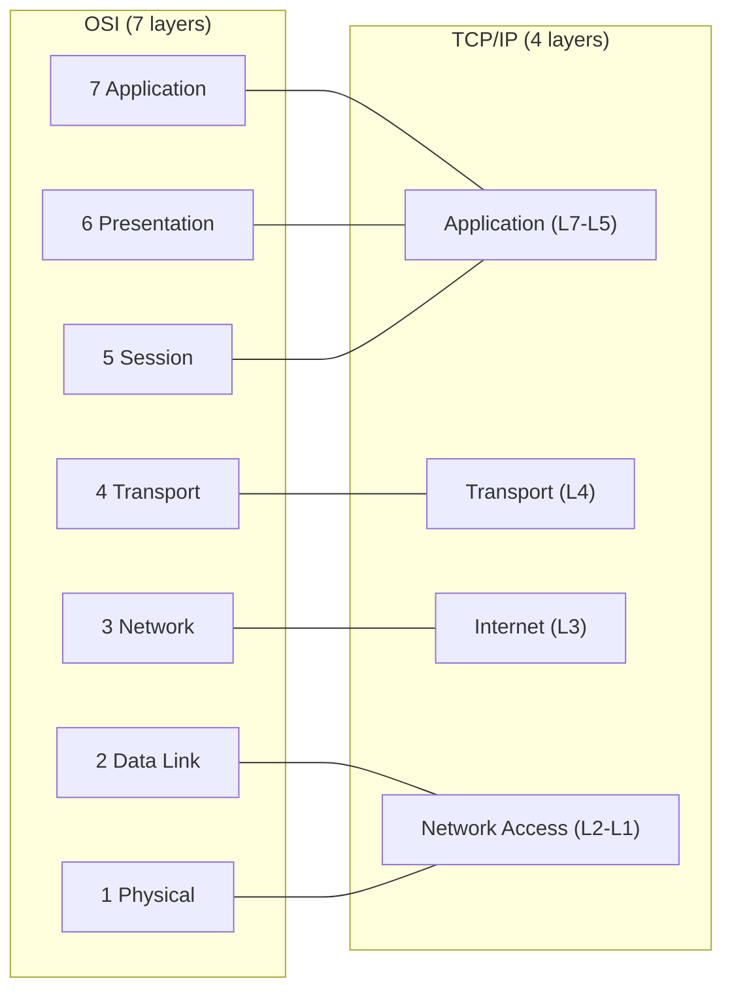
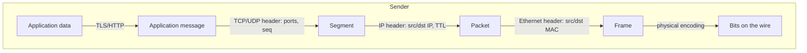

# Models and Encapsulation: How Networks Are Layered

## 1. Why This Chapter Exists

Every networking failure an engineer will ever debug happens at a specific layer, and every networking decision is a choice about which layer owns a responsibility. Without a working model of layering, troubleshooting becomes guesswork: people blame "the network" when the problem is DNS, or rewrite application code when the problem is an MTU black hole. This chapter establishes the mental model that the rest of the masterclass depends on.

Two ideas carry the chapter. The first is **layering**: networks are built as a stack of independent layers, each providing a service to the layer above and consuming a service from the layer below, with a well-defined interface between them. The second is **encapsulation**: data moving down the stack gains headers (and sometimes trailers) at each layer, and moving up the stack those headers are stripped and interpreted. Together they explain why a web request travels as Ethernet frames carrying IP packets carrying TCP segments carrying HTTP bytes, and why each layer can be replaced without rewriting the others.

The chapter is deliberately foundational. The following chapters zoom into individual layers, but they assume the vocabulary, the PDU names, and the demultiplexing model introduced here.

---

## 2. Why Layering Exists

Layering is the same idea as modular software design applied to communication. A complex problem—moving bytes reliably between two programs on different machines across unknown, heterogeneous networks—is decomposed into smaller problems, each solved independently:

- How to put bits on a physical medium.
- How to move a frame between two directly connected devices.
- How to route a packet across many networks to a remote host.
- How to deliver bytes reliably (or not) to a specific program.
- How to represent application data meaningfully.

Each layer solves one problem and exposes an interface to its neighbors. The interface, not the implementation, is the contract. This separation is what allows Ethernet to be replaced by Wi-Fi, or IPv4 by IPv6, without rewriting TCP or HTTP. It also creates a **boundary of ignorance**: the IP layer does not know or care whether the link below is copper, fiber, or radio, and the transport layer does not know how many routers a packet traversed.

The cost of layering is overhead and indirection. Each layer adds headers, and each crossing costs processing. Some performance techniques deliberately violate layer boundaries (for example, TCP segmentation offload or DPDK bypassing the kernel stack), and understanding why those are "cheating" requires first understanding the layering they bypass.

#### In-Line Glossary: Encapsulation

**What it is:** the process of wrapping data with a layer-specific header (and sometimes trailer) as it moves down the stack, so each layer sees the payload it is responsible for.

**Why here:** it is the mechanism that lets independent layers cooperate without knowing each other's internals.

**Systemic implication:** because each layer only inspects its own header, a fault in one layer's header can travel opaquely through others, which is why diagnosis must be performed layer by layer rather than by inspecting a single packet capture and guessing.

---

## 3. The Two Reference Models

Two models dominate. The **OSI reference model** is a seven-layer conceptual framework, valuable for vocabulary and for reasoning about responsibility boundaries. The **TCP/IP model** is the practical four-layer model that describes what the internet actually implements. They map cleanly onto each other.



The OSI layers, bottom to top: **Physical** moves bits on a medium; **Data Link** moves frames between directly connected nodes and handles media access; **Network** routes packets between hosts across networks; **Transport** provides end-to-end delivery and multiplexing to programs; **Session** manages dialogues; **Presentation** handles encoding and encryption; **Application** provides the user-facing protocol. In practice, the session and presentation layers are folded into application protocols or libraries, which is why TCP/IP collapses them.

The TCP/IP model simplifies to: **Network Access** (link + physical), **Internet** (IP), **Transport** (TCP/UDP), and **Application** (everything above). When engineers say "layer 2", "layer 3", or "layer 4", they are using OSI numbering even while describing a TCP/IP stack—an inconsistency worth internalizing because it is universal.

#### In-Line Glossary: PDU

**What it is:** Protocol Data Unit, the name of a unit of data at a given layer (bit at L1, frame at L2, packet at L3, segment/datagram at L4, data/message at L5-L7).

**Why here:** the PDU name tells you exactly which layer's header to inspect when troubleshooting.

**Systemic implication:** naming the unit forces precision; "the packet was dropped" and "the frame was dropped" point to different layers, different devices, and different fixes.

---

## 4. Encapsulation and Decapsulation in Motion

When an application sends data, it travels down the sender's stack, gaining headers at each layer. On the receiver, the process reverses.



Consider an HTTP GET. The application produces an HTTP message. The transport layer (TCP) prepends a header containing the source and destination **ports**, a **sequence number** for ordering, and flags for connection control, producing a **segment**. The internet layer (IP) prepends a header containing source and destination **IP addresses**, a **TTL** to bound the packet's lifetime, and protocol information, producing a **packet**. The link layer (Ethernet) prepends a header containing source and destination **MAC addresses** and appends a **frame check sequence** trailer for error detection, producing a **frame**. The physical layer encodes the frame as signals.

On the receiver, the link layer validates and strips the Ethernet header, hands the payload up as an IP packet, which the internet layer validates and strips, handing a TCP segment up, which the transport layer reassembles and delivers to the correct application socket identified by the port and connection state, and the application parses the HTTP message.

The critical insight is that **each layer's payload is opaque to the layer below it**. IP never parses the TCP header; Ethernet never parses the IP header. This opacity is what makes the stack extensible, and also what makes certain problems invisible from certain vantage points (a middlebox at layer 2 cannot see a layer 4 port).

---

## 5. Addressing and Demultiplexing

Each layer has its own addressing scheme and its own way of identifying the next recipient. Understanding demultiplexing—how a received unit is routed to the correct handler—explains how one physical link can carry traffic for many hosts, many programs, and many connections simultaneously.

**Link layer (MAC addresses)** identifies a network interface on a local segment. A frame is delivered to the interface whose MAC matches the destination. Broadcast and multicast MACs deliver to many interfaces at once.

**Internet layer (IP addresses)** identifies a host (more precisely, an interface) globally routable across networks. The IP header's protocol field names the next-layer protocol (for example TCP, UDP, or ICMP), which tells the receiver which transport handler to invoke.

**Transport layer (ports)** identifies the program and connection. The destination port selects the listening service; the four-tuple of (source IP, source port, destination IP, destination port) selects a specific connection or socket.

This nested demultiplexing—MAC → IP protocol → port → socket—is the reason a single server IP can host dozens of services on different ports, and a single port can serve thousands of concurrent connections distinguished by their four-tuples.

#### In-Line Glossary: Demultiplexing

**What it is:** the process of using a header field to determine which higher-layer handler should receive a unit of data.

**Why here:** it is the inverse of encapsulation and explains how shared media and shared host addresses serve many consumers.

**Systemic implication:** a demultiplexing failure (wrong protocol number, missing listener, closed port, exhausted connection table) manifests as silent drops or resets rather than clear errors, so it must be tested at the boundary where the identifier changes.

---

## 6. MTU: The One Number That Connects the Layers

The **Maximum Transmission Unit (MTU)** is the largest payload a link can carry in a single frame. Ethernet's classic MTU is 1500 bytes of IP payload. Because encapsulation adds headers, the MTU constrains every layer above: a TCP segment, its IP packet, and its Ethernet frame must all fit. When an application writes more than the path can carry in one frame, the data is split—either by the transport layer (TCP segmentation) or by the internet layer (IP fragmentation). IP fragmentation is generally harmful (see the IP layer chapter), and **Path MTU Discovery (PMTUD)** exists to discover the smallest MTU along a path and avoid it.

MTU is where encapsulation stops being an abstraction and becomes a physical constraint. It is also a classic source of "small requests work, large requests hang" incidents, which recur throughout this masterclass as a failure signature.

---

## 7. Invariants, Assumptions, and Boundaries

**Invariant: each layer only trusts and inspects its own header.** All higher-layer content is payload. This is what keeps layers independent and what makes the stack substitutable.

**Invariant: the destination identifier at each layer is resolved independently.** The receiver's MAC, IP, and port are determined by different mechanisms (ARP, routing + DNS, service binding), and a failure in any one produces a distinct symptom.

**Assumption: the lower layer provides the service the upper layer expects.** TCP assumes IP can deliver packets (possibly lost or reordered). IP assumes the link can deliver frames on a local segment. If a lower layer violates its contract silently, upper layers misbehave in confusing ways.

**Boundary: layering does not guarantee security or ordering.** Encryption is not provided by the stack by default; TLS sits between transport and application. Ordering and reliability are provided only by TCP, not by IP or Ethernet.

**Boundary: the models are descriptive, not prescriptive.** Real stacks bend the layers (encryption at multiple layers, tunneling that nests entire stacks inside other stacks, hardware offload that crosses boundaries). The models orient reasoning; they do not dictate implementations.

---

## 8. Trade-offs and Rejected Alternatives

**Why not a monolith rather than layers?** A single-purpose monolithic protocol could be optimized end to end, but it would be unmaintainable, unable to span heterogeneous links, and impossible to evolve piece by piece. Layering trades some efficiency for composability and evolvability, which is the correct trade for a global internet.

**Why not strict OSI seven-layer separation?** Session and presentation are rarely distinct in practice, and forcing them adds ceremony without benefit. The rejected alternative is a purely academic model that no implementation follows; the pragmatic TCP/IP collapse wins because it matches how software is actually built.

**Why does encapsulation overhead matter?** Each header consumes bytes and processing. For large transfers this is negligible; for small messages (IoT telemetry, RPC, voice) overhead is a material fraction of the payload. Overlay and tunneling protocols compound this by encapsulating already-encapsulated packets, which is why tunnel MTU management is a recurring operational concern.

**Why allow layer violations at all?** Offload techniques that cross layers (checksum offload, large send offload, kernel bypass) exist to recover performance that layering costs. They are accepted because the performance gain is large and the violations are localized, at the price of making packet captures taken on the host subtly misleading.

---

## 9. Failure Modes and Operational Consequences

**Blaming the wrong layer.** The most common operational failure of understanding is misattribution: a DNS failure reported as "the network is down", or a TLS certificate error reported as "the server is unreachable". Layer literacy shortens incidents by directing attention to the layer that actually owns the failing function.

**Opaque middleboxes.** Because each layer only parses its own header, devices that assume fixed byte offsets (ossification) break when a protocol changes. Operational consequence: leave room for evolution and treat middlebox behavior as a compatibility constraint.

**MTU and fragmentation surprises.** Encapsulation overhead can push a packet over the path MTU, causing fragmentation or drops that affect only larger messages. Operational consequence: test with realistic payload sizes, not just ping, and be aware of tunnel overhead.

**Capture ambiguity.** A capture taken on a host with hardware offload may show different headers (or checksums) than actually traversed the wire. Operational consequence: know where a capture was taken relative to the layers and offloads, and prefer captures at a stable observation point.

**Encapsulation nesting.** Overlays (VXLAN, tunnels) wrap packets inside packets, shrinking the usable MTU and adding devices that inspect an outer header while ignoring the inner one. Operational consequence: account for the effective MTU and the inner-versus-outer visibility gap when debugging.

---

## 10. Hands-On: Observing Encapsulation

These commands run on Linux hosts and require no cloud provider. They make layering visible.

List interfaces and addresses, showing link-layer and internet-layer identifiers side by side:

```bash
ip -br link
ip -br addr
```

Capture a few frames with link, internet, and transport headers decoded, to see encapsulation on the wire:

```bash
sudo tcpdump -e -nn -c 20 -i any
```

The `-e` flag prints link-layer (Ethernet) headers, so you can see source and destination MAC addresses alongside IP addresses and ports. Generate traffic in a second terminal:

```bash
curl -sS https://example.com > /dev/null
```

Observe the local neighbor (ARP/ND) table, which maps layer-3 addresses to layer-2 addresses:

```bash
ip neigh show
```

Inspect sockets and the four-tuples that demultiplex connections:

```bash
ss -tan
```

Interpretation: the capture shows the nested headers the sender added; the neighbor table shows how the link layer resolved the next hop; the socket table shows how the kernel demultiplexes incoming segments to connections.

---

## 11. Related Documents

- [Layer 2: Ethernet, ARP, Switching, and VLANs](./02-layer-2-ethernet-arp-switching-and-vlans.md)
- [The IP Layer: Packet Delivery, TTL, MTU, and ICMP](./03-the-ip-layer-delivery-ttl-mtu-and-icmp.md)
- [The Transport Layer: TCP, UDP, Ports, and Sockets](./04-the-transport-layer-tcp-udp-ports-and-sockets.md)
- [IPv4 Addressing Fundamentals](../02-ip-addressing-and-subnetting/01-ipv4-addressing-fundamentals.md)

## 12. External References

- [RFC 1122: Requirements for Internet Hosts — Communication Layers](https://www.rfc-editor.org/rfc/rfc1122)
- [RFC 1123: Requirements for Internet Hosts — Application and Support](https://www.rfc-editor.org/rfc/rfc1123)
- [RFC 1958: Architectural Principles of the Internet](https://www.rfc-editor.org/rfc/rfc1958)
- [RFC 791: Internet Protocol](https://www.rfc-editor.org/rfc/rfc791)
