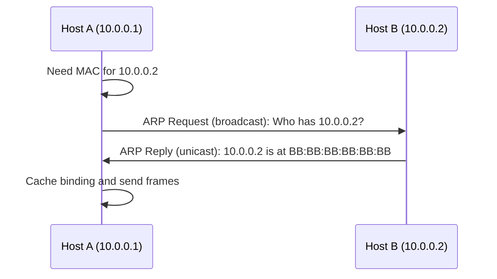
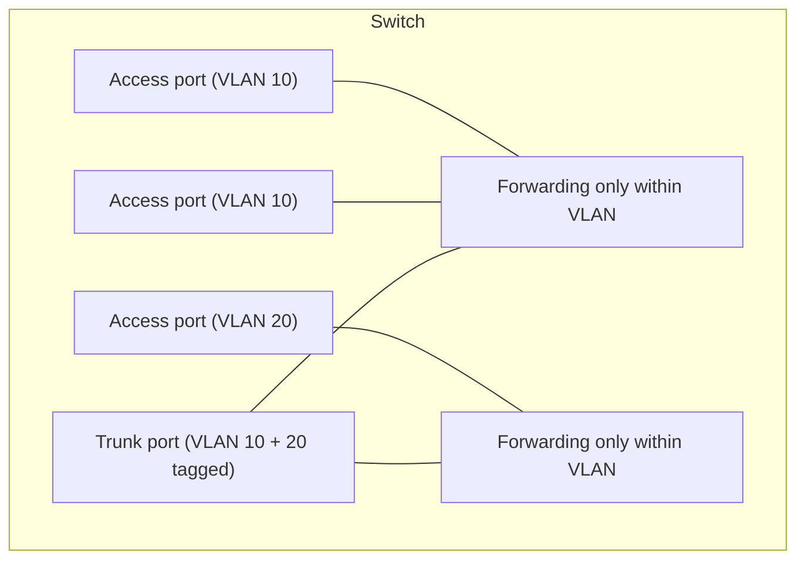

# Layer 2: Ethernet, ARP, Switching, and VLANs

## 1. Why This Chapter Exists

The link layer is where packets become electrical, optical, or radio signals and where the first hop of every journey is decided. It is also the layer where a surprising number of production incidents originate: a duplicate MAC address, an ARP cache poisoned by a misconfigured device, a VLAN tag mismatch between a switch and a hypervisor, or a broadcast storm from a loop. These failures look like "the network is down" but are precisely diagnosable once the link layer is understood.

This chapter explains how a frame is addressed and delivered on a local segment, how switches learn where devices are, how ARP resolves an IP address to a MAC address, how VLANs partition one physical switch into logically separate networks, and how loops are prevented. The goal is mechanism-level fluency so that an engineer can reason about the first hop with the same rigor they apply to routing later in the stack.

The chapter deliberately stays at layer 2. Routing between segments is the subject of the routing section, and IP addressing is handled separately. Here, the focus is the local delivery domain: what happens between a host and its first switch.

---

## 2. Frames and MAC Addressing

An **Ethernet frame** is the layer-2 PDU. It is addressed by **MAC addresses**: 48-bit identifiers, usually written as six hex pairs (`00:1A:2B:3C:4D:5E`). A MAC address is intended to be globally unique, with the first three octets identifying the manufacturer (the OUI) and the last three assigned by that manufacturer, though software can and does override this in virtualized environments.

Two special destination MACs matter constantly. The **broadcast address** `FF:FF:FF:FF:FF:FF` is delivered to every interface on the local segment. **Multicast** MAC addresses (those with the least significant bit of the first octet set) are delivered to a subscribed group. Broadcasts and multicasts define the reach of layer-2 discovery, so they are confined to a **broadcast domain**.

#### In-Line Glossary: MAC Address

**What it is:** a 48-bit link-layer identifier for a network interface, used to deliver frames within a single local segment.

**Why here:** it is the address the first hop actually uses; a packet can have a correct destination IP yet fail to leave the host if the next-hop MAC cannot be resolved.

**Systemic implication:** because MAC addresses are assumed unique within a segment, duplicates (common with cloned VMs, template images, or misconfiguration) cause intermittent, hard-to-trace delivery failures.

---

## 3. Ethernet Frame Format

Understanding the frame layout explains what a capture shows and where errors are detected.

```text
+----------------+--------------+------------+----------------+---------+------------+
| Preamble (8)   | Dst MAC (6)  | Src MAC(6) | EtherType (2)  | Payload | FCS (4)    |
+----------------+--------------+------------+----------------+---------+------------+
```

The **preamble** synchronizes the receiver's clock. **Destination and source MAC** identify the immediate recipient and sender. The **EtherType** field tells the receiver how to interpret the payload—`0x0800` for IPv4, `0x86DD` for IPv6, `0x0806` for ARP, `0x8100` for a VLAN tag. The **payload** carries the upper-layer packet. The **Frame Check Sequence (FCS)** is a CRC over the frame used to detect corruption; a frame failing the FCS is silently discarded, which is why a corrupt frame appears as a drop rather than an error message.

The EtherType field is a demultiplexing point: it is how the receiver knows whether the payload is IP, ARP, or something else. Getting it wrong (or mis-tagging a frame with a VLAN header) is a classic cause of a frame being dropped by a switch or NIC that does not expect it.

---

## 4. The Switching Function

An Ethernet switch is a layer-2 device that learns the location of MAC addresses and forwards frames only toward the correct destination port. It maintains a **MAC address table** (also called a forwarding database) mapping MAC addresses to ports.

The behavior is simple and mechanical. When a frame arrives, the switch records the **source** MAC against the port it arrived on. It then looks up the **destination** MAC:

- If the destination is known, the switch forwards the frame only out that port (**unicast forwarding**).
- If the destination is unknown, the switch **floods** the frame out all ports except the one it arrived on.
- If the destination is broadcast or multicast, the switch floods it to all relevant ports.

This learning process is why a switch is "transparent": it requires no configuration to begin forwarding correctly, and the table converges within seconds. Flooding is what makes the first frames of a new conversation reach their destination, and it is also the mechanism a broadcast storm exploits.

---

## 5. Broadcast Domains and Collision Domains

A **broadcast domain** is the set of interfaces that receive a broadcast frame. Originally, all ports on a switch (and all switches connected together) formed one broadcast domain. Because broadcasts consume bandwidth and CPU on every host, large flat broadcast domains are avoided; every host would process every ARP request, DHCP discovery, and other broadcast.

A **collision domain** is the set of interfaces sharing a medium where frames can collide. Modern full-duplex switched Ethernet eliminates collisions per port, so collision domains are largely historical, but the concept remains in diagnostic tools.

The practical rule: a switch segments collision domains per port but does **not** segment broadcast domains. Separating broadcast domains is the job of VLANs and routers.

#### In-Line Glossary: Broadcast Domain

**What it is:** the set of devices that receive a frame sent to the broadcast MAC address.

**Why here:** it bounds how far layer-2 discovery (ARP, DHCP) reaches and how much broadcast noise each host must process.

**Systemic implication:** a broadcast domain that grows too large degrades every host in it; segmenting with VLANs is not cosmetic but a capacity and stability requirement.

---

## 6. ARP: Resolving IP to MAC

A host knows the destination IP address of its next hop, but Ethernet delivery needs a MAC address. **Address Resolution Protocol (ARP)** bridges this gap on IPv4 networks (IPv6 uses Neighbor Discovery, its analogous mechanism).

The mechanism is a broadcast request and a unicast reply:



Host A broadcasts an ARP request asking who owns the target IP. Every host in the broadcast domain receives it; the owner replies directly with its MAC. Host A caches the binding in the **ARP cache** for a period, avoiding repeated broadcasts. If the target is on a different subnet, host A ARPs for the **default gateway's** MAC rather than the final destination's, because the frame only needs to reach the next hop.

Two operational realities follow. First, **stale or wrong ARP entries** cause traffic to be sent to the wrong MAC, often after a failover when a virtual IP moves but a client still has the old MAC cached. Second, **ARP has no authentication**, so an attacker or a misconfigured host can send unsolicited ("gratuitous") ARP replies and poison other hosts' caches, redirecting their traffic. This is why ARP spoofing is a real layer-2 attack and why tools such as Dynamic ARP Inspection exist.

#### In-Line Glossary: ARP Cache

**What it is:** the local table mapping IP addresses to MAC addresses, populated by ARP exchanges.

**Why here:** delivery to the next hop depends on this cache being correct and current.

**Systemic implication:** stale entries survive failovers and cause "it works after a while" symptoms; short cache lifetimes reduce staleness but increase broadcast load, an explicit trade-off.

---

## 7. VLANs and 802.1Q

A **VLAN (Virtual LAN)** partitions one physical switch into multiple isolated broadcast domains. Ports are assigned to a VLAN, and frames are forwarded only within the same VLAN. Two hosts in different VLANs cannot talk at layer 2 even though they are plugged into the same switch; they require a router or a layer-3 switch to communicate between VLANs.

To carry multiple VLANs over a single physical link (a **trunk**), Ethernet frames are tagged using the **IEEE 802.1Q** standard. A 4-byte tag is inserted after the source MAC, containing a 12-bit VLAN ID (VLAN 0-4095, with 0 and 4095 reserved). An **access port** belongs to one VLAN and sends untagged frames to end devices; a **trunk port** carries tagged frames for many VLANs between switches or to a hypervisor.



VLAN mismatch is a frequent failure: a switch port configured as an access port for VLAN 10 connected to a trunk expecting tags will drop or misinterpret frames, and a hypervisor bridging a VM into the wrong VLAN produces a host that is "plugged in" but unreachable by anything except its own subnet peers.

#### In-Line Glossary: VLAN

**What it is:** a logical layer-2 broadcast domain spanning a subset of ports on one or more switches, isolated from other VLANs.

**Why here:** it segments broadcast domains without buying separate physical hardware, and it underlies multi-tenant and environment separation.

**Systemic implication:** VLANs are a segmentation primitive, not a security boundary by themselves; adjoining a router or firewall between them is required to enforce policy, and mis-tagging silently breaks reachability.

---

## 8. Loop Prevention: STP in Brief

Redundant links between switches are desirable for resilience but catastrophic for Ethernet if unmanaged: a broadcast frame would circulate forever, growing as it is flooded, producing a **broadcast storm** that saturates the entire layer-2 domain. **Spanning Tree Protocol (STP)** prevents this by electing a root bridge and logically blocking redundant links, forming a loop-free tree. When a link fails, STP reconverges and unblocks a previously blocked link.

The trade-off is convergence time: classic STP can take tens of seconds to reconverge, during which traffic is disrupted. Faster variants (RSTP, MSTP) reduce this to seconds or less. The operational lesson is that redundancy at layer 2 must be paired with loop prevention, and that a misconfigured topology or a disabled STP is a fast path to a domain-wide outage.

---

## 9. Invariants, Assumptions, and Boundaries

**Invariant: within a broadcast domain, all interfaces receive broadcasts.** VLANs redefine the boundaries, but flooding behavior within a VLAN is unchanged.

**Invariant: a frame's destination MAC must be resolvable.** Without a correct ARP/ND entry or a matching local MAC, delivery fails at the first hop.

**Assumption: MAC addresses are unique within a segment.** Duplicates break learning and cause flapping, where the switch's MAC table entry for an address keeps moving between ports.

**Assumption: the layer-2 topology is loop-free (enforced by STP).** Without it, broadcasts do not terminate.

**Boundary: layer 2 does not provide isolation between VLANs.** Hosts on different VLANs cannot communicate at layer 2; any communication requires layer 3.

**Boundary: ARP has no inherent authenticity or encryption.** It can be observed and spoofed within the domain, so it must not be treated as a trust mechanism.

---

## 10. Trade-offs and Rejected Alternatives

**Why not a single flat layer-2 network?** Flat networks are simpler to configure but scale badly: large broadcast domains waste bandwidth and CPU, failures propagate domain-wide, and tenants cannot be isolated. VLANs trade configuration complexity for segmentation and stability.

**Why not skip VLANs and use physical separation?** Physical separation offers the strongest isolation but at prohibitive cost and inflexibility. VLANs provide logical separation on shared hardware; the cost is that misconfiguration can breach the intended separation, which is why defense in depth places a firewall at the layer-3 boundary.

**Why is flooding acceptable?** Flooding is what makes a switch transparent and plug-and-play. The alternative—requiring static MAC tables—is operationally untenable. The cost is broadcast noise and the storm risk, mitigated by segmentation and STP.

**Why not rely on ARP security features everywhere?** Dynamic ARP Inspection, DHCP snooping, and similar features add configuration and failure modes of their own. Their adoption is a function of threat model: on a trusted single-tenant segment they may be unnecessary, on a shared or hostile segment they are essential.

---

## 11. Failure Modes and Operational Consequences

**Broadcast storm.** A loop with STP bypassed floods the domain and saturates links and CPU. Symptom: link utilization spikes to saturation and every host becomes unresponsive. Operational consequence: enforce STP (or an equivalent fabric design) and monitor broadcast/multicast rates.

**ARP spoofing and cache poisoning.** An attacker or broken device redirects traffic by sending false ARP replies. Symptom: traffic transits an unexpected host, or intermittent connectivity as caches flip. Operational consequence: enable ARP inspection on untrusted segments and monitor for duplicate IP or MAC bindings.

**Duplicate MAC addresses.** Cloned VMs or copied configuration cause the switch to flap the MAC between ports, breaking connectivity intermittently. Symptom: intermittent loss for one host while others are fine. Operational consequence: enforce unique MAC assignment (MAC learning control) and avoid cloning interfaces.

**VLAN mismatch.** A tag/access misconfiguration silently drops or misdelivers frames. Symptom: a host is up but unreachable beyond nothing (or only within its mistaken VLAN). Operational consequence: verify port VLAN configuration and trunk allowed-VLAN lists as part of change control.

**STP changes as outages.** Topology changes during reconvergence cause brief but global disruption. Symptom: a brief network freeze after a link change. Operational consequence: prefer RSTP/MSTP, tune timers thoughtfully, and avoid unintentional root bridge changes.

---

## 12. Hands-On: Inspecting the First Hop

View interfaces and their MAC addresses (link layer):

```bash
ip -br link
```

View the neighbor (ARP/ND) table showing resolved IP-to-MAC bindings and their states:

```bash
ip neigh show
```

Trigger a fresh resolution and watch it populate:

```bash
ping -c1 10.0.0.2 >/dev/null; ip neigh show
```

Observe an ARP exchange in a capture (requires privileges):

```bash
sudo tcpdump -e -nn -i any arp
```

On a Linux bridge or vSwitch, inspect VLAN configuration of bridge ports (tooling varies):

```bash
bridge link show
bridge vlan show
```

Interpretation: the neighbor table is the layer-2 resolution state; if a next hop is `FAILED` or `INCOMPLETE`, the first hop cannot be resolved and no higher-layer troubleshooting is meaningful until it is fixed.

---

## 13. Related Documents

- [Models and Encapsulation](./01-models-and-encapsulation.md)
- [The IP Layer: Packet Delivery, TTL, MTU, and ICMP](./03-the-ip-layer-delivery-ttl-mtu-and-icmp.md)
- [IPv4 Addressing Fundamentals](../02-ip-addressing-and-subnetting/01-ipv4-addressing-fundamentals.md)
- [Cloud Virtual Networks: Fundamentals](../05-cloud-virtual-networks/01-virtual-network-fundamentals.md)

## 14. External References

- [IEEE 802.1Q: Bridges and Bridged Networks (VLAN Tagging)](https://standards.ieee.org/standard/802_1Q-2018.html)
- [RFC 826: An Ethernet Address Resolution Protocol (ARP)](https://www.rfc-editor.org/rfc/rfc826)
- [IEEE 802.1D: MAC Bridges (Spanning Tree)](https://standards.ieee.org/standard/802_1D-2004.html)
- [RFC 4861: Neighbor Discovery for IP version 6 (IPv6)](https://www.rfc-editor.org/rfc/rfc4861)
