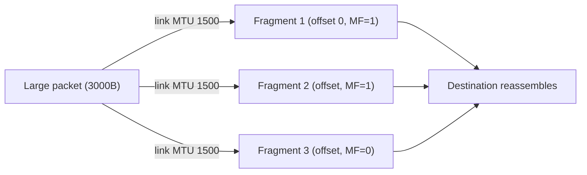

# The IP Layer: Packet Delivery, TTL, MTU, and ICMP

## 1. Why This Chapter Exists

The Internet Protocol is the layer that makes a global network possible: it takes a packet from any host and attempts to deliver it to any other host across an arbitrary sequence of heterogeneous networks, without any prior arrangement. It is also deliberately minimal, offering no reliability, no ordering, and no guarantee of delivery. Understanding exactly what IP does and does not promise is the prerequisite for understanding why TCP exists on top of it and why certain failures (fragmentation, black holes, TTL expiry) behave the way they do.

This chapter covers the IPv4 service model, the header fields that matter operationally, how fragmentation works and why it is dangerous, how Path MTU Discovery avoids it, and how ICMP reports errors. It also notes where IPv6 differs meaningfully. The emphasis is on mechanism and failure signatures, because IP problems present as subtle, size-dependent, or intermittent behaviors that are hard to attribute without this grounding.

---

## 2. The IP Service Model

IP is a **connectionless, best-effort** datagram service. Each packet is independent: it carries its own complete destination address, and the network makes no promise about whether it arrives, how long it takes, whether it arrives once, or in what order relative to other packets.

This minimalism is a deliberate design choice. Because IP assumes nothing about the underlying links except that they can carry datagrams (at least sometimes), it can run over Ethernet, Wi-Fi, cellular, fiber, and tunnels alike. Reliability and ordering are pushed to the endpoints (TCP) or handled by applications. The consequence is that IP is simple, universal, and scalable—and that any reliability expectation must be created at a higher layer.

The layer-3 PDU is the **packet**. Every router along the path examines the destination address and forwards the packet toward it; this per-hop, independent forwarding is what makes the network stateless in the core.

---

## 3. The IPv4 Header

The header carries the information routers and hosts need to forward and process the packet.

```text
 0                   1                   2                   3
 +-------+-------+---------------+-------------------------------+
 |Version|  IHL  |    DSCP/ECN   |          Total Length         |
 +-------+-------+---------------+-------------------------------+
 |         Identification        |Flags|    Fragment Offset      |
 +-------------------------------+-----+-------------------------+
 |      TTL      |   Protocol    |        Header Checksum        |
 +---------------+-------+-------+-------------------------------+
 |                       Source IP Address                       |
 +---------------------------------------------------------------+
 |                     Destination IP Address                    |
 +---------------------------------------------------------------+
 |                    Options (variable, rare)                   |
 +---------------------------------------------------------------+
```

Fields that matter in practice:

**Total Length** bounds the packet and, with the header length (IHL), the payload. **Identification, Flags, and Fragment Offset** support fragmentation. **TTL (Time To Live)** is a hop counter that prevents packets from circulating forever (see below). **Protocol** is the demultiplexing field naming the payload (6 = TCP, 17 = UDP, 1 = ICMP). **Header Checksum** covers only the header, protecting against corruption of forwarding fields. **Source and Destination Addresses** are the core of forwarding. **Options** are rarely used and often filtered, which is one reason modern extensions moved to separate protocols.

#### In-Line Glossary: TTL (Time To Live)

**What it is:** an 8-bit field decremented by every router; a packet whose TTL reaches zero is discarded and an ICMP Time Exceeded message is returned.

**Why here:** it prevents infinite loops in the presence of routing errors and is the mechanism behind traceroute.

**Systemic implication:** TTL is a safety bound, not a distance measure; unequal TTL defaults across operating systems are a fingerprinting and diagnostics signal, and a too-small TTL silently truncates reachability.

---

## 4. Addresses, Masks, and Next-Hop Selection

A host deciding where to send a packet asks a single question: is the destination on my local subnet, or not? The answer is computed with the **subnet mask**. If the destination IP, masked with the local prefix, equals the host's own network, the host delivers the packet directly to the destination (resolving its MAC via ARP). If not, the host sends the packet to its **default gateway**, and the frame is addressed to the gateway's MAC while the packet still carries the final destination IP.

This distinction—between the **layer-3 destination** (the real target) and the **layer-2 next hop** (the current step) —is fundamental. A packet's destination IP stays constant end to end, while its destination MAC changes at every hop. Routers repeat the same decision: forward to the next hop toward the destination prefix.

The routing decision itself (which prefix is chosen among many) is longest-prefix match, covered in the routing section. Here it is enough to note that a host with the wrong mask or a wrong gateway sends packets that it believes are local to the wrong place, producing a "works to some hosts, not others" signature.

---

## 5. Fragmentation and Reassembly

If a packet is larger than the MTU of a link it must traverse, IPv4 can fragment it into smaller pieces that fit. Each fragment carries the same Identification value, a Fragment Offset indicating its position, and the More Fragments flag for all but the last. The destination reassembles the original packet from the fragments.

Fragmentation is strongly discouraged for several reasons. Reassembly requires state and memory at the destination, and an attacker can exhaust it with partial fragment sets. Losing any single fragment forces the entire original packet to be retransmitted by a higher layer, wasting bandwidth. Firewalls and middleboxes often drop fragments or handle them inconsistently. And overlapping fragments have historically enabled evasion of security inspection.

Modern practice sets the **Don't Fragment (DF)** flag and relies on the sender to size packets correctly using Path MTU Discovery, so that fragmentation never occurs. IPv6 removed router fragmentation entirely, requiring sources to discover the path MTU and leaving fragmentation only at the source.



#### In-Line Glossary: Fragmentation

**What it is:** splitting an IP packet into smaller fragments that fit a link's MTU, with the receiver reassembling them.

**Why here:** it is the fallback when a packet exceeds the path MTU, and it is a major source of subtle, size-dependent failures.

**Systemic implication:** because losing one fragment discards the whole packet and middleboxes treat fragments inconsistently, fragmentation turns a simple size problem into an availability and security problem, which is why DF plus PMTUD is preferred.

---

## 6. Path MTU Discovery and Black Holes

**Path MTU Discovery (PMTUD)** discovers the smallest MTU along the path so the sender can avoid fragmentation. The sender sets DF and sends packets at its own MTU. If a router cannot forward a packet because the next link's MTU is smaller, it sends back an ICMP "Fragmentation Needed" message stating the correct MTU. The sender lowers its packet size and retries.

PMTUD fails when that ICMP message never reaches the sender—because a firewall blocks all ICMP, or a load balancer drops it. The result is a **PMTU black hole**: the connection establishes and small packets flow, but any full-size packet is silently dropped. The classic symptom is a TCP connection that handshakes fine (small packets) but hangs as soon as a large payload or TLS certificate is sent. This is why blocking ICMP wholesale is dangerous, and why "ping works but the app hangs" is a signature worth remembering.

#### In-Line Glossary: Path MTU Black Hole

**What it is:** a situation where PMTUD fails because the ICMP fragmentation-needed message is filtered, so the sender keeps sending packets too large for the path.

**Why here:** it produces a connection that works for small transfers and fails for large ones, which is a recurring and misleading production failure.

**Systemic implication:** blanket ICMP filtering trades a perceived security gain for a real availability failure; the correct posture is to rate-limit ICMP rather than block it.

---

## 7. ICMP

**ICMP (Internet Control Message Protocol)** is IP's companion for error reporting and diagnostics. It is not a transport protocol; it rides directly inside IP packets (Protocol = 1). Its messages fall into two families: **error messages** (Destination Unreachable, Time Exceeded, Fragmentation Needed, Redirect) and **informational messages** (Echo Request/Reply, used by `ping`).

Operationally, ICMP is how you learn *why* a packet failed: an unreachable means no route or a denied path; Time Exceeded usually means a routing loop or a TTL too small; Fragmentation Needed is PMTUD working correctly. **Traceroute** exploits TTL: it sends packets with increasing TTL values and collects the Time Exceeded messages from each hop, revealing the path. The *absence* of ICMP (filtered) removes this visibility, which is why mature networks rate-limit rather than block it.

---

## 8. Where IPv6 Differs

IPv6 changes several fundamentals. The address is 128 bits instead of 32, so the header is simpler and larger addresses dominate. Routers do **not** fragment; only the source may, and only after PMTUD. There is no header checksum (link and transport layers handle integrity). TTL is renamed **Hop Limit** with the same behavior. The header is fixed size with extension headers for options, which improves processing. Neighbor Discovery (with ICMPv6) replaces ARP. These changes are covered in detail in the IPv6 addressing chapter; the operational takeaway here is that IPv6 assumes PMTUD works, which makes ICMPv6 filtering even more harmful than ICMP filtering in IPv4.

---

## 9. Invariants, Assumptions, and Boundaries

**Invariant: every packet carries a complete destination address and is forwarded independently.** No per-flow state is required in the core.

**Invariant: TTL/Hop Limit is decremented per hop and never increases.** This bounds packet lifetime and prevents persistent loops.

**Assumption: routers can send ICMP errors back to the source when forwarding fails.** PMTUD and much of diagnostics depend on this.

**Assumption: the MTU is known or discoverable along the path.** Without it, large packets fail unpredictably.

**Boundary: IP provides no reliability, ordering, or duplicate suppression.** Those are TCP's or the application's responsibility.

**Boundary: IP provides no confidentiality, integrity, or authentication.** Any of those require a layer above (TLS, IPsec) or below.

**Boundary: IP addresses are identifiers, but not stable identities.** They change with mobility, NAT, and renumbering, which is why applications should not treat them as durable identity.

---

## 10. Trade-offs and Rejected Alternatives

**Why keep IP minimal rather than build reliability in?** Building reliability into the network would require state in routers and would not compose with applications that prefer their own semantics (real-time media prefers loss tolerance to retransmission). The rejected alternative—a reliable network layer—is both harder to scale and less flexible for diverse application needs.

**Why prefer PMTUD over fragmentation?** PMTUD keeps the network free of reassembly state and avoids the amplification of a single fragment loss. Fragmentation is the fallback because it works without cooperation from the path, but its costs outweigh its convenience in modern networks.

**Why is blocking ICMP tempting but wrong?** ICMP errors are the mechanism by which the network tells endpoints to adapt. Blocking all ICMP breaks PMTUD and degrades diagnostics. The sound alternative is rate-limiting ICMP while allowing the specific types needed for correctness.

**Why not use fixed jumbo frames everywhere?** Larger MTUs reduce per-packet overhead, but only if every link in the path supports them. Mixed MTUs reintroduce PMTUD and fragmentation. Jumbo frames are appropriate within controlled domains (data-center fabrics) and dangerous across heterogeneous paths.

---

## 11. Failure Modes and Operational Consequences

**PMTU black holes.** Large packets dropped, small ones pass. Symptom: handshake succeeds, bulk transfer or TLS stalls. Operational consequence: allow ICMP fragmentation-needed through, test with full-size payloads, and be aware of tunnel overhead.

**Routing loops.** A misconfigured route sends packets in a circle until TTL expires. Symptom: high TTL-exceeded ICMP and latency for a destination. Operational consequence: monitor for TTL expiries and validate routing changes.

**Asymmetric or unexpected paths.** Forward and return paths differ, so a filter on one direction breaks flows. Symptom: connection times out though the destination is reachable by ping. Operational consequence: validate stateful filtering assumptions and test both directions.

**ICMP-based reconnaissance and suppression.** ICMP reveals topology, so some operators block it—and then cannot diagnose their own failures. Operational consequence: rate-limit, log, and retain the diagnostic types rather than blanket-blocking.

**Overlapping/malicious fragments.** Fragment overlap can evade inspection or exhaust reassembly buffers. Operational consequence: prefer DF and PMTUD, and configure middleboxes to handle fragments consistently.

---

## 12. Hands-On: IP-Level Diagnostics

Inspect addresses and routes (layer 3 view):

```bash
ip -br addr
ip route
```

Test reachability and observe ICMP echo:

```bash
ping -c4 1.1.1.1
```

Discover the path and per-hop latency with TTL-based probes:

```bash
traceroute 1.1.1.1      # or: tracepath 1.1.1.1
mtr -rwzbc 10 1.1.1.1
```

Probe PMTU by sending packets of increasing size with Don't Fragment set; the failure point reveals the path MTU:

```bash
ping -M do -s 1472 1.1.1.1   # 1472 + 28 bytes headers = 1500
```

Capture ICMP messages to see errors returned by the path:

```bash
sudo tcpdump -nn -i any icmp
```

Interpretation: if large `-s` values fail while small ones succeed with `-M do`, you have found a PMTU limit or black hole; if traceroute shows repeated `* * *` after a hop, ICMP is likely filtered beyond it.

---

## 13. Related Documents

- [Models and Encapsulation](./01-models-and-encapsulation.md)
- [Layer 2: Ethernet, ARP, Switching, and VLANs](./02-layer-2-ethernet-arp-switching-and-vlans.md)
- [The Transport Layer: TCP, UDP, Ports, and Sockets](./04-the-transport-layer-tcp-udp-ports-and-sockets.md)
- [IPv6 Addressing](../02-ip-addressing-and-subnetting/04-ipv6-addressing.md)

## 14. External References

- [RFC 791: Internet Protocol](https://www.rfc-editor.org/rfc/rfc791)
- [RFC 792: Internet Control Message Protocol](https://www.rfc-editor.org/rfc/rfc792)
- [RFC 1191: Path MTU Discovery](https://www.rfc-editor.org/rfc/rfc1191)
- [RFC 8200: Internet Protocol, Version 6 (IPv6) Specification](https://www.rfc-editor.org/rfc/rfc8200)
- [RFC 4443: Internet Control Message Protocol (ICMPv6)](https://www.rfc-editor.org/rfc/rfc4443)
