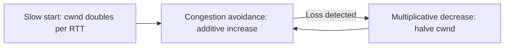

# The Transport Layer: TCP, UDP, Ports, and Sockets

## 1. Why This Chapter Exists

The transport layer is where most application-visible network behavior is determined. It decides whether bytes arrive reliably and in order (TCP) or as independent messages without guarantees (UDP), how connections are established and torn down, how senders avoid overwhelming receivers, and how the network as a whole avoids collapse under load. When an application "hangs", "resets", or "gets slow under load", the answer is frequently in the transport layer: a zero window, a retransmission storm, a congestion response, or a port state like `TIME_WAIT` or `CLOSE_WAIT`.

This chapter explains TCP and UDP at the level needed to reason about real failures. It covers the TCP connection lifecycle and states, reliability and retransmission, flow control, and congestion control, then UDP's deliberately minimal model, and finally the port and socket abstractions that demultiplex everything. The goal is that an engineer reading a socket dump or a packet capture can reconstruct what the transport is doing and why.

Transport security (TLS/DTLS) sits directly above this layer, so this chapter is also the substrate for the later transport-security section.

---

## 2. UDP: The Minimal Datagram Service

**UDP (User Datagram Protocol)** provides almost nothing beyond IP: it adds a source port, destination port, length, and checksum, and delivers each datagram independently. There is no handshake, no ordering, no retransmission, no flow control, and no congestion control.

This minimalism is a feature for certain workloads. Real-time voice and video prefer to drop a late packet rather than wait for a retransmission; DNS queries are single request/response exchanges where connection overhead is wasteful; telemetry and gaming benefit from low latency and application-controlled reliability. The cost is that UDP gives the network no feedback loop about fairness or congestion, so a poorly designed UDP application can starve competing traffic—a problem that culminates in the "UDP is unfair" concerns that motivated mechanisms like QUIC's own congestion control.

#### In-Line Glossary: Datagram

**What it is:** an independent, self-contained message delivered without connection setup or ordering guarantees.

**Why here:** it is the unit of UDP, and its independence is exactly what applications needing low latency want and what makes reliability an application responsibility.

**Systemic implication:** because datagrams carry no delivery guarantee, any application requiring reliability over UDP must reimplement ordering, retransmission, and congestion behavior—which is precisely what QUIC does, and what naive custom protocols get wrong.

---

## 3. TCP: A Reliable, Ordered Byte Stream

**TCP (Transmission Control Protocol)** presents applications with a **reliable, ordered byte stream**: bytes are numbered, acknowledged, retransmitted if lost, reordered if out of order, deduplicated, and delivered once into the receiving process's buffer. TCP handles connection setup and teardown, flow control so a fast sender does not overrun a slow receiver, and congestion control so senders back off when the network is stressed.

The abstraction is a stream, not messages. TCP does not preserve application write boundaries; a receiver may get the bytes of a single write split across multiple reads, or multiple writes coalesced. Applications that need message framing must impose it themselves (length prefixes, delimiters, or an application protocol like HTTP).

---

## 4. Connection Lifecycle and States

TCP connections are established with a **three-way handshake** and closed with a coordinated exchange. The handshake is required to synchronize sequence numbers and confirm both sides are ready.

```mermaid
sequenceDiagram
    participant C as Client
    participant S as Server
    C->>S: SYN (seq=x)
    S->>C: SYN-ACK (seq=y, ack=x+1)
    C->>S: ACK (ack=y+1)
    Note over C,S: Established; data flows
    C->>S: FIN
    S->>C: ACK
    S->>C: FIN
    C->>S: ACK
    Note over C,S: Connection closed (after TIME_WAIT on active closer)
```

The **three-way handshake** (SYN, SYN-ACK, ACK) establishes the connection and negotiates initial sequence numbers. Closing uses FIN/ACK in each direction independently, because TCP is full-duplex: each direction closes separately. The endpoint that closes actively enters **TIME_WAIT** for a period (typically twice the maximum segment lifetime) to ensure the final ACK arrived and to prevent stray segments from a previous connection being mistaken for a new one.

The states are operationally meaningful. `ESTABLISHED` is normal. `CLOSE_WAIT` means the remote closed but the local application has not called `close()`—a large count indicates an application leaking connections. `TIME_WAIT` is normal after active close but a very large count can exhaust ephemeral ports. `SYN_SENT` accumulating suggests the destination is not responding (filtered or down). Reading these states is a primary diagnostic skill.

#### In-Line Glossary: Three-Way Handshake

**What it is:** the SYN / SYN-ACK / ACK exchange that establishes a TCP connection and synchronizes sequence numbers.

**Why here:** it is the gate for every TCP connection and a common failure point (filtering, SYN floods, asymmetric paths).

**Systemic implication:** because it requires one full round trip in each direction, handshake latency is bounded by network RTT—a fact that makes connection reuse (keep-alive, pooling) a major performance lever.

#### In-Line Glossary: TIME_WAIT

**What it is:** the state held by the endpoint that actively closed a connection, lasting roughly twice the maximum segment lifetime.

**Why here:** it guarantees the peer received the final ACK and prevents old duplicate segments from corrupting a new connection with the same four-tuple.

**Systemic implication:** high connection churn from short-lived connections accumulates TIME_WAIT and can exhaust local ports; the fix is connection reuse, not blindly lowering timers.

---

## 5. Reliability: Sequence Numbers, ACKs, and Retransmission

TCP assigns each byte a sequence number. The receiver acknowledges the highest contiguous byte received; unacknowledged bytes are presumed lost and retransmitted after a **retransmission timeout (RTO)** or on detection of duplicate ACKs (fast retransmit). The RTO is estimated from measured round-trip time, adapting to the path.

This design yields robustness over lossy paths but also predictable pathologies. A retransmission that was unnecessary (because the ACK was merely delayed) wastes bandwidth and can, if frequent, be read as congestion. Distinguishing genuine loss from reordering is a fundamental difficulty, which is why TCP's loss-based congestion response can underperform on paths with reordering.

---

## 6. Flow Control: The Receive Window

Flow control protects the receiver. Each side advertises a **receive window** (`rwnd`), the number of bytes it can currently accept. A sender must not have more unacknowledged bytes in flight than the window allows. When an application stops reading from its socket, the receive buffer fills and the window shrinks to zero: a **zero-window** condition that pauses the sender until the application drains the buffer.

Zero-window situations are a common cause of "the connection is stalled" incidents. The network is fine; the receiving application is not reading. A capture shows repeated zero-window advertisements, which points the diagnosis at the application rather than the network.

---

## 7. Congestion Control: The Send Window

Flow control protects the receiver; **congestion control** protects the network. The sender maintains a **congestion window** (`cwnd`) that limits how much unacknowledged data it will have in flight, independent of the receive window. The effective send window is the minimum of `cwnd` and `rwnd`.

TCP begins conservatively with **slow start**, roughly doubling `cwnd` each round trip until a threshold or loss. On loss it reduces sharply: classic AIMD (additive increase, multiplicative decrease) halves `cwnd` on detected loss, then grows cautiously again. This is why a TCP connection ramps throughput over the first few round trips and why a lossy path caps throughput. Modern algorithms (CUBIC, BBR, and others) tune this behavior; BBR in particular models bandwidth and RTT rather than treating all loss as congestion, which matters on paths with buffer-induced latency.



The operational consequences are direct: throughput depends on RTT (the **bandwidth-delay product** sets how much data must be in flight to fill a link), a single lossy link can throttle an entire flow, and bufferbloat (excessive buffering) can inflate RTT and mask loss, delaying the congestion response.

#### In-Line Glossary: Congestion Window (cwnd)

**What it is:** the sender-side limit on unacknowledged bytes in flight, adjusted by the congestion-control algorithm in response to perceived network conditions.

**Why here:** it is the mechanism that prevents a sender from overwhelming the network and governs how quickly throughput ramps up and recovers.

**Systemic implication:** cwnd makes throughput a function of RTT and loss, so application performance can be network-shaped in ways invisible to application logs; measuring and tuning requires transport-level observability.

---

## 8. Head-of-Line Blocking

Because TCP delivers a single ordered stream, a missing segment stalls delivery of everything behind it until the gap is filled, even if later segments have arrived. This is **head-of-line (HOL) blocking**: at the TCP layer, one lost segment delays all subsequent data. For loss-tolerant or multiplexed applications this is wasteful, which is a key motivation for QUIC (which runs over UDP and gives independent streams so one stream's loss does not block another) and for using multiple connections where appropriate.

---

## 9. Ports, Sockets, and Demultiplexing

Ports are 16-bit identifiers that, combined with IP addresses, select connections. A **socket** is the operating system abstraction binding an address and port to a process. Incoming segments are demultiplexed using the **four-tuple** (source IP, source port, destination IP, destination port), which uniquely identifies a connection on a host.

**Server ports** are well-known (80, 443, 22, 53) or registered, and a server binds a listening socket to a port to receive new connections. **Ephemeral ports** are transient source ports chosen by the client's operating system from a configured range (commonly 32768-60999 on Linux). Because a client's connection is identified by the full four-tuple, many simultaneous connections to the same server port are distinguished by their distinct ephemeral source ports.

This design has a well-known limit: a host can have at most roughly 64K connections to a single remote (destination) address and port, because ephemeral source ports are finite and `TIME_WAIT` keeps recently closed ports unavailable for a time. This is why connection churn and connection pooling matter at scale.

#### In-Line Glossary: Ephemeral Port

**What it is:** a short-lived source port chosen automatically by the client's operating system for outbound connections.

**Why here:** it completes the four-tuple that demultiplexes concurrent connections to the same destination.

**Systemic implication:** ephemeral port exhaustion (from too many short-lived outbound connections, aggravated by TIME_WAIT) causes connection failures that look like remote unavailability; the remedy is reuse and pooling, and monitoring of port usage.

---

## 10. Invariants, Assumptions, and Boundaries

**Invariant: TCP guarantees ordered, reliable, deduplicated delivery within a connection, or it tears the connection down.** It does not guarantee delivery time.

**Invariant: UDP guarantees only per-datagram integrity (via its checksum), nothing else.**

**Invariant: the four-tuple identifies a TCP connection on a host.** Two connections with the same four-tuple cannot coexist meaningfully.

**Assumption: the underlying IP layer can deliver packets, at least sometimes.** Total persistent loss means TCP cannot make progress.

**Boundary: TCP does not preserve message boundaries.** Framing is the application's job.

**Boundary: neither TCP nor UDP provides confidentiality or authentication.** TLS or DTLS is required above them.

**Boundary: congestion control is a fairness heuristic, not a guarantee.** Competing flows and non-TCP traffic can produce unfairness that TCP tries to manage but cannot enforce.

---

## 11. Trade-offs and Rejected Alternatives

**Why not use TCP for everything?** TCP's reliability and ordering are wrong for real-time media, where waiting for a retransmission is worse than losing a frame. UDP's rejection of those guarantees is the point for latency-sensitive traffic.

**Why not use UDP for everything?** Without congestion control, UDP traffic can starve the network; and without reliability, every application reinvents it incorrectly. TCP's mechanisms are hard to reproduce well, which is why most request/response traffic uses TCP (or QUIC, which reimplements them carefully over UDP).

**Why is connection reuse so important?** Each new TCP connection costs a handshake round trip and a TLS handshake if encrypted, and consumes ephemeral ports and TIME_WAIT. Keep-alive and pooling amortize these costs. The rejected alternative—a fresh connection per request—is simple but pays latency and resource costs on every request.

**Why not simply lower TIME_WAIT to free ports faster?** Reducing TIME_WAIT risks accepting stale segments into new connections and hides the underlying churn problem. The sound approach is to reduce connection churn rather than to weaken the safety mechanism.

---

## 12. Failure Modes and Operational Consequences

**SYN floods / half-open connections.** Many SYNs without completions fill the connection backlog. Symptom: new connections time out while established ones work. Operational consequence: SYN cookies, rate limiting, and backlog tuning, with monitoring of `SYN_RECV`.

**Zero-window stalls.** The receiver stops reading, so the sender pauses. Symptom: transfer hangs mid-stream; capture shows zero-window. Operational consequence: fix the application's read loop; do not blame the network.

**TIME_WAIT / ephemeral port exhaustion.** High churn exhausts local ports. Symptom: `Cannot assign requested address` on outbound connects. Operational consequence: reuse connections, tune port ranges, and monitor usage.

**Retransmission storms.** Loss triggers retransmissions that add load. Symptom: high retransmit rate and latency. Operational consequence: distinguish occasional loss from persistent loss; investigate the path, not just the endpoint.

**Bufferbloat.** Large buffers inflate RTT without loss, delaying congestion response. Symptom: high latency under load with throughput intact. Operational consequence: manage buffer sizes and consider latency-aware congestion control.

**HOL blocking under loss.** One stream stalls due to a single lost segment. Symptom: large transfers stall while small requests succeed. Operational consequence: consider QUIC or multiple connections where this matters.

---

## 13. Hands-On: Inspecting Sockets and TCP Behavior

List sockets with states, which reveals CLOSE_WAIT/TIME_WAIT/SYN_SENT patterns:

```bash
ss -tan
ss -s
```

Show TCP internals (cwnd, rwnd, RTT, retransmits) for established connections:

```bash
ss -ti
```

Count states to spot leaks or churn:

```bash
ss -tan state time-wait | wc -l
ss -tan state close-wait
```

Observe the handshake and teardown in a capture:

```bash
sudo tcpdump -nn -i any 'tcp[tcpflags] & (tcp-syn|tcp-fin) != 0'
```

Measure achievable throughput (requires `iperf3` server elsewhere):

```bash
iperf3 -c <server> -t 10
```

Interpretation: a growing `CLOSE_WAIT` count is an application bug (missing `close()`), a large `TIME_WAIT` count is connection churn, repeated retransmissions in `ss -ti` indicate path loss, and a stalled transfer with a zero window points at the receiver's application.

---

## 14. Related Documents

- [Models and Encapsulation](./01-models-and-encapsulation.md)
- [The IP Layer: Packet Delivery, TTL, MTU, and ICMP](./03-the-ip-layer-delivery-ttl-mtu-and-icmp.md)
- [Naming and Address Assignment: DNS, DHCP, and SLAAC](./05-naming-and-address-assignment-dns-dhcp-and-slaac.md)
- [SSL to TLS: Evolution, Threat Model, and Security Guarantees](../04-transport-security/01-ssl-to-tls-evolution-and-threat-model.md)

## 15. External References

- [RFC 768: User Datagram Protocol](https://www.rfc-editor.org/rfc/rfc768)
- [RFC 9293: Transmission Control Protocol (TCP)](https://www.rfc-editor.org/rfc/rfc9293)
- [RFC 6298: Computing TCP's Retransmission Timer](https://www.rfc-editor.org/rfc/rfc6298)
- [RFC 5681: TCP Congestion Control](https://www.rfc-editor.org/rfc/rfc5681)
- [RFC 9000: QUIC: A UDP-Based Multiplexed and Secure Transport](https://www.rfc-editor.org/rfc/rfc9000)
