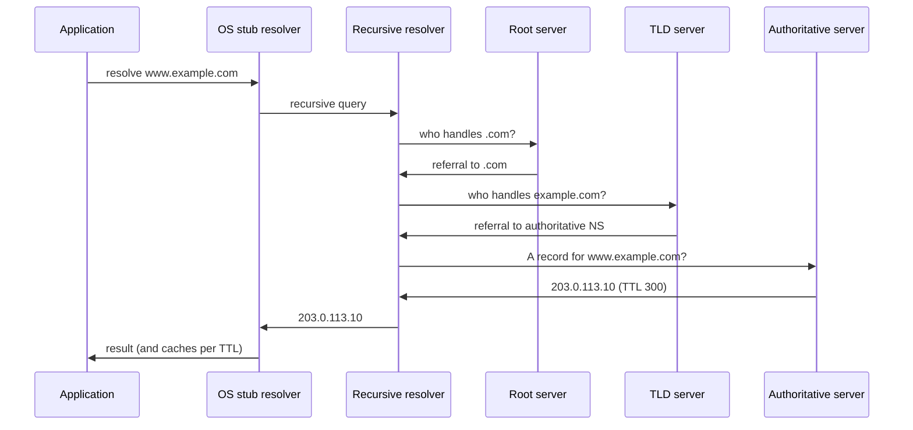

# Naming and Address Assignment: DNS, DHCP, and SLAAC

## 1. Why This Chapter Exists

Before a host can open a socket, it usually needs two things it does not inherently have: a human-meaningful name mapped to an address (DNS), and an address itself plus basic configuration (DHCP or SLAAC). These mechanisms run before application traffic and are therefore frequent, high-impact points of failure. "The site is down" is as often a DNS resolution failure or a stale record as it is a server problem, and "the host has no network" is often a DHCP failure or an address conflict rather than a broken link.

This chapter explains how names are resolved through a distributed hierarchical system, how caching and TTLs govern propagation and staleness, how hosts obtain addresses and configuration automatically, and how these mechanisms fail. It treats DNS as a distributed database with delegation and caching—not as a single service—because that framing is what makes its failure modes predictable.

---

## 2. DNS as a Distributed Hierarchical Database

The **Domain Name System (DNS)** maps names to records. It is not one server but a hierarchy of servers, each authoritative for a portion of the namespace called a **zone**, with responsibility **delegated** downward. The namespace is read right to left: the root (`.`) delegates to top-level domains (`.com`, `.org`, `.io`), each TLD delegates to second-level domains (`example.com`), and so on.

Because authority is delegated and results are cached, no single server knows every name, and no single failure takes down the whole system. The cost of this distribution is that correctness depends on the delegation chain being intact and on caches holding reasonably fresh data.

---

## 3. Resolution: Recursive and Iterative

A client application does not talk to the root servers. It talks to a **stub resolver** (in the OS), which asks a **recursive resolver** (often provided by the ISP, the cloud provider, or a public resolver). The recursive resolver does the hard work: if it has a cached answer, it returns it; otherwise it walks the hierarchy.



The distinction matters. A **recursive** query asks the resolver to find the final answer. **Iterative** queries ask each server for the next referral. The recursive resolver issues iterative queries to walk the tree. When debugging, `dig +trace` simulates this walk from the root, which is a powerful way to locate where delegation or authority is broken.

#### In-Line Glossary: Recursive Resolver

**What it is:** a server that accepts a query and returns a final answer (or error), performing the delegation walk on the client's behalf and caching results.

**Why here:** it is the component that actually performs resolution and where the vast majority of caching—and caching failures—live.

**Systemic implication:** because clients depend on a resolver, resolver outages or misconfiguration can make an entire network appear offline even when connectivity is fine; resolver health is a first-class dependency.

#### In-Line Glossary: TTL (DNS Time To Live)

**What it is:** the number of seconds a resolver or client may cache a record before it must be re-queried.

**Why here:** it sets the trade-off between freshness and query load, and it determines how quickly changes and mistakes propagate.

**Systemic implication:** short TTLs enable fast failover but increase query load; long TTLs reduce load but make failures persist after the cause is fixed. Planning a cutover requires lowering TTLs in advance.

---

## 4. Common Record Types

DNS holds many record types, each serving a purpose. **A** maps a name to an IPv4 address. **AAAA** maps a name to an IPv6 address. **CNAME** aliases one name to another (and cannot coexist with other records at the same name). **NS** identifies the authoritative name servers for a zone. **SOA** holds zone metadata, including the serial number used for zone transfers and the negative-caching TTL. **MX** names mail exchangers. **TXT** carries arbitrary text (used for verification and policy such as SPF/DKIM/DMARC). **PTR** maps an address back to a name (reverse DNS). **SRV** names a service and port for service discovery. Understanding which record answers which question is essential to reading a DNS query's intent and result.

---

## 5. Caching and Propagation

Every resolver and stub caches records for their TTL. This is what makes DNS scale, and it is also the source of the phrase "DNS propagation": a change is not pushed instantly, it becomes visible as caches expire. There is no propagation in the sense of a broadcast; there is only expiration and re-querying.

**Negative caching** also exists: a non-existent name (NXDOMAIN) is cached per the SOA minimum TTL, so a name that did not exist when queried can remain unresolvable briefly after it is created. This surprises people who create a record and still cannot resolve it.

#### In-Line Glossary: Split-Horizon DNS

**What it is:** serving different DNS answers for the same name depending on who is asking (internal clients versus the public internet).

**Why here:** it lets internal services use private names and addresses while the same or related names resolve publicly as needed.

**Systemic implication:** split-horizon DNS makes resolution context-dependent, so a name that resolves inside the network may fail or resolve differently outside; debugging must always state which resolver and which network the query originated from.

---

## 6. DHCP: Automatic Address Configuration

**DHCP (Dynamic Host Configuration Protocol)** assigns addresses and configuration to hosts that do not have static configuration. It operates in four steps, remembered by the mnemonic **DORA**:

- **Discover:** the client broadcasts to find a server.
- **Offer:** a server offers an address and parameters.
- **Request:** the client requests the offered address.
- **Acknowledge:** the server confirms the lease.

A **lease** is time-bounded; the client renews before expiry, and an un-renewed address returns to the pool. DHCP carries **options** beyond the address: subnet mask, default gateway, DNS servers, domain name, and more. Because DHCP Discover is a broadcast, DHCP requires the client to be in the same broadcast domain as the server, or a **DHCP relay** on the router must forward the request to a server on another subnet.

#### In-Line Glossary: DHCP Lease

**What it is:** a time-limited grant of an address plus options to a client, renewable before expiry.

**Why here:** it is how most endpoints obtain identity and configuration, and lease timing governs address reuse and conflict risk.

**Systemic implication:** lease duration is a trade-off; short leases free addresses quickly but increase renewal load, while long leases reduce churn but hold addresses after hosts leave, and an exhausted pool prevents new hosts from joining.

---

## 7. SLAAC: IPv6 Stateless Autoconfiguration

IPv6 hosts often do not need DHCP. **SLAAC (Stateless Address Autoconfiguration)** lets a host construct its own address from a network prefix advertised by a router plus an interface identifier. Routers send **Router Advertisements (RAs)** that carry the prefix, flags, and default route information; hosts listen, form a **Global Unicast Address**, and verify uniqueness using Duplicate Address Detection before using it. **Neighbor Discovery (ND)** replaces ARP for address resolution.

SLAAC is stateless because no server tracks allocations, which suits large or dynamic networks, but it offers less centralized control than DHCPv6. In practice, networks often combine RA for the prefix and default route with DHCPv6 for DNS and other options (a common "SLAAC plus stateless DHCPv6" pattern).

---

## 8. Invariants, Assumptions, and Boundaries

**Invariant: DNS answers are only as authoritative as the delegation chain.** A broken delegation or incorrect NS/glue records make a zone unresolvable regardless of the zone's own correctness.

**Invariant: caches hold records for their TTL.** Freshness is a function of TTL, not of the publisher's wishes.

**Assumption: the resolver is reachable and correctly configured.** Client resolution depends on a working resolver, which is a separate dependency from network connectivity.

**Assumption: DHCP/SLAAC configuration is coherent.** Duplicate addresses, wrong gateways, or missing DNS options produce hosts that are "up" but misconfigured.

**Boundary: DNS provides names, not trust.** Plain DNS is unauthenticated and observable; DNSSEC adds authentication of records but not confidentiality of queries.

**Boundary: DNS resolves names, not availability.** A record pointing at an address that is down resolves fine; DNS success is not reachability.

---

## 9. Trade-offs and Rejected Alternatives

**Why a distributed, cached system rather than a central registry?** A central registry cannot scale to the modern namespace and would be a single point of failure. Distribution plus caching trades eventual consistency for scale and resilience. The rejected alternative—one authoritative database for all names—is neither scalable nor survivable.

**Why cache with TTLs rather than always query?** Always querying would overwhelm authoritative servers and add latency to every lookup. Caching introduces the staleness problem, which is managed (not eliminated) by choosing TTLs appropriate to how often the record changes.

**Why DHCP rather than static configuration everywhere?** Static configuration is predictable but unscalable and error-prone at scale. DHCP centralizes configuration and changes. The cost is dependence on a DHCP service and the lease/conflict behavior it introduces. Static addresses remain appropriate for servers, gateways, and infrastructure.

**Why SLAAC alongside DHCPv6?** SLAAC reduces server dependency and suits dynamic networks; DHCPv6 offers finer control and richer options. Using both captures most benefits, at the cost of having two configuration paths to reason about.

---

## 10. Failure Modes and Operational Consequences

**Resolver failure or misconfiguration.** Hosts cannot resolve any name; everything appears down. Symptom: `dig @good-resolver` works but default resolution fails. Operational consequence: monitor resolver reachability and correct `resolv.conf`/resolver settings.

**Stale records after a change.** Clients get old addresses because caches have not expired. Symptom: some clients reach the new target, others the old. Operational consequence: lower TTLs before changes and wait out the old TTL.

**Negative caching surprises.** A newly created name is still NXDOMAIN for the cached minimum. Symptom: record exists at the authoritative server but resolves as NXDOMAIN for some clients. Operational consequence: plan around the SOA minimum TTL when creating records.

**Split-horizon confusion.** A name resolves internally but not externally (or vice versa). Symptom: "works on the VPN, fails off it". Operational consequence: always identify the resolver/network context and maintain both views deliberately.

**DHCP pool exhaustion or rogue servers.** No free addresses, or a rogue server hands out wrong gateways/DNS. Symptom: new hosts get no lease or get wrong configuration. Operational consequence: size pools, enable DHCP snooping, and monitor lease utilization.

**Address conflicts.** Duplicate IP from static misconfiguration or SLAAC/ND collisions. Symptom: intermittent connectivity for both hosts. Operational consequence: keep a registry or IPAM, and use Duplicate Address Detection.

**Search-domain and `.local` overreach.** Misconfigured search domains append suffixes unexpectedly, or `.local` collides with mDNS. Symptom: hostnames resolve to wrong hosts or intermittently. Operational consequence: keep search domains minimal and avoid `.local` for unicast DNS.

---

## 11. Hands-On: Diagnosing Name and Address Assignment

Query a name and show the answer, authority, and additional sections:

```bash
dig www.example.com
```

Trace resolution from the root to locate a broken delegation:

```bash
dig +trace www.example.com
```

Query a specific server and record type (verifies authority directly):

```bash
dig @ns1.example.com example.com MX
```

Check reverse DNS:

```bash
dig -x 203.0.113.10
```

View how the host is configured (DNS servers, search domains, leases):

```bash
cat /etc/resolv.conf
resolvectl status           # systemd-resolved systems
ip -br addr
ip route
```

Observe DNS traffic and DHCP in a capture:

```bash
sudo tcpdump -nn -i any port 53
sudo tcpdump -nn -i any 'udp port 67 or udp port 68'
```

Interpretation: `dig` at the default resolver versus `dig +trace` isolates resolver problems from delegation problems; comparing `dig @authoritative` with default resolution reveals caching or resolver issues; a missing DHCP ACK points at the DHCP path.

---

## 12. Related Documents

- [The IP Layer: Packet Delivery, TTL, MTU, and ICMP](./03-the-ip-layer-delivery-ttl-mtu-and-icmp.md)
- [The Transport Layer: TCP, UDP, Ports, and Sockets](./04-the-transport-layer-tcp-udp-ports-and-sockets.md)
- [IPv6 Addressing](../02-ip-addressing-and-subnetting/04-ipv6-addressing.md)
- [Cloud Virtual Networks: Fundamentals](../05-cloud-virtual-networks/01-virtual-network-fundamentals.md)

## 13. External References

- [RFC 1034: Domain Names — Concepts and Facilities](https://www.rfc-editor.org/rfc/rfc1034)
- [RFC 1035: Domain Names — Implementation and Specification](https://www.rfc-editor.org/rfc/rfc1035)
- [RFC 2131: Dynamic Host Configuration Protocol](https://www.rfc-editor.org/rfc/rfc2131)
- [RFC 4862: IPv6 Stateless Address Autoconfiguration](https://www.rfc-editor.org/rfc/rfc4862)
- [RFC 8415: Dynamic Host Configuration Protocol for IPv6 (DHCPv6)](https://www.rfc-editor.org/rfc/rfc8415)
