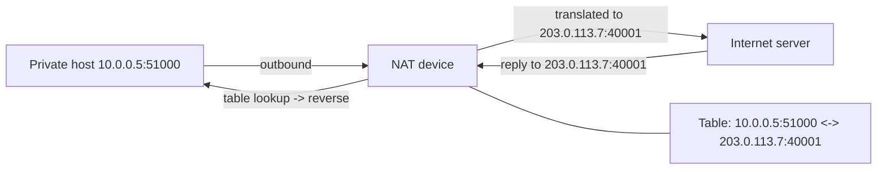

# NAT and Address Translation

## 1. Why This Chapter Exists

Network Address Translation was introduced as a short-term workaround for IPv4 address exhaustion and became a load-bearing part of the internet. It is now pervasive: home routers, corporate firewalls, cloud gateways, load balancers, and carrier networks all translate addresses. Because NAT rewrites the very identifiers the rest of the stack depends on, it breaks the clean end-to-end model, complicates peer-to-peer connectivity, and produces failure modes that are hard to reason about without understanding the translation mechanics.

This chapter explains why NAT exists, the different translation modes, how the translation table works, what changes when translation is stateful, how inbound connections are enabled, and how large-scale NAT and traversal techniques (STUN, TURN, hole-punching) evolved to cope with NAT's constraints. It also corrects the widespread misconception that NAT is a security feature.

---

## 2. Why NAT Exists

IPv4 provides roughly 4.3 billion addresses, and the address space was allocated in ways that left far fewer usable globally routable addresses than there were devices. NAT extends the usable life of IPv4 by allowing many private hosts to share one (or few) public addresses. Private ranges defined in `RFC 1918` (10.0.0.0/8, 172.16.0.0/12, 192.168.0.0/16) are not globally routable, so they can be reused in every private network without coordination; a NAT device translates between the private addresses inside and the public address outside.

The consequence is a fundamental break in **end-to-end connectivity**. Without NAT, any address can connect to any other address (subject to firewalls). With NAT, hosts behind the translator are not directly addressable from outside; inbound connections require an explicit mapping. IPv6 was designed to eliminate the need for NAT by providing enough addresses, though translation still appears in some deployments for other reasons (overlapping prefixes, migration).

---

## 3. Modes of Translation

Translation comes in several forms, distinguished by what is rewritten and whether the mapping is static or dynamic.

**Static NAT (one-to-one)** maps a private address permanently to a public address. It is used for servers that must be reachable from outside and for site-to-site scenarios with overlapping address spaces.

**Dynamic NAT (one-to-one pool)** maps private addresses to a pool of public addresses on demand. When the pool is exhausted, new connections wait or fail.

**PAT / NAPT (one-to-many)** is what almost everyone means by "NAT": many private hosts share a single public address, distinguished by translating the **source port** as well as the source address. This is also called **overloading** or **masquerading**. It works because the transport four-tuple (which includes the port) uniquely identifies each connection, so port translation can multiplex thousands of flows through one public IP.

**SNAT (source NAT)** rewrites the source address (outbound traffic behind a gateway). **DNAT (destination NAT)** rewrites the destination address (inbound port forwarding, or load balancing that redirects to a backend).

#### In-Line Glossary: PAT (Port Address Translation)

**What it is:** NAT that rewrites both the source address and the source port so many hosts can share one public address, using distinct translated ports to keep flows separate.

**Why here:** it is the dominant NAT mode, and its port-multiplexing behavior is the reason most private hosts can reach the internet at all with a single public IP.

**Systemic implication:** because PAT consumes a translated port per concurrent flow, a NAT device has a finite connection capacity (roughly 64K per destination and per public IP), so high churn or many clients can exhaust the translation table—a failure that looks like the internet being down.

---

## 4. The Translation Table and Stateful NAT

Stateful NAT keeps a **translation table** (Linux calls it **conntrack**) recording each flow's original and translated addresses and ports. Outbound packet: the device replaces the private source tuple with a public one and records the mapping. Return packet: the device looks up the mapping, reverses the translation, and forwards to the original private host.



Because the table is stateful, the device must track flow lifetime, handle TCP teardown and timeouts, and purge idle entries. The table has a finite size: when it fills, new translations cannot be created and connections fail. TCP `TIME_WAIT`, long-lived idle connections, and high connection churn all consume entries, which is why conntrack tuning and monitoring matter in busy gateways.

#### In-Line Glossary: Conntrack

**What it is:** the Linux connection-tracking subsystem that records NAT and firewall state for each flow.

**Why here:** it is the actual mechanism behind stateful NAT and stateful firewalling on Linux, and its table size and timeouts govern gateway capacity.

**Systemic implication:** conntrack exhaustion silently drops new connections while existing ones continue, producing a partial outage that is easy to misattribute; table utilization must be monitored as a capacity signal.

---

## 5. Inbound Connections and Hairpinning

Because PAT has no mapping for an inbound connection until an outbound flow creates one, unsolicited inbound connections cannot reach a private host. To allow them, operators configure **port forwarding** (a static DNAT rule mapping a public port to a private address and port) or a reverse proxy/load balancer. This is also why peer-to-peer applications struggle behind NAT: neither peer can accept an unsolicited connection from the other.

**Hairpinning (NAT loopback)** is the case where an internal host tries to reach another internal host via the public address. Some NATs handle this correctly by translating and looping the traffic back inside; others do not, causing "it works from outside but not from inside" failures. Cloud and enterprise gateways differ in whether they support hairpin, so it must be verified rather than assumed.

---

## 6. Carrier-Grade NAT and Traversal

As IPv4 exhaustion worsened, ISPs deployed **CGNAT (Carrier-Grade NAT, also LSN)**, which places thousands of subscribers behind a shared pool of public addresses with multiple translation layers. CGNAT aggravates many NAT problems: users behind it cannot accept inbound connections at all without carrier cooperation, abuse attribution becomes harder, and port availability is contended across subscribers.

To make peer-to-peer work through NAT, a set of **NAT traversal** techniques emerged. **STUN** lets a host discover its public mapped address and port as seen by a server. **ICE** coordinates candidate addresses to find a working path. **UDP hole punching** exploits the fact that once both peers send outbound packets creating translations, the NATs will pass replies, enabling a direct path. When hole punching fails (symmetric NATs, strict firewalls), **TURN** relays traffic through a server. This machinery is why video calls and peer-to-peer systems work at all despite pervasive NAT.

#### In-Line Glossary: NAT Traversal

**What it is:** the set of techniques (STUN, ICE, hole punching, TURN relay) used to establish connectivity between hosts separated by NAT.

**Why here:** NAT removes direct addressability, so peer-to-peer connectivity must be re-established explicitly.

**Systemic implication:** traversal works best through endpoint-independent NAT and fails through symmetric NAT, so real-time application reliability depends on NAT behavior that the application cannot control—hence the standing need for relay fallbacks.

---

## 7. NAT-Aware Protocols and Application Gateways

Some protocols embed addresses and ports inside the payload, not just in headers. FTP's classic mode puts the data connection's address and port in the control channel; SIP embeds addresses in its messages; IPsec's integrity protection covers the address fields, so translation breaks it. NAT cannot rewrite what it cannot parse, so devices use **Application Layer Gateways (ALGs)** that understand specific protocols and rewrite their payloads. ALGs are fragile, often buggy, and a frequent source of subtle breakage, which is one reason modern designs prefer protocols that are NAT-friendly (HTTPS, QUIC) and why FTP is discouraged.

Fragmentation also interacts badly with NAT: only the first fragment carries the transport header (and thus the port) needed for PAT, so subsequent fragments may not be translatable, requiring special handling.

---

## 8. The Security Myth

NAT is often described as providing security by "hiding" internal hosts. This is a side effect, not a security control. NAT provides no authentication, no integrity, and no confidentiality, and a stateful NAT that permits return traffic for outbound flows is effectively a weak, implicit firewall—but a firewall is the correct tool for that job, and NAT's behavior should not be relied on for policy. Treating NAT as security leads to misconfigurations where internal services are assumed protected when they are merely unaddressable, and where explicit firewall policy is omitted.

---

## 9. Invariants, Assumptions, and Boundaries

**Invariant: the translation table maps each active flow's tuples bidirectionally.** A missing or expired entry means the return traffic has nowhere to go.

**Invariant: with PAT, inbound connections require a pre-existing mapping or an explicit rule.** There is no implicit inbound path.

**Assumption: the NAT device can parse the headers needed for translation.** Protocols that hide addressing in payloads or encrypt those fields break translation.

**Boundary: NAT does not provide security.** It is a reachability and address-space mechanism.

**Boundary: NAT breaks end-to-end transparency.** Applications that assume they can accept inbound connections or embed their own addresses must be adapted (traversal, relay, ALG).

**Boundary: NAT state is finite and time-bound.** Table size and idle timeouts cap capacity and can silently drop new flows.

---

## 10. Trade-offs and Rejected Alternatives

**Why not just deploy IPv6 and drop NAT?** IPv6 provides enough addresses to restore end-to-end connectivity, and it is the long-term answer. But adoption is incremental and legacy IPv4 assets persist, so translation remains in mixed and transitional networks. The rejected alternative—a hard cutover—is not operationally feasible for most organizations.

**Why PAT rather than one-to-one NAT?** PAT multiplexes many hosts onto one address, which is what makes the shared-address model economical. The cost is stateful port multiplexing, finite capacity, and broken inbound reachability. One-to-one NAT preserves more transparency but requires an address per host, defeating the purpose.

**Why accept the fragility of ALGs?** Because legacy protocols with embedded addresses must still work. The better answer is to avoid such protocols, and ALGs exist to bridge the gap. The rejected ideal is a world where every protocol is NAT-transparent; reality requires exceptions.

**Why is NAT traversal so complex?** Because NAT behavior is not standardized across devices, and traversal must work against unknown implementations. The complexity of STUN/ICE/TURN is the price of connectivity in a NAT-dominated world.

---

## 11. Failure Modes and Operational Consequences

**Translation table exhaustion.** Too many flows or too much churn fills conntrack; new connections fail while existing ones continue. Symptom: partial outage, "can't open new connections". Operational consequence: monitor table utilization, tune timeouts, and reduce connection churn.

**Port exhaustion behind CGNAT.** Many subscribers compete for translated ports. Symptom: intermittent connectivity depending on carrier load. Operational consequence: prefer protocols with connection reuse and be aware the failure is outside the organization's control.

**Asymmetric routing breaking stateful NAT.** Return traffic that bypasses the NAT device loses its translation. Symptom: one-way connectivity. Operational consequence: ensure symmetric paths for stateful devices and validate both directions.

**Hairpin not supported.** Internal clients cannot reach a service via its public address. Symptom: "works externally, fails internally". Operational consequence: verify hairpin support or use split-horizon DNS to send internal clients directly to the internal address.

**ALG-induced breakage.** A protocol's ALG rewrites payloads incorrectly or a new protocol has no ALG. Symptom: one specific application fails while everything else works. Operational consequence: disable unnecessary ALGs and prefer NAT-friendly protocols.

**Fragmentation and translation.** Non-initial fragments lacking port information are mishandled. Symptom: large or exotic flows fail. Operational consequence: prefer DF and PMTUD and ensure fragments are handled consistently.

---

## 12. Hands-On: Inspecting Translation State

Show the NAT and firewall connection-tracking table (Linux):

```bash
sudo conntrack -L
sudo conntrack -S
```

Show NAT rules in the firewall (nftables or legacy iptables):

```bash
sudo nft list ruleset | grep -i nat
sudo iptables -t nat -L -n -v      # legacy
```

Observe translated addresses as seen by a remote server (your public IP):

```bash
curl -s https://ifconfig.me
```

Watch NAT create and expire entries while generating traffic:

```bash
sudo conntrack -E &
curl -s https://example.com > /dev/null
```

Interpretation: `conntrack -L` shows the original and translated tuples and confirms the mapping direction; `conntrack -S` reveals table pressure; a public IP different from the host's address proves translation is in effect.

---

## 13. Related Documents

- [The IP Layer: Packet Delivery, TTL, MTU, and ICMP](./03-the-ip-layer-delivery-ttl-mtu-and-icmp.md)
- [The Transport Layer: TCP, UDP, Ports, and Sockets](./04-the-transport-layer-tcp-udp-ports-and-sockets.md)
- [Cloud Virtual Networks: Gateways and Connectivity Primitives](../05-cloud-virtual-networks/03-gateways-and-connectivity-primitives.md)
- [IPv4 Addressing Fundamentals](../02-ip-addressing-and-subnetting/01-ipv4-addressing-fundamentals.md)

## 14. External References

- [RFC 1918: Address Allocation for Private Internets](https://www.rfc-editor.org/rfc/rfc1918)
- [RFC 3022: Traditional IP Network Address Translator (Traditional NAT)](https://www.rfc-editor.org/rfc/rfc3022)
- [RFC 4787: Network Address Translation (NAT) Behavioral Requirements for Unicast UDP](https://www.rfc-editor.org/rfc/rfc4787)
- [RFC 8445: Interactive Connectivity Establishment (ICE)](https://www.rfc-editor.org/rfc/rfc8445)
- [RFC 8489: Session Traversal Utilities for NAT (STUN)](https://www.rfc-editor.org/rfc/rfc8489)
