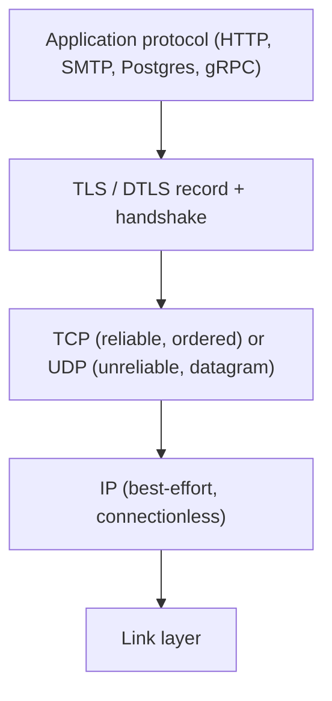
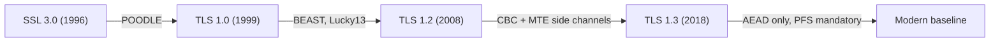

# SSL to TLS: Evolution, Threat Model, and Security Guarantees

## 1. Why This Chapter Exists

Almost every production system terminates encrypted connections at some point: browsers to load balancers, services to services inside a cluster, database clients to database servers, IoT devices to gateways, and WebRTC peers to each other. The protocol that makes this traffic confidential and authenticated is TLS, and the older name for its ancestor is SSL. Engineers routinely use the terms interchangeably, deploy certificates they did not design, and treat the handshake as a black box that "just works" until it silently fails in production.

The purpose of this chapter is to establish the vocabulary, the historical failures, and the precise security model that every later chapter depends on. Before we can reason about record framing, key schedules, certificate validation, or mutual authentication, we must be exact about what transport security promises, what it refuses to promise, and why the promise is stated in terms of an explicit threat model rather than an absolute guarantee of safety. Without this grounding, configuration decisions become cargo cult: people copy cipher lists and protocol version flags without understanding which adversary each choice defends against.

This chapter deliberately front-loads theory. The mechanism details of the handshake arrive in the next chapters, but the reason the handshake is shaped the way it is only makes sense once the threat model is understood.

---

## 2. Layers, Names, and What "SSL" Really Means

Transport Layer Security is a cryptographic protocol that runs between a reliable, ordered byte-stream transport (almost always TCP) and an application protocol (HTTP, SMTP, IMAP, LDAP, PostgreSQL wire protocol, and many others). It is important to place it correctly in the stack, because its design assumptions follow directly from the layer below it.

The name history matters because it explains why the language is inconsistent. **SSL** (Secure Sockets Layer) was designed at Netscape in the mid-1990s. SSL 1.0 was never released, SSL 2.0 shipped in 1995, and SSL 3.0 shipped in 1996. When the IETF standardized the protocol, it renamed it **TLS** (Transport Layer Security): TLS 1.0 (1999), TLS 1.1 (2006), TLS 1.2 (2008), and TLS 1.3 (2018). Despite the rename, the industry kept the word "SSL" for certificates, libraries, and configuration flags, so "SSL certificate" and "TLS certificate" mean the exact same artifact, and "SSL handshake" usually means the TLS handshake. In this masterclass, we use the modern technical term TLS and explicitly label the legacy versions as SSL when discussing history.

The practical consequence is that when you read an old configuration file, an `openssl` command name, or a directory like `/etc/ssl`, you are seeing a fossil of the naming transition, not a different protocol. `openssl` is a library and tool set, not the protocol; it implements TLS today. Treating the word "SSL" as a synonym for "the TLS protocol in general" is acceptable colloquially, but treating it as "the legacy protocol" is essential when interpreting version negotiation and security warnings.

---

## 3. The Threat Model: What TLS Is Actually Defending Against

TLS is not a vague promise of "security." It defends against a specific set of adversaries under specific assumptions, and being explicit about those assumptions prevents both overconfidence and misconfiguration.

### 3.1 The Adversary TLS Assumes

The canonical adversary is an **active network attacker** who can read, modify, drop, inject, reorder, and replay packets on the path between client and server, and who may also be a passive eavesdropper. This models a hostile Wi-Fi network, a compromised router, an on-path middlebox, or a nation-state tapping a backbone. The attacker also knows the protocol, all public algorithms, and all ciphertext, and can run many sessions concurrently.

### 3.2 The Adversary TLS Does Not Assume Away

TLS explicitly does **not** defend against an attacker who controls an endpoint's private keys, who compromises the operating system or process memory, who has a validly issued certificate for the target name from a trusted certificate authority, or who can coerce a user to click through a warning. It also does not defend against application-layer vulnerabilities carried inside the encrypted tunnel. This last point is crucial: encryption hides the contents of a message from the network, but it does not make the message safe to execute. SQL injection, cross-site scripting, and deserialization bugs work identically inside TLS as outside it.

### 3.3 The Security Goals, Stated Precisely

TLS targets four properties, and each later chapter maps back to one of them.

**Confidentiality** means that an adversary on the path cannot learn the plaintext of the exchanged messages. This is achieved by encrypting application data with a symmetric cipher under keys that the network attacker never sees.

**Integrity** means that an adversary cannot tamper with messages undetected. TLS does not merely hide data; it authenticates it with a message authentication code, so a modified record fails verification and the connection aborts. Integrity is arguably more important than confidentiality in many systems, because a silent modification such as changing a bank routing number or a package version is more damaging than mere disclosure.

**Authentication** means each side can verify the identity of the other. Historically this was one-directional (the client verifies the server, because the server's name matches what the user typed). Mutual TLS (mTLS), covered later, extends this so the server also verifies the client via a certificate.

**Forward secrecy** means that compromise of a long-term private key in the future does not expose past recorded sessions. The next chapters show how ephemeral Diffie-Hellman makes this possible and why TLS 1.3 makes it mandatory.

#### In-Line Glossary: Forward Secrecy

**What it is:** the property that the session keys used to encrypt a past conversation cannot be reconstructed even if the server's long-term private key is later stolen.

**Why here:** it is one of the four goals and the single largest behavioral difference between legacy RSA key transport and modern ephemeral key exchange.

**Systemic implication:** without it, an adversary who records ciphertext today and steals a key next year can decrypt the entire recorded past. With it, the recorded ciphertext remains opaque, which is why compliance regimes increasingly require it.

#### In-Line Glossary: Man-in-the-Middle (MITM)

**What it is:** an active attacker positioned on the network path who can relay, modify, or inject traffic between two parties.

**Why here:** it is the central adversary the threat model assumes, and it is the threat that authentication (signatures and certificates) exists to defeat.

**Systemic implication:** confidentiality against a passive eavesdropper is insufficient; without authentication, an active MITM can complete two separate key exchanges and read everything.

---

## 4. Why the Protocol Was Redesigned Repeatedly: A History of Concrete Failures

The evolution from SSL 2.0 to TLS 1.3 is best understood not as a sequence of feature additions but as a sequence of defeats. Each generation fixed attacks that broke the previous one, which explains why modern guidance is "disable everything older than TLS 1.2" and increasingly "prefer TLS 1.3."

### 4.1 SSL 2.0 and the Absence of Integrity

SSL 2.0 lacked a proper integrity check in the modern sense and used weak, export-era cryptography. It was deprecated quickly. Its key lesson is that confidentiality without integrity is close to useless: an attacker who can flip bits can often recover plaintext through oracle behavior even without reading the key.

### 4.2 SSL 3.0 and the Cipher Block Chaining Problems

SSL 3.0 introduced the general structure that survives to this day, but it used CBC-mode block ciphers in a construction that later proved fragile. **BEAST** (Browser Exploit Against SSL/TLS, 2011) exploited predictable initialization vectors in TLS 1.0 to attack CBC, and **POODLE** (Padding Oracle On Downgraded Legacy Encryption, 2014) exploited SSL 3.0's CBC padding checking to recover plaintext one byte at a time. The fix for POODLE was to disable SSL 3.0 entirely. **Lucky13** targeted timing in CBC MAC-then-Encrypt constructions across TLS 1.0–1.2.

The systemic lesson: **CBC mode with MAC-then-Encrypt, combined with error messages and timing, leaks through side channels.** This is precisely why TLS 1.3 removed CBC and MAC-then-Encrypt from the protocol and standardized on AEAD constructions.

### 4.3 Compression and the CRIME/BREACH Class

TLS-level compression enabled **CRIME** (2012), and HTTP-level compression enabled **BREACH** (2013). Both exploit the fact that compression ratio depends on secret content, turning ciphertext length into an oracle. The fix was to disable TLS compression and to be careful with application-layer compression over secrets such as CSRF tokens.

### 4.4 Renegotiation and the Triple Handshake

TLS 1.2 and earlier allowed **renegotiation**, a mid-connection re-handshake. A series of attacks, including the **Triple Handshake** (2014), showed that a man-in-the-middle could splice a victim's credentials into a connection to a server. The mitigation was the renegotiation indication extension (`RFC 5746`), and TLS 1.3 removed renegotiation entirely.

### 4.5 Heartbleed and Implementation versus Protocol

**Heartbleed** (2014) was a buffer over-read in OpenSSL's heartbeat extension that leaked up to 64 KB of process memory per request, exposing private keys and session secrets. It is the canonical reminder that a mathematically sound protocol is worthless if the implementation is unsafe. The lesson is operational: keep libraries patched, minimize exposed surface, and assume memory-safety bugs will occasionally defeat the protocol layer.

### 4.6 Downgrade Attacks and Version Negotiation

Because old clients and servers must interoperate, TLS negotiates a version, and an active attacker can try to force both parties down to the weakest acceptable version. Explicit downgrade attacks (for example **FREAK** and **Logjam**, which pushed clients toward export-grade RSA and Diffie-Hellman) demonstrated that "we still support old versions for compatibility" is an attack surface. The modern mitigation is to simply not offer obsolete versions and, in TLS 1.3, to cryptographically bind the negotiated parameters so silent downgrades are detectable.

#### In-Line Glossary: Downgrade Attack

**What it is:** an attack that forces two parties to negotiate a weaker protocol version or algorithm than they are capable of supporting.

**Why here:** retained legacy versions and algorithms are the substrate for downgrade attacks such as FREAK and Logjam, which is why the modern stance is to stop offering them rather than to warn about them.

**Systemic implication:** security posture is determined by the weakest option a peer is willing to accept, not by the strongest option a configuration lists, so optionality itself must be minimized.

### 4.7 TLS 1.3 as a Deliberate Simplification

TLS 1.3 did not add features so much as delete dangerous ones: it removed RSA key transport, static Diffie-Hellman, CBC ciphers, MAC-then-Encrypt, compression, renegotiation, and custom (non-AEAD) constructions. It reduced the handshake to a formally analyzed key schedule based on HKDF, made forward secrecy mandatory, and cut a round trip from the common case. The design philosophy is "fewer, safer choices," which is itself a security strategy: every optional legacy feature is a potential downgrade or implementation-mismatch vector.

---

## 5. Invariants, Assumptions, and Boundaries

A protocol is only as good as the invariants it maintains and the assumptions it is allowed to make. Stating them explicitly prevents subtle reasoning errors later.

**Invariant: the transport below TLS is reliable and ordered.** TLS over TCP assumes that bytes arrive in order and that a lost segment is retransmitted by TCP. This assumption is what allows TLS to define a stream record layer without sequence-gap logic. DTLS, covered in a later chapter, deliberately relaxes this invariant to run over UDP and must add its own sequencing, retransmission, and replay protection to compensate. The existence of DTLS is itself the proof that this invariant is load-bearing.

**Invariant: negotiated parameters are bound into the handshake transcript.** Both parties hash the entire handshake into a transcript and derive keys and verification data from it. If an attacker changes any parameter in flight, the hashes disagree and the handshake fails. This is what makes the negotiation tamper-evident rather than merely tamper-resistant.

**Assumption: endpoints' private keys and random number generators are trustworthy.** TLS assumes the operating system provides secure randomness and that private keys are not extracted. A weak or predictable random source (historically, the Debian OpenSSL bug of 2008) collapses the entire security model regardless of protocol version.

**Assumption: the trust anchor set is meaningful.** Server authentication rests on the client trusting a set of root certificate authorities. If that set is bloated or a root is compromised, the assurance degrades. The certificate ecosystem chapter examines this in depth.

**Boundary: TLS secures data in transit, not at rest and not at the endpoints.** Once plaintext reaches the application, TLS has no authority over it. Encryption at rest, access control, and input validation are separate disciplines.

---

## 6. Trade-offs and Rejected Alternatives

**Why not encrypt at the application layer and skip TLS?** Application-layer cryptography is repeatedly reinvented and repeatedly broken (custom protocols, home-grown key exchange, ECB mode misuse). TLS concentrates decades of peer review and formal verification into one audited layer. The cost is that TLS is a shared, complex state machine, but the benefit is that individual teams do not each have to solve authenticated key exchange correctly. Rejected alternative: bespoke crypto per application.

**Why not rely on IPsec or network-layer encryption instead?** Network-layer encryption (IPsec) protects all traffic between hosts transparently and is excellent for site-to-site tunnels, but it authenticates machines, not named applications, and it does not compose naturally with per-request authorization in a mesh or with browser trust models. TLS operates at the identity granularity that applications actually use: a named service, a domain, or a workload identity. In practice the two are complementary, not competing. Rejected alternative: transport security only at layer 3.

**Why not keep old versions for a few legacy clients?** Every retained version is an attack surface and a downgrade target, as the history above shows. The cost is occasional breakage of ancient clients; the benefit is the removal of entire vulnerability classes. Modern guidance converges on TLS 1.2 as an absolute floor and TLS 1.3 as the default, with legacy versions reachable only through an explicitly isolated, monitored endpoint if at all.

**Why not make everything mandatory and skip negotiation?** Some negotiation is unavoidable because clients and servers upgrade at different times, and ossification (middleboxes that assume fixed byte layouts) is a real deployment constraint. TLS 1.3 was designed to resist ossification better than 1.2 by encrypting more of the handshake, which is a deliberate rebalancing of flexibility versus safety.

---

## 7. Failure Modes and Operational Consequences

When the threat model is misunderstood or the configuration drifts, failures cluster in recognizable patterns. This section previews them; the hardening chapter gives the diagnostic tree.

**Silent downgrade in practice.** A load balancer with a permissive cipher configuration may accept a weak suite from a non-browser client, and nothing in normal monitoring notices, because the connection succeeds. The failure is invisible until an audit or an incident. Observability consequence: you must log the negotiated protocol version and cipher suite per connection or per aggregate, not just success or failure.

**Certificate trust is the real boundary, not the cipher.** Teams frequently obsess over cipher suites while shipping certificates with the wrong hostname, an incomplete chain, or an expired root. In real incidents, certificate mismatch and expiry dominate. Operational consequence: certificate expiry must be an automated, alerting signal well before the deadline, and chain completeness must be verified from the client's perspective, not the server's.

**Performance versus security pressure.** Every additional handshake costs round trips and CPU, and at high concurrency this becomes a capacity concern. The temptation is to weaken security (long session resumption, static keys) to save latency. The correct response is to use modern primitives that recover latency safely: TLS 1.3's reduced round trips and session resumption, hardware acceleration, and session tickets with rotation. The trade-off is real but should be paid with better engineering, not weaker cryptography.

**Compliance as a lagging signal.** Regulations (for example PCI-DSS requiring strong TLS versions and forward-secure ciphers) encode lessons that the industry already learned the hard way. Treating compliance as the goal rather than the floor produces configurations that pass an audit and still fail an attack. The mastery stance is to configure for the threat model and let compliance be a subset of that.

---

## 8. How the Rest of This Series Fits Together

This chapter established the vocabulary and the security model. The following chapters build mechanism by mechanism on top of it.

The record layer and TLS 1.2 handshake chapter shows how framing, MACs, and the classic handshake turn the goals into wire behavior. The TLS 1.3 chapter shows the redesign that makes those goals stronger and simpler. The DTLS chapter relaxes the reliable-transport invariant and shows how the protocol adapts to datagrams. The PKI and X.509 chapter expands the authentication goal into the certificate ecosystem. The key exchange and cipher chapter explains the mathematics behind confidentiality and forward secrecy. The mTLS chapter extends authentication to both directions and connects it to zero-trust architecture. Finally, the hardening and debugging chapter converts all of it into operational practice.

---

## 9. Related Documents

- [The TLS Record Layer and the TLS 1.2 Handshake](./02-record-layer-and-tls-1-2-handshake.md)
- [TLS 1.3: The Cryptographic Redesign](./03-tls-1-3-cryptographic-redesign.md)
- [DTLS: TLS Over Datagram Transport](./04-dtls-tls-over-datagram-transport.md)
- [PKI, X.509, and Certificate Trust Chains](./05-pki-x509-and-certificate-trust-chains.md)
- [Key Exchange, Ciphers, and Forward Secrecy](./06-key-exchange-ciphers-and-forward-secrecy.md)
- [Mutual TLS (mTLS): Identity, Zero Trust, and Service-to-Service Authentication](./07-mutual-tls-identity-and-zero-trust.md)
- [TLS and DTLS in Production: Hardening, Debugging, and Failure Modes](./08-tls-hardening-debugging-and-failure-modes.md)

## 10. External References

- [RFC 8446: The Transport Layer Security (TLS) Protocol Version 1.3](https://www.rfc-editor.org/rfc/rfc8446)
- [RFC 5246: The Transport Layer Security (TLS) Protocol Version 1.2](https://www.rfc-editor.org/rfc/rfc5246)
- [RFC 7525: Recommendations for Secure Use of TLS and DTLS (BCP 195)](https://www.rfc-editor.org/rfc/rfc7525)
- [RFC 8446 and RFC 5746: Transport Layer Security (TLS) Renegotiation Indication Extension](https://www.rfc-editor.org/rfc/rfc5746)
- [OWASP Transport Layer Security Cheat Sheet](https://cheatsheetseries.owasp.org/cheatsheets/Transport_Layer_Security_Cheat_Sheet.html)
