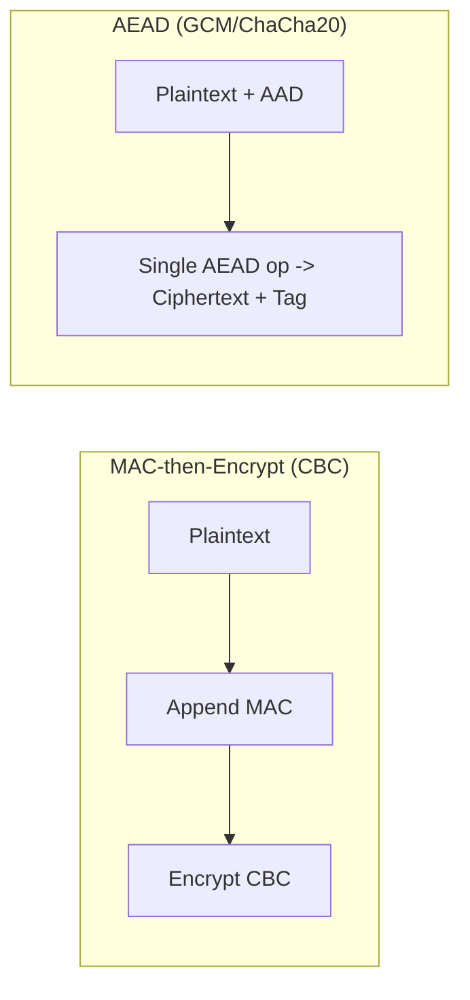
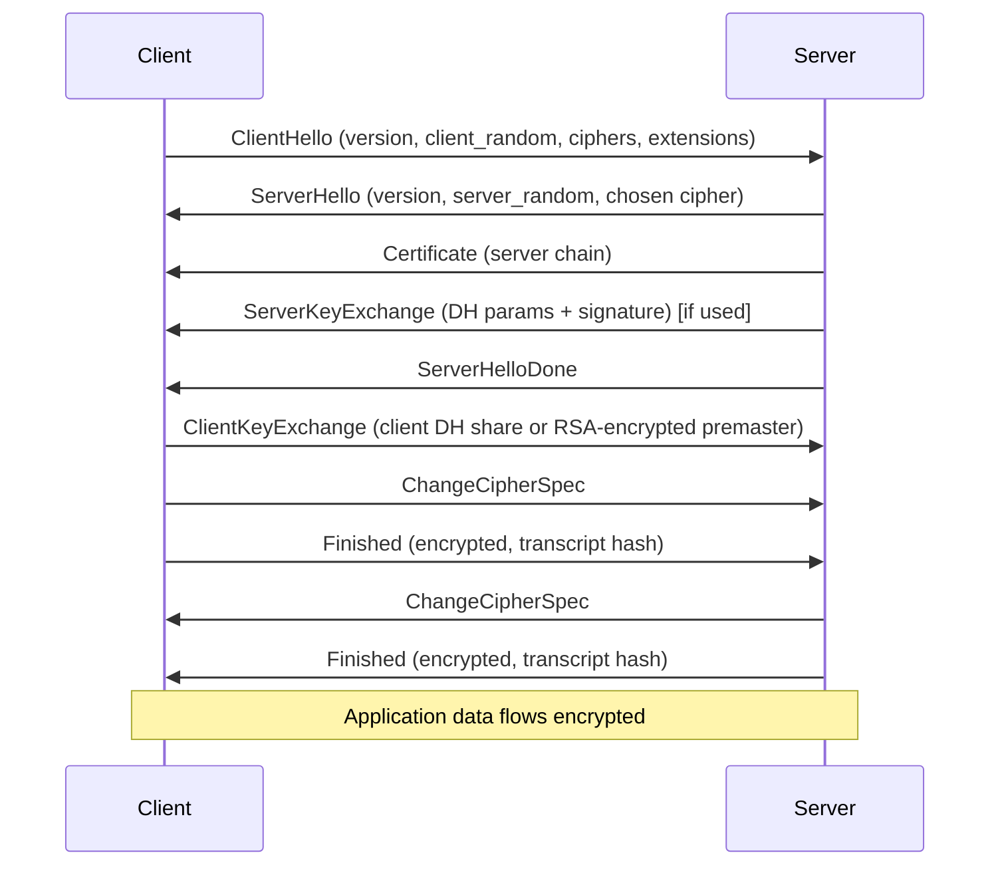

# The TLS Record Layer and the TLS 1.2 Handshake

## 1. Why This Chapter Exists

The previous chapter established what TLS promises and why the protocol kept being redesigned. This chapter opens the box and shows how those promises are actually manufactured on the wire, using TLS 1.2 as the reference because it is still the most widely deployed version and because its structure makes the individual mechanisms visible. TLS 1.3 hides more of the handshake and removes entire categories of negotiation, which makes it a poor teaching baseline for first principles.

Two things must be understood separately and then connected. The **record layer** is the framing and protection machinery that runs for the entire life of the connection, encrypting and authenticating every byte of application data. The **handshake** is the setup phase that negotiates parameters, authenticates the server, and installs the keys that the record layer will use. Keeping these distinct prevents a common confusion: the record layer does the ongoing work, and the handshake only configures it.

Understanding TLS 1.2 in detail is not nostalgia. A very large fraction of production traffic, especially in regulated and legacy environments, still negotiates TLS 1.2, and many of its failure modes (CBC padding, MAC-then-Encrypt side channels, incomplete certificate chains) survive precisely because 1.2 permits them. Knowing exactly where 1.2 is dangerous is what justifies the 1.3 redesign.

---

## 2. The Record Layer: Framing and Protection

### 2.1 The Record Structure

Application data is not handed to the network as an unbounded stream. TLS segments it into **records**, each carrying a small header followed by protected payload.

```text
struct {
    ContentType type;        // 1 byte  (handshake, alert, change_cipher_spec, application_data)
    ProtocolVersion version; // 2 bytes (the record's protocol version)
    uint16 length;           // 2 bytes (length of the following fragment, max)
    opaque fragment[length];
} TLSPlaintext;
```

The **content type** tells the receiver how to interpret the fragment. `application_data` is the actual payload the application asked to send. `handshake` carries handshake messages. `alert` carries warnings and fatal errors. `change_cipher_spec` is a legacy compatibility artifact used during the handshake to signal "from here on, records are encrypted."

The **length** caps the fragment size, typically 16 KB, which bounds per-record memory and processing and forces the record layer to split large writes into multiple records. This matters operationally: a single application write of one megabyte becomes roughly sixty-four records, each independently authenticated, and the cost of authentication scales with the number of records, not just the number of bytes.

### 2.2 Protection in TLS 1.2: MAC-then-Encrypt

TLS 1.2 offers two families of record protection. The first and historically dominant one is **MAC-then-Encrypt (MtE)** with a block cipher in CBC mode. The construction proceeds in a specific order:

First, the sender computes a **Message Authentication Code (MAC)** over the record content, the sequence number, the content type, and the length, using a shared MAC key and a hash function such as HMAC-SHA256. The sequence number is included so that records cannot be reordered or replayed and so that truncation is detected. Next, the sender appends the MAC to the plaintext. Then the sender encrypts the concatenation (plaintext plus MAC) with a block cipher in CBC mode, using an explicit or derived initialization vector. On the receiving side the process is reversed: decrypt, then verify the MAC.

The critical property of MtE is that **decryption happens before authentication can be completed**, because the MAC is inside the ciphertext. This is the structural weakness that produced Lucky13 and the padding-oracle family. If a receiver reveals, through timing or through distinct error messages, whether decryption padding was valid before the MAC is checked, an attacker can iteratively recover plaintext. The mitigation in TLS 1.2 is the "constant-time" processing guidance (encrypt-then-MAC alternative, uniform timing, uniform error), but the guidance is subtle and frequently implemented imperfectly. This is why TLS 1.3 abandoned MAC-then-Encrypt entirely.

### 2.3 Protection in TLS 1.2: AEAD

The second TLS 1.2 family is **AEAD** (Authenticated Encryption with Associated Data), such as AES-GCM or ChaCha20-Poly1305. Here the construction is fundamentally better. The AEAD primitive takes the plaintext, a nonce, and **associated data** (the record header and sequence number, which are authenticated but not encrypted), and produces ciphertext plus an authentication tag in a single operation. Decryption either returns correct plaintext or fails; there is no intermediate state that leaks padding validity. AEAD is the recommended mode in TLS 1.2 and the only mode in TLS 1.3.

The practical guidance for TLS 1.2 is therefore not just "use TLS 1.2" but "prefer AEAD cipher suites and avoid CBC." A deployment that negotiates `TLS_RSA_WITH_AES_128_CBC_SHA` is technically TLS 1.2 and simultaneously carries the entire historical side-channel surface.



#### In-Line Glossary: Nonce

**What it is:** a number used once per encryption operation under a given key, required by AEAD modes to guarantee that the same key never encrypts two different plaintexts with the same nonce.

**Why here:** TLS derives the nonce from the record sequence number and secret, so it is implicit and never sent, which saves bytes and removes a class of misuse.

**Systemic implication:** nonce reuse in GCM catastrophically breaks confidentiality and integrity; the record layer's deterministic nonce derivation is a deliberate safeguard against implementer error.

---

## 3. The TLS 1.2 Handshake: Negotiating and Authenticating

The handshake must accomplish several things at once: agree on a protocol version, agree on a cipher suite, authenticate the server (and optionally the client), and derive a shared secret from which all keys are produced. In TLS 1.2 over TCP it also determines how many round trips are needed, which is a direct latency cost.

### 3.1 The Full Handshake Messages

The handshake is a sequence of typed messages. The important ones are:

`ClientHello` is the client's opening bid. It contains the highest protocol version the client supports, a random 32-byte **client random**, the list of cipher suites the client offers in preference order, the list of compression methods, and a set of **extensions** (Server Name Indication, supported groups, signature algorithms, and more).

`ServerHello` is the server's response. It selects one version (at most the client's maximum), chooses one cipher suite from the client's list, and contributes a 32-byte **server random**.

`Certificate` carries the server's X.509 certificate chain so the client can authenticate the server's identity and public key.

`ServerKeyExchange` is present when the key exchange requires server-provided parameters, such as an ephemeral Diffie-Hellman public value and its signature. It is absent when RSA key transport is used, because the client can generate the premaster secret itself and encrypt it to the server's RSA key.

`ServerHelloDone` signals that the server has finished its part of the negotiation.

`ClientKeyExchange` carries the client's contribution: either an encrypted premaster secret (RSA transport) or the client's Diffie-Hellman public value.

`ChangeCipherSpec` is a one-byte legacy record signaling that the sender will now send encrypted records. It is not a handshake message but a separate content type, and it survives in TLS 1.3 only for middlebox compatibility.

`Finished` is the first authenticated message under the new keys. It contains a hash of the entire handshake transcript, so both sides can confirm that nothing on the wire was altered and that both computed identical keys.



### 3.2 Two Key Exchange Families

**RSA key transport** is the older approach. The client invents the premaster secret, encrypts it with the server's RSA public key from the certificate, and sends it in `ClientKeyExchange`. The server decrypts it and both derive session keys. This is simple but has a fatal property: the session secret is protected only by the server's long-term private key. If that key is ever stolen, every recorded session that used RSA transport can be decrypted retroactively. There is no forward secrecy. RSA key transport was removed in TLS 1.3.

**Ephemeral Diffie-Hellman (DHE or ECDHE)** is the forward-secret approach. The server generates a fresh ephemeral Diffie-Hellman key pair per handshake, sends the public value in `ServerKeyExchange` signed with its long-term key, and the client responds with its own ephemeral public value. Both compute the same shared secret from their ephemeral private values and the other's public value. Because the ephemeral private values are discarded after the handshake, stealing the long-term key later does not reveal the session key. The signature only authenticates the ephemeral value in the moment; it does not protect the session afterward. This is the mechanism behind forward secrecy. The next chapter covers the mathematics.

### 3.3 Key Derivation

Neither RSA transport nor Diffie-Hellman yields keys directly usable for bulk encryption. Both sides obtain a **premaster secret**, then run it through a **pseudorandom function (PRF)** keyed by the premaster secret, salted with the client and server randoms, to derive a **master secret**. From the master secret and the same randoms, the PRF derives the **key block**, which is partitioned into the client write MAC key, the server write MAC key, the client write encryption key, the server write encryption key, and the initial IVs. The client and server randoms are inputs explicitly so that two handshakes with the same premaster secret still produce different keys, which defends against replay across sessions. TLS 1.3 replaces this ad hoc PRF construction with a formal HKDF-based key schedule.

---

## 4. Session Resumption: Abbreviated Handshakes

A full handshake is expensive. TLS 1.2 provides two mechanisms to avoid repeating it.

**Session IDs** are issued by the server and cached locally. On reconnect the client presents the ID in `ClientHello`; if the server still has the corresponding state, it accepts and both sides jump straight to `Finished` using the cached master secret. The cost is server-side state, which does not scale cleanly across a fleet of load-balanced servers unless state is shared.

**Session tickets** (an extension, `RFC 5077`) solve the state problem differently. The server encrypts the session state into a **ticket** and sends it to the client, who stores it and presents it on reconnect. The server decrypts the ticket to recover state without keeping per-session memory. This scales, but it introduces a new secret: the ticket encryption key. If that key is static and compromised, past tickets can be decrypted; therefore ticket keys must be rotated, and rotating them invalidates outstanding tickets, which is an availability consideration during rotation windows.

Both mechanisms are a performance-versus-security trade. Resumption reuses a master secret, so it does not provide fresh forward secrecy for the resumed session in TLS 1.2 the way a fresh ephemeral exchange does. TLS 1.3 improves this with a PSK handshake bound to fresh key material.

#### In-Line Glossary: Session Ticket

**What it is:** a server-encrypted blob of session state that the client stores and returns on reconnect, letting the server resume without keeping per-session memory.

**Why here:** tickets convert resumption state from a server-side scaling problem into a key-management problem, which changes how a fleet must operate.

**Systemic implication:** the ticket encryption key is a high-value secret; it must be shared uniformly across the fleet and rotated, and rotation invalidates outstanding tickets, creating a recurring availability risk that must be monitored.

---

## 5. Invariants, Assumptions, and Boundaries

**Invariant: the handshake transcript hash in `Finished` must match.** This single check binds every prior message. If an attacker edits the cipher suite list, swaps a certificate, or changes the Diffie-Hellman value, the transcript differs and `Finished` verification fails. This is the integrity mechanism for the negotiation itself.

**Invariant: sequence numbers are authenticated but not transmitted.** Because both sides track record sequence numbers implicitly and feed them into the MAC or AEAD associated data, reordering, dropping, replaying, or inserting records is detected without spending bytes on the wire. Truncation attacks that cut a stream mid-connection are detected because the final record's integrity depends on its sequence.

**Assumption: the record layer's keys are only installed after the handshake authenticates.** Before `ChangeCipherSpec`, records are in the clear (the handshake), and after it they are keyed. Getting this ordering wrong in an implementation is catastrophic, which is why TLS libraries centralize it.

**Boundary: the record layer cannot protect metadata.** The record header, the packet sizes, the timing, and the endpoints' IP addresses remain visible to a network observer even with perfect encryption. Traffic-analysis defenses are a separate and largely unsolved problem; TLS confines its guarantee to content and integrity, not to the existence or shape of the conversation.

**Boundary: TLS 1.2 leaves several negotiable hazards.** Whether the connection is forward-secret, whether it uses AEAD, whether it allows weak curves, and whether it permits compression all depend on negotiation and configuration, not on the version number alone. This negotiability is exactly what TLS 1.3 removed.

---

## 6. Trade-offs and Rejected Alternatives

**Why not always use the full handshake?** Because the round trips are real user-visible latency, and at scale the CPU cost of asymmetric operations is significant. Resumption is the accepted optimization. The rejected extreme, "resume everything forever," destroys forward secrecy and creates long-lived shared secrets; the modern balance is short-lived tickets with rotation plus TLS 1.3's forward-secret PSK mode.

**Why MAC-then-Encrypt existed at all.** Encrypt-then-MAC is cryptographically cleaner, but TLS 1.2's design predates the broad adoption of AEAD and was shaped by the desire to support stream ciphers and CBC in one framework. The rejected alternative, requiring AEAD from the start, would have excluded then-common hardware and ciphers. The cost of that historical flexibility is the padding-oracle attack class, which is why the cleaner design eventually won in 1.3.

**Why keep `ChangeCipherSpec` and renegotiation compatibility.** Purely for deployment and middlebox compatibility. These are examples of protocol ossification forcing the retention of mechanisms that serve no modern security purpose. The trade is safety for interoperability, and TLS 1.3 minimizes the concession to a compatibility no-op.

---

## 7. Failure Modes and Operational Consequences

**CBC and MAC-then-Encrypt in production.** A TLS 1.2 endpoint that still offers CBC suites exposes the Lucky13/BEAST/POODLE surface. The failure usually appears as a compliance finding or a research advisory rather than a live break, which makes it easy to deprioritize. Operational consequence: cipher-suite policy must be explicit and audited; "TLS 1.2 enabled" is not a sufficient statement of security posture.

**Session ticket key sprawl.** If multiple servers generate their own ticket keys, a client that resumes against a different server may fail. If keys are never rotated, compromise exposes past sessions. Operational consequence: ticket keys must be distributed uniformly across the fleet and rotated on a schedule, with monitoring for resumption failures during rotation.

**Record-size and CPU amplification.** Because authentication cost scales with record count, a peer sending many tiny records can impose more per-byte CPU than one sending full records. This is a consideration in rate limiting and in sizing. Operational consequence: capacity models should account for record shape, not only throughput.

**Incomplete chains and wrong ciphers misdiagnosed.** A `handshake_failure` alert can mean no shared cipher suite, while a certificate alert means a trust problem. Conflating them wastes incident time. Operational consequence: alert decoding and per-connection negotiated-parameter logging are first-class observability requirements, detailed in the hardening chapter.

---

## 8. External References

- [RFC 5246: The Transport Layer Security (TLS) Protocol Version 1.2](https://www.rfc-editor.org/rfc/rfc5246)
- [RFC 8446: The Transport Layer Security (TLS) Protocol Version 1.3](https://www.rfc-editor.org/rfc/rfc8446)
- [RFC 5077: Transport Layer Security (TLS) Session Resumption without Server-Side State](https://www.rfc-editor.org/rfc/rfc5077)
- [RFC 5746: Transport Layer Security (TLS) Renegotiation Indication Extension](https://www.rfc-editor.org/rfc/rfc5746)
- [RFC 7525: Recommendations for Secure Use of TLS and DTLS (BCP 195)](https://www.rfc-editor.org/rfc/rfc7525)
- [TLS 1.3: The Cryptographic Redesign](./03-tls-1-3-cryptographic-redesign.md)
