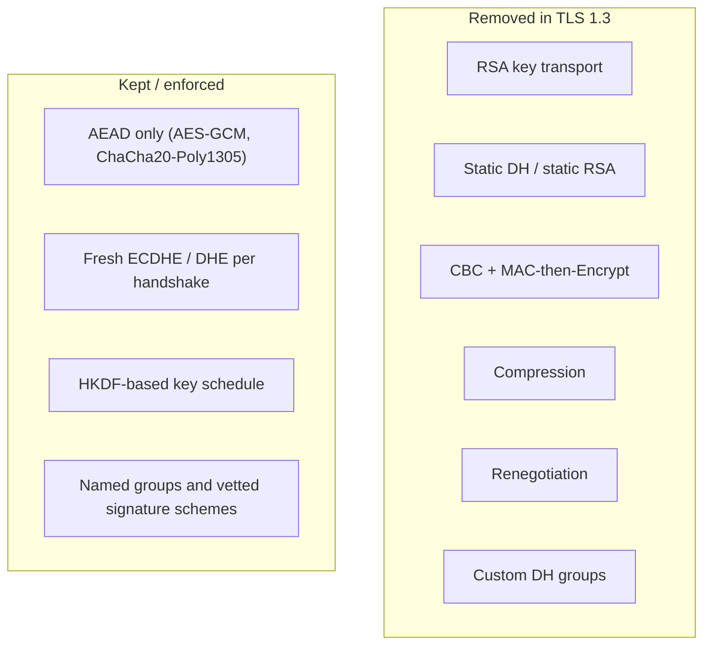
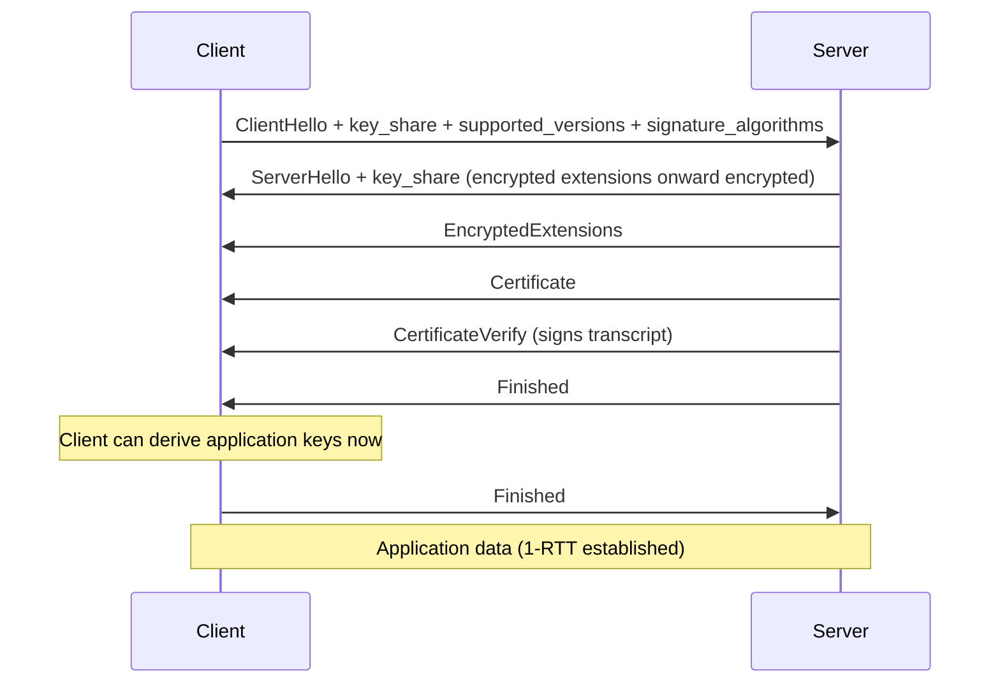
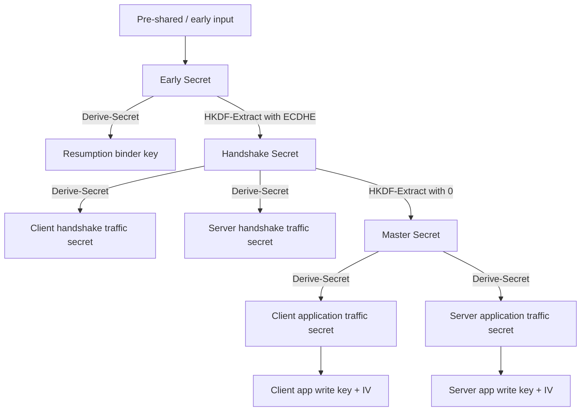

# TLS 1.3: The Cryptographic Redesign

## 1. Why This Chapter Exists

TLS 1.3 is not an incremental update to TLS 1.2. It is a redesign that removes dangerous options, shortens the handshake, formalizes key derivation, and closes downgrade and replay paths that 1.2 left open. Understanding 1.3 requires holding two ideas at once: it is simpler on the wire, and it is stricter in what it allows. The simplicity comes from deletion, not from adding new magic.

This chapter explains the mechanisms that make 1.3 different, why each removal was necessary, and what the new costs are. It is the bridge between the 1.2 baseline of the previous chapter and the operational hardening and mutual-authentication chapters that follow, both of which assume 1.3 features such as the formal key schedule and mandatory forward secrecy.

The central engineering insight of TLS 1.3 is that **optionality is itself a vulnerability**. Every legacy feature that a peer is allowed to negotiate is a knob an attacker can try to turn. Removing RSA key transport, static Diffie-Hellman, CBC ciphers, compression, and renegotiation eliminated whole categories of attack and made the remaining surface small enough to analyze formally.

---

## 2. What Was Removed and Why

Each deletion targets a specific class of attack established in the history chapter.

**RSA key transport** was removed because it is not forward-secret and is vulnerable to Bleichenbacher-style padding-oracle attacks when the server's decryption behavior leaks. Its removal eliminates the entire "recover session secret by attacking the server's RSA decryption" family and makes forward secrecy mandatory rather than optional.

**Static Diffie-Hellman and static RSA** were removed for the same reason: they reuse long-term key material for the session secret, defeating forward secrecy.

**CBC-mode ciphers** were removed because they were the substrate for POODLE, BEAST, and Lucky13. TLS 1.3 permits only AEAD constructions, so there is no padding to attack and no MAC-then-Encrypt ordering to get wrong.

**MAC-then-Encrypt** was removed in favor of AEAD's single integrity-plus-confidentiality operation.

**Compression** was removed because of CRIME.

**Renegotiation** was removed because of the Triple Handshake and its relatives.

**Custom Diffie-Hellman groups and arbitrary parameters** were removed; only named, vetted groups are allowed. This closes the Logjam-style path of negotiating weak parameters.

The pattern is consistent: every removed feature had produced a real attack. The rejected alternative, "keep them but warn," was rejected because warnings do not change negotiation in an adversarial network.

---

## 3. The TLS 1.3 Handshake: One Round Trip and Encrypted Negotiation

### 3.1 The 1-RTT Flow

The full TLS 1.3 handshake completes in a single round trip for the key material, compared to two in TLS 1.2. The client guesses the server's key-exchange group and sends its ephemeral share in the first message, saving a round trip in the common case. If the guess is wrong, the server sends a `HelloRetryRequest` and the client retries, adding a round trip, but this is rare.

The differences from 1.2 are structural. There is no `ServerKeyExchange` because the key share is already in `ServerHello`. There is no `ChangeCipherSpec` in the protocol proper (a dummy record may be sent only for middlebox compatibility). The `ServerHello` carries the server's ephemeral `key_share`, and everything after it is encrypted under handshake keys derived immediately, so the server's certificate is no longer exposed to a passive observer.

### 3.2 Encrypted Everything After Hello

In TLS 1.2 the server's certificate and much of the negotiation were sent in the clear, visible to any passive observer. In TLS 1.3, once `ServerHello` is sent, both sides derive a **handshake traffic secret** and encrypt all remaining handshake messages. This means a passive observer can no longer see which certificate the server presented or which extensions were agreed. The trade-off is increased complexity in the handshake state machine, because the handshake is now encrypted with keys that continue to evolve. The benefit is metadata and privacy protection, and resistance to ossification by middleboxes that cannot inspect what they cannot parse.

### 3.3 Authentication via CertificateVerify

Because the handshake transcript is encrypted, the server's proof of possession of its private key is separated from the certificate itself. The server sends its `Certificate`, then a `CertificateVerify` message containing a signature over the current transcript hash using the private key corresponding to the certificate's public key. The client verifies both that the certificate chains to a trusted root and that the signature validates against the transcript. Splitting identity (certificate) from proof (signature) is cleaner and enables certificate-based client authentication symmetrically, which the mTLS chapter builds on.

---

## 4. The Key Schedule: Formal Derivation with HKDF

TLS 1.3 replaces the ad hoc TLS 1.2 PRF with a formal **key schedule** built on **HKDF** (HMAC-based Key Derivation Function). HKDF has two phases: `HKDF-Extract`, which condenses a source of key material and a salt into a fixed-length pseudorandom key, and `HKDF-Expand`, which stretches that key into as many output bytes as needed, labeled so that different uses produce independent outputs.

The TLS 1.3 schedule begins with `HKDF-Extract` over a zero salt and the shared ECDHE secret to produce the **early secret**-derived chain, then extracts again with the handshake secret, then again with the master secret. At each level, `HKDF-Expand-Label` derives **traffic secrets** for specific directions and phases: client handshake traffic, server handshake traffic, client application traffic, server application traffic, and exporter keys.

The formalization has several consequences. First, **separation of secrets is provable**: each key is derived with a distinct label, so a flaw in one usage cannot trivially expose another. Second, **the key schedule is a single point to audit**; it is small enough to be specified, reviewed, and verified once, instead of being reimplemented inconsistently. Third, **resumption and PSK share the same schedule**, so resumption is not a special cryptographic path but a different input to the same machinery.

#### In-Line Glossary: HKDF

**What it is:** a two-step key derivation function standardized in `RFC 5869` that extracts entropy into a pseudorandom key and then expands it into labeled outputs.

**Why here:** it gives TLS 1.3 a clean, auditable way to derive many independent keys from one shared secret.

**Systemic implication:** because labels separate outputs, the same master secret safely produces encryption keys, IVs, and exporter material without cross-contamination, which removes an entire class of key-reuse mistakes.

---

## 5. Zero Round Trip (0-RTT) and Its Risks

TLS 1.3 supports an optional **0-RTT** mode in which a client that has previously connected sends application data in its very first flight, encrypted under a pre-shared key derived from a prior session. This is attractive for latency-sensitive workloads because it removes even the single round trip of the full handshake.

The security cost is severe and must be stated plainly. 0-RTT data is not forward-secret in the same way, because it is keyed by a secret derived from the previous session. More importantly, 0-RTT data is **replayable**: an attacker who captures the early data flight can resend it, and unless the server tracks state or the application is idempotent, the replayed request executes again. This is a genuine weakness of 0-RTT as a protocol; the mitigation is at the application and deployment level, not in the cryptography.

The operational guidance is therefore restrictive. Use 0-RTT only for idempotent requests where replay is harmless, typically `GET` or clearly idempotent APIs, and never for state-changing operations such as payments. Servers should reject 0-RTT for non-idempotent methods, and should limit how long early data is accepted, since accepting stale early data broadens the replay and forward-secrecy exposure. The rejected alternative, "enable 0-RTT everywhere for speed," trades a real security property for sub-round-trip latency and is almost never worth it for sensitive operations.

#### In-Line Glossary: 0-RTT

**What it is:** a TLS 1.3 mode where a reconnecting client sends application data in its first flight, encrypted under a pre-shared key from a prior session.

**Why here:** it removes a round trip of latency but is replayable and not forward-secret, so its safety depends on application semantics rather than on cryptography.

**Systemic implication:** opting into 0-RTT moves a security obligation into every application, so it must be gated to idempotent operations and bounded in acceptance time rather than enabled globally.

---

## 6. Downgrade Protection and Version Negotiation

TLS 1.3 negotiates versions using the `supported_versions` extension rather than the legacy version field, and it binds the negotiation into the transcript. If a server supports 1.3 but a middlebox strips the extension to force 1.2, the client can detect it: the server, seeing the downgraded hello, includes a special value in its server random that signals "I actually support 1.3." A client that offered 1.3 and receives this marker knows an attacker intervened and aborts. This is a direct, protocol-level answer to the downgrade attacks that plagued earlier versions.

This binding is why the phrase "TLS 1.3 is a redesign" is accurate: it turns a hopeful negotiation into a tamper-evident one.

---

## 7. Invariants, Assumptions, and Boundaries

**Invariant: only AEAD and only named groups.** Because the cipher menu is tiny, there is no weak option to negotiate into. This removes configuration-dependent security, which was a major source of real-world weaknesses in 1.2.

**Invariant: forward secrecy is always present for fresh handshakes.** The ECDHE exchange happens in every full handshake, so there is no non-forward-secret mode to accidentally select.

**Invariant: the transcript binds everything, including version negotiation.** Any in-flight modification fails at `Finished` or at `CertificateVerify`.

**Assumption: the client correctly handles `HelloRetryRequest`.** A client that mishandles the retry can fall back to a weaker group or fail incorrectly; this is implementation territory, not protocol design.

**Boundary: 0-RTT weakens replay and forward-secrecy guarantees by design.** It is not a flaw to be "fixed" but a documented trade that must be gated by application semantics.

**Boundary: middlebox compatibility shims exist.** Dummy `ChangeCipherSpec` records and legacy fields may still appear to satisfy broken middleboxes, so a packet capture can look more like 1.2 than the actual negotiation warrants. Interpretation requires care.

---

## 8. Trade-offs and Rejected Alternatives

**Why encrypt the handshake and lose observability?** Passive network monitors previously used certificates and extensions for troubleshooting and for some network security functions. TLS 1.3 hides them, which is a deliberate privacy and ossification-resistance choice. The cost is that troubleshooting now requires endpoint-side logging, keys exported to a monitor, or in-network termination. This is a recurring theme: modern transport security pushes observability to the endpoints.

**Why remove so much and risk compatibility?** Because the removed features were attack vectors, and the compatibility cost is bounded and temporary as clients upgrade. The rejected alternative, retaining optional weak modes for compatibility, is precisely what enabled the attack history of the previous chapter.

**Why not make 0-RTT the default?** Because replayability is fundamental to stateless early data, and the correctness burden falls on every application. Defaulting to it would push a subtle security requirement onto teams that may not realize it. The safe default is full 1-RTT, with 0-RTT opted into deliberately.

---

## 9. Failure Modes and Operational Consequences

**0-RTT replay in the wild.** An application enables early data for all methods and a retried request causes a duplicate charge or duplicate write. The failure is application-visible and hard to attribute to TLS. Operational consequence: enforce idempotency at the application layer and explicitly disable 0-RTT for mutating methods.

**HelloRetryRequest storms.** If clients routinely guess a group the server rejects, the handshake adds a round trip, silently negating the latency benefit of 1.3. This is often a configuration mismatch between client and server preferred groups. Operational consequence: align preferred groups and monitor for retry rates.

**Observability gaps.** After upgrading to 1.3, existing passive monitors see less and dashboards based on certificate fields break. Operational consequence: plan observability migration alongside the protocol upgrade; use endpoint telemetry, exported key material for authorized inspection, or service-side logs of negotiated parameters.

**Resumption key management.** TLS 1.3 PSK resumption still depends on ticket keys, and single-use tickets can fail under load balancers that do not share ticket key material. Operational consequence: distribute and rotate ticket keys uniformly, and monitor resumption success rates.

**False confidence from the version number.** "We run TLS 1.3" does not guarantee correct certificate validation, correct 0-RTT policy, or correct key management. The version is the floor, not the whole posture.

---

## 10. External References

- [RFC 8446: The Transport Layer Security (TLS) Protocol Version 1.3](https://www.rfc-editor.org/rfc/rfc8446)
- [RFC 5869: HMAC-based Extract-and-Expand Key Derivation Function (HKDF)](https://www.rfc-editor.org/rfc/rfc5869)
- [RFC 7301: TLS Application-Layer Protocol Negotiation (ALPN) Extension](https://www.rfc-editor.org/rfc/rfc7301)
- [RFC 7525: Recommendations for Secure Use of TLS and DTLS (BCP 195)](https://www.rfc-editor.org/rfc/rfc7525)
- [The TLS Record Layer and the TLS 1.2 Handshake](./02-record-layer-and-tls-1-2-handshake.md)
- [DTLS: TLS Over Datagram Transport](./04-dtls-tls-over-datagram-transport.md)
