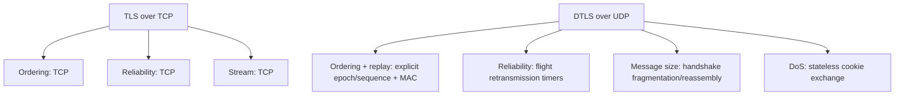
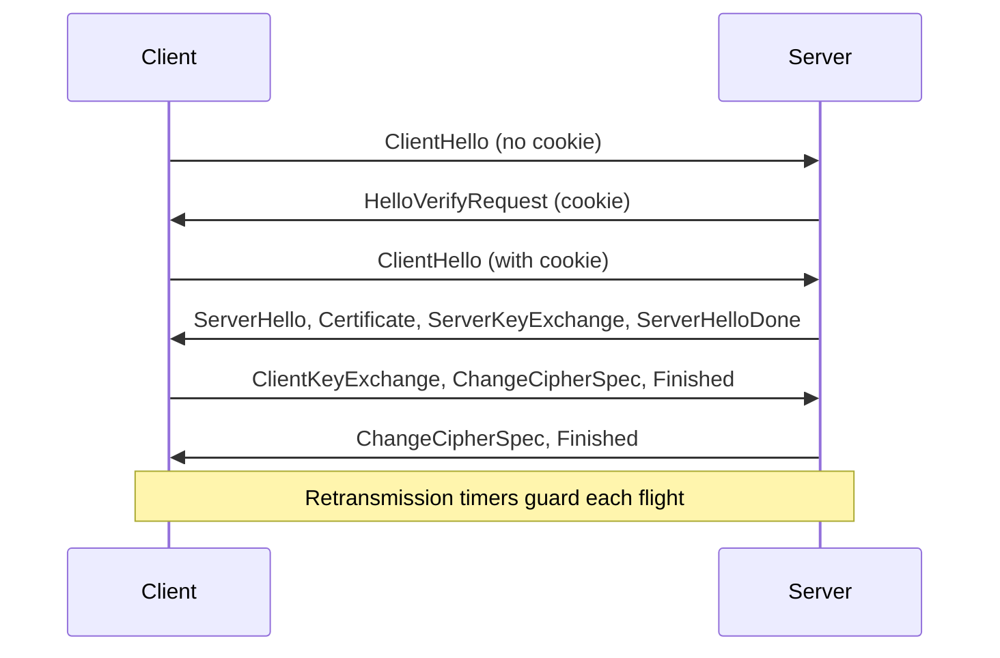

# DTLS: TLS Over Datagram Transport

## 1. Why This Chapter Exists

Everything in the previous chapters assumed a reliable, ordered byte stream, almost always TCP. That assumption is load-bearing: it is why TLS can number records implicitly, ignore network reordering, and define a stream record layer without sequence-gap logic. But a large and growing class of applications cannot use TCP at all. Real-time voice and video, WebRTC data channels, some VPNs, CoAP-based IoT fleets, and gaming traffic all run over UDP, where datagrams can be lost, duplicated, reordered, or delivered after a large delay.

DTLS (Datagram Transport Layer Security) is TLS adapted to that environment. It provides the same four goals as TLS (confidentiality, integrity, authentication, forward secrecy) but must solve additional problems that TCP previously solved for free. This chapter explains which invariants break, what DTLS adds to compensate, how the handshake and record layer change, and where the trade-offs of running security over an unreliable transport appear in production.

The chapter is essential for architects working on real-time media, edge and IoT, and modern VPN or mesh transports, because DTLS is where the "just use TLS" mental model stops working and explicit reasoning about loss, retransmission, and replay becomes mandatory.

---

## 2. What Breaks When You Remove TCP

TCP provides several guarantees that TLS silently relied upon. Removing TCP removes all of them at once.

**Ordering** is gone. Datagrams can arrive out of order, so an implicit sequence number that both sides increment does not identify the same record. A late datagram can be mis-associated with the wrong record position.

**Reliability** is gone. Datagrams can be lost without notification. A handshake flight that is lost will never be retransmitted by the transport, so DTLS must retransmit messages itself.

**Message boundaries exist.** Unlike a byte stream, UDP preserves message boundaries, and datagrams have a maximum size (roughly the path MTU). A handshake message larger than one datagram must be fragmented and reassembled, a concern that does not arise over TCP because the stream carries arbitrarily large messages.

**Duplication and replay are possible.** The network can deliver the same datagram twice, and an attacker can replay captured datagrams. TLS's implicit sequence mechanism detects these; DTLS must add explicit, authenticated counters.

The compensating mechanisms in DTLS map one-to-one to these losses: explicit epoch and sequence numbers for ordering and replay, a retransmission timer and flight-based acknowledgement for reliability, handshake fragmentation and reassembly for message size, and a stateless cookie exchange for denial-of-service resistance.



---

## 3. The DTLS Record Layer

DTLS keeps the TLS record concept but changes the header to carry explicit sequencing and an epoch.

```text
struct {
    ContentType type;         // handshake, alert, change_cipher_spec, application_data
    ProtocolVersion version;  // DTLS version (e.g. DTLS 1.2, DTLS 1.3)
    uint16 epoch;             // key generation; increments on key change (e.g. after CCS)
    uint48 sequence_number;   // explicit per-epoch sequence
    uint16 length;            // fragment length
    opaque fragment[length];
} DTLSPlaintext;
```

The **epoch** is a key-generation counter. It increments each time the cipher state changes (for example after a `ChangeCipherSpec`), and it ensures that records encrypted under different keys cannot be confused or replayed across key changes. The **sequence number** is explicit and 48 bits wide, large enough that it will not wrap within any realistic session, and it is authenticated as associated data. Because the sequence is now on the wire rather than implicit, the receiver can detect duplicates, replays, and reordering directly.

### 3.1 Replay Detection

Replay protection uses a sliding window, not just a high-water mark. A window (typically 64 records) tracks which recent sequence numbers have been received. A record whose sequence has already been seen inside the window is dropped as a replay; a record older than the window is dropped as too old. This is necessary because on an unreliable network, legitimate records can arrive out of order, so the receiver cannot simply reject anything below the highest seen sequence. The window trades memory for tolerance of legitimate reordering while still rejecting replays.

### 3.2 The MAC Covers the Header

In DTLS the MAC or AEAD associated data includes the epoch and sequence number explicitly, not just the content and length. This binds the sequence number to the ciphertext, so an attacker cannot rewrite a sequence number to make a record look new or to reorder records without detection. This is a direct response to the loss of TCP's implicit ordering: the sequencing now lives in the protocol and is cryptographically protected.

---

## 4. The DTLS Handshake

### 4.1 Cookies and the Stateless HelloVerifyRequest

A server exposed on UDP is especially vulnerable to amplification and spoofed-source denial of service, because UDP has no handshake and source addresses are trivially spoofable. If the server allocated expensive handshake state on receiving a `ClientHello`, an attacker could exhaust memory with a small number of spoofed bytes.

DTLS solves this with a **stateless cookie exchange**. The server does not proceed to a full handshake on the first `ClientHello`. Instead it responds with a `HelloVerifyRequest` containing a cookie: a value computed by the server (typically a keyed hash of the client's address and a rotating secret) but with no per-client state stored. The client must echo the cookie in a second `ClientHello`. Only if the cookie verifies—which requires the client to actually receive the response at the claimed address—does the server allocate handshake state. This proves address reachability and blunts spoofed-source floods, at the cost of one additional round trip before the handshake proper begins.

#### In-Line Glossary: Amplification Attack

**What it is:** an attack where a small spoofed request triggers a large response sent to the victim, so the attacker uses a server to multiply traffic toward a target.

**Why here:** UDP servers are prime amplification reflectors, and DTLS's cookie exchange ensures the server only responds heavily to verified clients.

**Systemic implication:** DTLS deployments should also limit response sizes and rate-limit cookie generation, because cookies reduce but do not eliminate reflection risk.

### 4.2 Message Fragmentation and Reassembly

A handshake message in TLS can be arbitrarily large (a certificate chain can easily exceed a datagram). In DTLS, handshake messages are carried in a handshake header that includes a `message_seq` (to order handshake messages independently of record sequence), a fragment offset, and a fragment length. A large message is split across multiple records, and the receiver reassembles fragments by offset before processing.

Reassembly has security and resource implications. An attacker can send fragments that never complete, forcing the receiver to hold partial state. Implementations limit the number and total size of outstanding fragmented messages, and they impose timeouts. This is a resource-exhaustion surface unique to the datagram setting.

### 4.3 Flights and Retransmission

Handshake messages are grouped into **flights**: the client's messages form flights, and the server's form flights. Because the transport does not retransmit, DTLS adds its own timers. When a flight is sent, each side starts a retransmission timer. If the expected next-flight message does not arrive before the timer fires, the whole last flight is retransmitted (DTLS retransmits flights, not individual messages, and the receiving side deduplicates). The timer uses exponential backoff to avoid flooding a congested or lossy path.

The choice of retransmission parameters is an operational trade-off. Too aggressive and DTLS adds load and self-inflicted loss under congestion; too conservative and connections appear to hang on a lossy path. On the public internet, loss can spike; on a clean data-center fabric, retransmission should be rare. This is why DTLS tuning is workload- and network-specific rather than a single universal setting.



---

## 5. DTLS 1.2 Versus DTLS 1.3

DTLS 1.2 mirrors TLS 1.2 and therefore inherits its historical hazards: it can negotiate CBC and MAC-then-Encrypt, and it can lack forward secrecy if RSA transport is used. The practical guidance is the same as for TLS 1.2: prefer AEAD suites and ECDHE, and avoid CBC.

DTLS 1.3 tracks TLS 1.3 and inherits its improvements: AEAD-only, mandatory forward secrecy, the HKDF key schedule, fewer round trips, and encrypted handshake after the hello. It also addresses a datagram-specific problem that DTLS 1.2 handled awkwardly: **connection identifiers (CIDs)**.

Without a CID, a DTLS session is identified by the client's source address and port. If a client roams (changes network, as mobile devices constantly do) or a NAT rebinding changes the observed source port, the server sees a different address and treats the datagrams as a new or unknown session, breaking the connection. CIDs let the endpoints agree on a stable identifier carried in the record, so the session survives address changes. This is essential for mobile WebRTC and multi-homed clients. The cost is a few bytes per record and additional state, and the requirement that CIDs be coordinated during the handshake.

Another 1.3 datagram adaptation concerns the `ServerHello` and ACK handling: DTLS 1.3 introduces explicit record acknowledgements to reduce needless retransmission, because it can acknowledge at the record level rather than blindly retransmitting whole flights as 1.2 does.

#### In-Line Glossary: Connection ID (CID)

**What it is:** a stable session identifier carried in DTLS records that is independent of the client's source address and port.

**Why here:** without a CID a session is bound to a transport address, so roaming across networks or NAT rebinding silently breaks the connection.

**Systemic implication:** CIDs make datagram security viable for mobile and multi-homed clients, at the cost of a few bytes per record and the need to negotiate the identifier during the handshake.

---

## 6. Where DTLS Is Used and Why It Fits

**WebRTC** uses DTLS to establish keys for Secure Real-time Transport Protocol (DTLS-SRTP). The media itself flows over SRTP, using keys exported from the DTLS handshake. DTLS fits because media is inherently real-time and loss-tolerant: a late video frame is useless, so transport-level retransmission of media would defeat the purpose. DTLS provides the key establishment and identity binding without imposing reliability on the media.

**CoAP over DTLS** secures constrained IoT devices. The datagram model matches constrained networks (lossy, low-power, UDP-only), and DTLS provides security without the overhead of TCP. DTLS 1.3 with CIDs is attractive here because IoT devices roam and are often behind NATs.

**VPNs** such as OpenConnect (AnyConnect-compatible) use DTLS as a UDP fast path in parallel with a TCP control channel, so interactive traffic avoids TCP-over-TCP meltdown. The datagram transport preserves the latency characteristics that a VPN needs.

**Gaming and custom real-time transports** use DTLS where they need authenticated, encrypted datagrams without TCP head-of-line blocking.

The common thread is that these applications value latency and tolerate loss, which is exactly the property that makes TCP's reliability inappropriate and DTLS's per-datagram security appropriate.

---

## 7. Invariants, Assumptions, and Boundaries

**Invariant: every record is individually authenticated with its epoch and sequence bound in.** This is what makes reordering, duplication, replay, and truncation detectable on an unreliable transport.

**Invariant: the cookie must verify before expensive state is allocated.** This preserves the server's availability under spoofed-source floods.

**Invariant: handshake messages are ordered by `message_seq`, independent of record sequence.** This decouples transport-level reordering from handshake-level ordering.

**Assumption: the application tolerates reordering and loss for its payload.** DTLS secures datagrams but does not make them reliable. An application that needs reliability on top of DTLS must implement it, and must not naively retransmit encrypted media as if it were TCP.

**Boundary: DTLS protects datagrams, not streams.** It cannot provide the ordered-stream semantics that applications built on TLS take for granted. Any adaptation is the application's responsibility.

**Boundary: loss and reordering interact with security differently than in TLS.** For example, dropping the final records of a stream is undetectable as truncation in a datagram context the way it is over an ordered stream, because there is no "next" record to expect. Applications must define their own completion semantics.

---

## 8. Trade-offs and Rejected Alternatives

**Why not just run TLS over UDP?** Because TLS's implicit sequencing and stream assumptions are incompatible with datagrams; it would mis-handle reordering and lack retransmission. DTLS is the principled adaptation, not a hack. The rejected alternative, layering TLS directly on UDP, would either silently corrupt state or require the application to fake reliability.

**Why not force everything onto TCP to use TLS?** For real-time media, TCP introduces head-of-line blocking: a single lost segment stalls all subsequent data until retransmission, which is directly harmful to latency-sensitive streams. This is the **TCP-over-TCP meltdown** problem when a reliable protocol is tunneled over another reliable protocol. The rejected alternative accepts latency and jitter that media cannot afford.

**Why accept the extra round trip for cookies?** Because the alternative—allocating state on unverified sources—makes the server trivially exploitable as an amplification and exhaustion vector. The round trip is a deliberate availability tax paid once per handshake.

**Why add CIDs in 1.3 despite the bytes?** Because without them, mobility and NAT rebinding break sessions, and mobile clients move constantly. The bytes are a small price for session continuity; the rejected alternative, address-and-port session identity, is simply unusable at mobile scale.

---

## 9. Failure Modes and Operational Consequences

**HTTP/3 confusion.** HTTP/3 runs over QUIC, which has its own integrated TLS 1.3 handshake and does not use DTLS. Teams sometimes assume "UDP + encryption means DTLS" and misconfigure. Operational consequence: distinguish QUIC (TLS integrated, reliable-by-QUIC) from DTLS (security over raw datagrams) when reasoning about a UDP encrypted flow.

**Retransmission storms on lossy paths.** If a path is very lossy, DTLS flight retransmission can amplify traffic and worsen congestion, especially with many clients retrying in sync. Operational consequence: tune retransmission and backoff, and monitor handshake failure rates as a function of path quality.

**Reassembly memory exhaustion.** Incomplete fragmented handshakes can consume memory. Operational consequence: cap outstanding fragments and set aggressive timeouts; monitor for partial-handshake buildup.

**CID mismatch and roaming breakage.** Deployments that omit CIDs see sessions drop whenever a client changes networks. Operational consequence: enable CIDs for mobile or multi-homed clients and verify the server supports them.

**Amplification exposure with large certificate chains.** A DTLS server that returns large handshake flights to spoofed sources is a reflector. Operational consequence: require cookie verification, cap flight sizes, and consider abbreviated certificates or session resumption to reduce response size.

**Nonce and epoch bugs in custom implementations.** Because sequencing is explicit, an implementation that forgets to authenticate the epoch or sequence reintroduces replay and reordering attacks. Operational consequence: use audited DTLS libraries rather than custom record handling, and treat the epoch/sequence handling as security-critical code.

---

## 10. External References

- [RFC 6347: Datagram Transport Layer Security Version 1.2](https://www.rfc-editor.org/rfc/rfc6347)
- [RFC 9147: The Datagram Transport Layer Security (DTLS) Protocol Version 1.3](https://www.rfc-editor.org/rfc/rfc9147)
- [RFC 5764: Datagram Transport Layer Security (DTLS) Extension to Establish Keys for SRTP](https://www.rfc-editor.org/rfc/rfc5764)
- [RFC 8446: The Transport Layer Security (TLS) Protocol Version 1.3](https://www.rfc-editor.org/rfc/rfc8446)
- [RFC 9000: QUIC: A UDP-Based Multiplexed and Secure Transport](https://www.rfc-editor.org/rfc/rfc9000)
- [TLS 1.3: The Cryptographic Redesign](./03-tls-1-3-cryptographic-redesign.md)
- [TLS and DTLS in Production: Hardening, Debugging, and Failure Modes](./08-tls-hardening-debugging-and-failure-modes.md)
