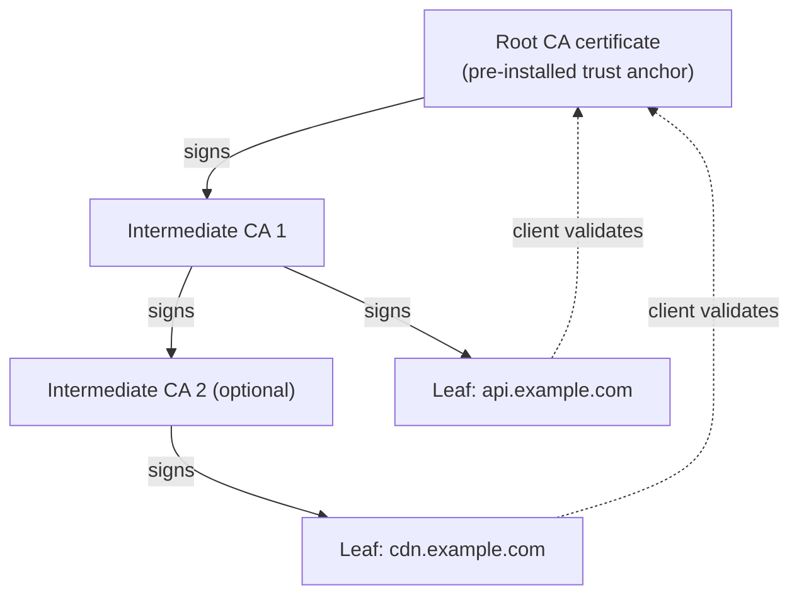
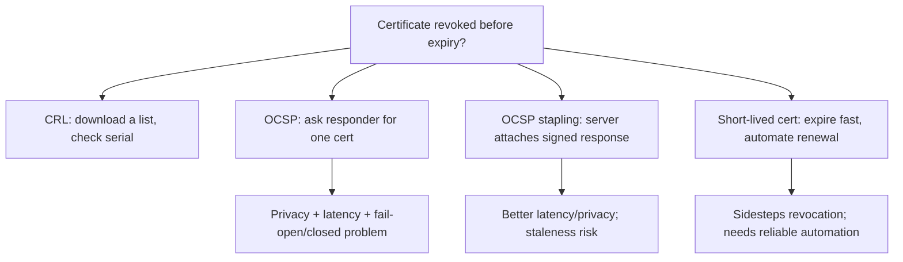

# PKI, X.509, and Certificate Trust Chains

## 1. Why This Chapter Exists

The handshake chapters showed that the server proves possession of a private key and presents a certificate, and the client decides whether to trust it. That decision—whether to trust—is the entire substance of authentication, and it depends on an infrastructure far larger than the TLS protocol itself: the Public Key Infrastructure (PKI), the X.509 certificate format, the chain of trust anchored in pre-installed root certificate authorities, and the mechanisms for revocation and transparency.

In real production incidents, the failures that actually wake people up are almost always certificate failures: an expired leaf, an incomplete chain, a hostname mismatch, a discontinued root, or a revoked intermediate. Cipher suites and protocol versions are important, but they are negotiated automatically; certificates are configured by humans and expire on their own schedule. This chapter explains the trust model precisely enough that an architect can design certificate lifecycle management, diagnose validation failures, and reason about the compromise of a certificate authority.

The chapter is also the foundation for mutual TLS. Once we understand how a client validates a server's certificate, extending the same logic to a server validating a client's certificate is a short step, both mechanically and architecturally.

---

## 2. The Trust Problem and Its Solution

A certificate is fundamentally a claim: "this public key belongs to this identity." The hard question is why a client should believe the claim. The client cannot independently know every server on the internet, and it cannot know the server's public key in advance. It needs a third party whose attestation both sides accept.

PKI solves this with **certification authorities (CAs)**. A CA is an entity whose public key is pre-installed in the client (in the operating system or browser trust store). The CA signs certificates, and its signature vouches that it verified the identity before issuing. Because the CA's public key is pre-installed, the client can verify the CA's signature without needing any prior relationship with the server. The server's identity is thereby delegated to the CA.

This model has a well-known structural property: it collapses trust. Any trusted CA can issue a certificate for any domain, and if a single CA is compromised or coerced, an attacker can obtain valid certificates for domains it does not own. This is why the ecosystem has layered defenses (intermediates, Certificate Transparency, pinning where appropriate), and why the trust store's contents are a security boundary in their own right.

---

## 3. The X.509 Certificate Format

An X.509 certificate is a structured, signed document. Understanding its key fields is necessary to diagnose validation failures.

```text
Certificate
├── tbsCertificate (the part that is signed)
│   ├── version            (v3 is universal today)
│   ├── serialNumber       (unique per issuer; used in revocation)
│   ├── signature          (algorithm identifier for the signature)
│   ├── issuer             (DSN of the issuing CA)
│   ├── validity           (notBefore, notAfter)
│   ├── subject            (DSN of the entity)
│   ├── subjectPublicKeyInfo  (algorithm + the public key)
│   ├── extensions         (v3 features)
│   │   ├── SubjectAlternativeName (SAN): hostnames/IPs
│   │   ├── KeyUsage / ExtendedKeyUsage
│   │   ├── BasicConstraints (CA:TRUE/FALSE, path length)
│   │   ├── AuthorityKeyIdentifier / SubjectKeyIdentifier
│   │   ├── CRLDistributionPoints
│   │   ├── AuthorityInfoAccess (OCSP URL)
│   │   └── SignedCertificateTimestampList (CT)
│   └── ...
└── signatureAlgorithm
└── signatureValue         (the CA's signature over tbsCertificate)
```

### 3.1 Subject, Issuer, and Distinguished Names

The **subject** names the entity the certificate describes, and the **issuer** names the CA that signed it. Both are **Distinguished Names (DNs)**: ordered sets of attributes such as Common Name (CN), Organization (O), and Country (C). A crucial and commonly misunderstood point is that **the Common Name is no longer used for hostname matching**. Modern clients match hostnames against the **Subject Alternative Name (SAN)** extension's `dNSName` entries. A certificate with the right CN but no matching SAN will fail validation in every modern browser and many libraries. This is the single most common cause of confusing "the certificate has the right name but it is rejected" incidents.

#### In-Line Glossary: Subject Alternative Name (SAN)

**What it is:** a v3 certificate extension listing the DNS names and IP addresses for which the certificate is valid.

**Why here:** it is the field modern clients match against the requested hostname, replacing the Common Name entirely.

**Systemic implication:** a certificate can be cryptographically valid, unexpired, and correctly issued, yet still fail every connection because the requested name is absent from the SAN; name coverage must be tested per name, not inferred from the subject.

### 3.2 Validity

The `notBefore` and `notAfter` fields bound the certificate's validity. Both are checked. A certificate that is not yet valid (clock skew, mis-issued future start) or expired fails validation. Expiry is not a warning in TLS; it is a hard failure. This is why automated renewal and expiry alerting are non-negotiable operational requirements, not nice-to-haves.

### 3.3 Basic Constraints and Path Length

The `BasicConstraints` extension marks whether a certificate is a CA certificate (`CA:TRUE`) and, if so, how many further intermediate CAs may appear below it (`pathLenConstraint`). A leaf certificate must have `CA:FALSE`; a leaf that attempts to act as a CA, or a chain that exceeds the path length, is rejected. This limits the damage a compromised intermediate can do.

### 3.4 Key Usage

`KeyUsage` and `ExtendedKeyUsage` constrain what the key may be used for. For TLS server authentication, the leaf typically asserts `serverAuth` in ExtendedKeyUsage. A certificate issued with only `clientAuth` will fail when presented as a server certificate, even though it is otherwise valid and unexpired. This is another frequent and non-obvious validation failure.

---

## 4. The Chain of Trust

Certificates are validated as a chain from a leaf up to a trusted root.



Validation proceeds in a specific way. The client takes the leaf certificate, finds the issuer in its candidate chain (or fetches it via the Authority Information Access extension), verifies the signature on the leaf using the issuer's public key, checks validity and constraints at each step, and continues until it reaches a certificate whose issuer matches a self-signed certificate in the trust store—the **trust anchor**. If any link is missing, mis-signed, expired, or constraint-violating, the whole chain fails.

### 4.1 Why Intermediates Exist

Root keys are offline and rare because they are the highest-value secrets; if a root is compromised, the entire trust store must be updated, which is slow and disruptive. Intermediates let the owner of a root issue many leaf certificates without using the root key per issuance, and let a compromised intermediate be revoked without touching the root. The trade-off is chain length and the requirement that servers send the intermediates.

### 4.2 The Incomplete Chain Failure

A server must present the leaf plus all intermediates up to (but not including, normally) the root. If it sends only the leaf, clients that already have the correct intermediate cached may succeed, while fresh clients fail. This produces the infuriating "works in my browser, fails in curl" symptom. The cause is almost always an incomplete chain configured on the server. The fix is to configure the full chain file (leaf plus intermediates) and to verify from a client with an empty or clean cache. The robustness of some clients makes this failure intermittent and environment-dependent, which is exactly why it must be tested from the client's perspective rather than inferred from server success.

### 4.3 Root Store Trust and Cross-Signing

A client only trusts roots present in its trust store, and trust stores differ across operating systems, browsers, and runtimes (Java has its own `cacerts`, for example). A certificate chain that validates in one environment may fail in another because a root or intermediate is absent. Cross-signing—where an intermediate is signed by multiple roots—is a technique to bridge trust across environments during root migrations, but it is a temporary measure, not a substitute for a clean chain. Architects should standardize on a known, documented trust store per environment and test against each one.

---

## 5. Revocation: The Hard Problem

A certificate can be compromised or mis-issued before it expires. Revocation is the mechanism to invalidate it early, and it is historically the weakest part of the PKI ecosystem because it trades availability, privacy, and latency against correctness.

### 5.1 CRL (Certificate Revocation List)

A **CRL** is a signed list of revoked serial numbers published by the CA. Clients download it and check whether the presented certificate's serial appears. The problems are scale and freshness: CRLs grow large, they are downloaded repeatedly, and they can be stale between publications. Because downloading a large CRL on every handshake is impractical, many clients use a CRL only as a fallback.

### 5.2 OCSP (Online Certificate Status Protocol)

**OCSP** lets a client ask the CA's responder for the status of a single certificate, receiving `good`, `revoked`, or `unknown`. The advantage is topicality; the costs are a per-handshake round trip and a privacy leak, because the CA learns which certificate a client is validating. Worse, if the OCSP responder is unreachable, clients must decide between **fail-open** (accept on error, preserving availability but ignoring revocation) and **fail-closed** (reject, preserving revocation but risking outage). Different clients choose differently, which makes revocation behavior inconsistent and unreliable in practice.

### 5.3 OCSP Stapling

**OCSP stapling** removes the client-to-CA round trip and much of the privacy leak. The server periodically obtains a signed, time-stamped OCSP response for its own certificate and attaches ("staples") it to the TLS handshake. The client verifies the stapled response's signature without contacting the CA. The trade-offs are staleness (the staple has a validity window) and server-side complexity (obtaining and refreshing staples). Stapling is strongly recommended because it improves both latency and privacy, but it must be monitored, because a stale or missing staple can silently degrade to fail-open behavior.

### 5.4 Short-Lived Certificates as a Revocation Strategy

A newer approach sidesteps revocation by making certificates so short-lived (for example, days or hours) that the exposure window is small enough to tolerate. Automated issuance such as ACME's lets services rotate frequently. The trade-off is operational: you must have reliable automation and monitoring, because a failure to renew now causes an outage within hours rather than months. Many modern platforms accept this trade deliberately, preferring the predictability of automation over the unreliability of revocation.



---

## 6. Certificate Transparency

**Certificate Transparency (CT)** addresses the CA-compromise and mis-issuance problem with public, append-only, cryptographically verifiable logs. Every certificate issued is submitted to one or more logs, which return a **signed certificate timestamp (SCT)**. The certificate (or the TLS handshake, via an extension) carries SCTs. Browsers require a certain number of SCTs to accept a public certificate, which means mis-issued certificates are detectable because they must be logged to be trusted.

CT does not prevent mis-issuance; it makes it **discoverable**. Domain owners can monitor the logs for certificates they did not request, which is the practical defense. The trade-off is added handshake bytes and log infrastructure, but the transparency benefit is significant and is now part of the baseline expectation for publicly trusted certificates.

#### In-Line Glossary: Certificate Transparency (CT)

**What it is:** a system of public, append-only, cryptographically verifiable logs to which certificates are submitted, returning a signed certificate timestamp.

**Why here:** it is the ecosystem's answer to CA mis-issuance and compromise, because a certificate that is not logged is not trusted by modern browsers.

**Systemic implication:** CT converts a silent trust failure into a monitorable event, so domain owners must watch the logs for unauthorized issuance rather than assume the CA hierarchy cannot fail.

---

## 7. Certificate Types and Deployment Choices

**DV (Domain Validation)** certificates prove control of a domain (via DNS or HTTP challenge) and are the cheapest and most common, appropriate for most public services. **OV (Organization Validation)** and **EV (Extended Validation)** add verified organizational identity; their browser-visible benefits have been reduced over time, so they are mainly relevant for policy or contractual reasons rather than security. **Wildcard** certificates cover a domain and its immediate subdomains, which is convenient but concentrates risk: one key compromise affects all covered names, and wildcards complicate revocation granularity. **SAN certificates** bundle multiple names into one certificate, useful for a service fleet but again concentrating risk.

**Internal PKI** is the complement for private services. Publicly trusted CAs cannot issue for internal-only names (and doing so leaks internal topology into public logs). Organizations run their own CA hierarchy for internal service-to-service authentication and for mTLS, which is covered in the next chapter. The trade-off is that internal PKI must be operated with the same discipline as a public CA: offline roots, protected intermediates, documented issuance, and revocation—none of which is free.

---

## 8. Invariants, Assumptions, and Boundaries

**Invariant: every link in the chain must verify cryptographically and satisfy its constraints.** Signature, validity window, key usage, basic constraints, and name matching are all checked; any single failure rejects the chain.

**Invariant: hostname matching is against SAN, not CN.** This is the modern rule and the source of many "valid certificate rejected" incidents.

**Invariant: the trust anchor must be in the client's trust store.** Trust is environment-specific; there is no universal answer to "is this certificate trusted?"

**Assumption: the CA verified identity before issuing.** DV, OV, and EV represent different levels of that verification; a DV certificate meaningfully proves only control of the name.

**Assumption: the private key remains secret.** If the leaf or intermediate key is compromised, the certificate's authenticity is void, and revocation must be used—which is exactly where the ecosystem is weak.

**Boundary: PKI authenticates names, not trustworthy behavior.** A valid certificate proves a name was issued to someone who controlled it, not that the service behind it is safe, honest, or uncompromised.

**Boundary: trust stores are not neutral.** Their contents reflect policy choices by OS vendors, browser vendors, and enterprises, and those choices change over time (root removals, additions, distrust events).

---

## 9. Trade-offs and Rejected Alternatives

**Why not pin certificates everywhere?** Pinning—requiring a specific key or CA—prevents mis-issued certificates from being accepted, but it breaks on legitimate rotation and root changes, causing outages, especially in mobile fleets that update slowly. Pinning is appropriate for controlled deployments (internal service meshes, known client-server pairs) where rotation is coordinated, but it is a liability for public, long-lived, hard-to-update clients. The rejected alternative, universal pinning, trades operational fragility for narrow security gain.

**Why not abandon CAs for a web of trust?** Peer-to-peer trust models (as in early PGP) avoid central authorities but fail at internet scale because ordinary users cannot manage trust relationships, and there is no discovery or revocation mechanism that scales. The rejected alternative concentrates trust as a feature, accepting the collapse-of-trust weakness in exchange for a workable model.

**Why not always use fail-closed revocation?** Because a revocation responder outage would then cause a global TLS outage. Most clients choose availability. The rejected alternative is safer in theory and unusable in practice, which is why short-lived certificates and CT are gaining ground as complementary defenses.

**Why not issue very long-lived certificates and skip renewal?** Because a long-lived certificate with a compromised key is exposure for years, and revocation is unreliable. Short lifetimes bound damage; the cost is automation. The industry trend is decisively toward shorter lifetimes plus automation, accepting the operational burden because it is manageable and the security benefit is real.

---

## 10. Failure Modes and Operational Consequences

**Expiry.** The most common and most embarrassing. Consequences range from degraded clients to full outage. Operational consequence: automated renewal with generous lead time, expiry monitoring as a first-class alert, and a tested renewal runbook. Treat certificate expiry like disk-full: a predictable, preventable failure.

**Incomplete chain.** Works in some clients, fails in others. Operational consequence: serve the full chain, and verify from clean clients (e.g., `openssl s_client -showcerts`, `curl` against a fresh trust store, and container images) as part of deployment tests.

**Hostname mismatch.** Right key, wrong SAN, or SAN present but the requested name is absent. Operational consequence: include all names the service is reachable by (including internal and external names as appropriate) and test each name explicitly.

**Root or intermediate deprecation.** A root removed from a trust store, or an intermediate that expires, breaks otherwise-correct chains. Cross-signing is a temporary bridge, not a fix. Operational consequence: inventory chains by root, track trust-store changes, and migrate deliberately with overlap.

**Revocation invisibility.** Fail-open clients ignore revocation, so a revoked certificate may still be accepted. Operational consequence: do not rely on revocation as the primary control; prefer short lifetimes, CT monitoring, and stapling with monitoring.

**Trust-store divergence across runtimes.** A service validates in the JVM but not in a Go binary or a container with a trimmed CA bundle. Operational consequence: standardize CA bundles per environment and test each runtime's actual trust store.

**Clock skew.** `notBefore`/`notAfter` checks fail if the host clock is wrong. Operational consequence: run time synchronization and alert on drift.

---

## 11. External References

- [RFC 5280: Internet X.509 Public Key Infrastructure Certificate and CRL Profile](https://www.rfc-editor.org/rfc/rfc5280)
- [RFC 6125: Representation and Verification of Domain-Based Application Service Identity](https://www.rfc-editor.org/rfc/rfc6125)
- [RFC 6960: X.509 Internet Public Key Infrastructure Online Certificate Status Protocol (OCSP)](https://www.rfc-editor.org/rfc/rfc6960)
- [RFC 6962: Certificate Transparency](https://www.rfc-editor.org/rfc/rfc6962)
- [RFC 9162: Certificate Transparency Version 2.0](https://www.rfc-editor.org/rfc/rfc9162)
- [RFC 8555: Automatic Certificate Management Environment (ACME)](https://www.rfc-editor.org/rfc/rfc8555)
- [Mutual TLS (mTLS): Identity, Zero Trust, and Service-to-Service Authentication](./07-mutual-tls-identity-and-zero-trust.md)
