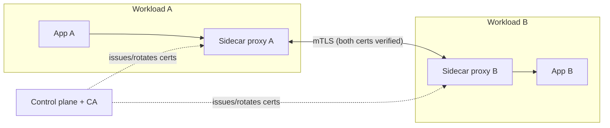

# Mutual TLS (mTLS): Identity, Zero Trust, and Service-to-Service Authentication

## 1. Why This Chapter Exists

Standard TLS authenticates only the server. The client verifies the server's certificate, but the server generally does not verify the client's identity at the transport layer; instead, the client proves who it is at the application layer (a session cookie, a bearer token, an API key, or a database credential). Mutual TLS (mTLS) flips the second half on: both sides present certificates, and both sides verify them.

mTLS matters because the security perimeter has dissolved. In a service mesh, in a zero-trust network, in an internal microservice cluster, and increasingly between partner organizations, the network itself is not trusted, and "inside the firewall" is not an identity. mTLS provides a strong, cryptographic, transport-level identity for every participant, which enables authentication and authorization decisions that do not depend on network location or on a bearer credential that can be stolen and replayed.

This chapter explains the mTLS handshake mechanics, how client identity is derived and matched, how mTLS fits into zero-trust architecture and service meshes, and—critically—the operational burden that mTLS imposes. Many teams adopt mTLS for its security properties and are then surprised by certificate rotation, trust domain design, and the blast radius of a mis-issued client certificate. Understanding both the mechanism and the operational cost is what makes mTLS a sound architectural decision rather than a fashionable one.

---

## 2. From One-Way to Mutual Authentication

In one-way TLS, the client sends `ClientHello`, the server sends `Certificate` and proves possession of its private key, and the client validates. The client's identity is established later, if at all, by the application.

In mTLS, the server additionally sends a `CertificateRequest` during the handshake, indicating that it wants the client to authenticate with a certificate. The client responds with its own `Certificate` and a `CertificateVerify` message, which signs the handshake transcript with the client certificate's private key. The server validates the client certificate against its trust store, exactly as a client validates a server certificate, and confirms the client possesses the corresponding private key. Only then does the handshake complete.

```mermaid
sequenceDiagram
    participant C as Client
    participant S as Server
    C->>S: ClientHello
    S->>C: ServerHello, Certificate, CertificateRequest, ServerHelloDone
    C->>S: Certificate (client cert chain)
    C->>S: ClientKeyExchange
    C->>S: CertificateVerify (signs transcript with client key)
    C->>S: ChangeCipherSpec, Finished
    S->>C: ChangeCipherSpec, Finished
    Note over C,S: Both identities verified; encrypted channel
    Note over S: Server maps client cert identity to authorization policy
```

### 2.1 CertificateRequest and CertificateVerify

The `CertificateRequest` message optionally specifies acceptable CAs and certificate types, allowing the server to guide the client toward an appropriate certificate. The client may send an empty `Certificate` message if it has no suitable certificate; whether the server then aborts depends on its policy (whether client authentication is required or merely requested).

The `CertificateVerify` message is the proof of private key possession. Without it, an attacker who captured a client's certificate (which is public) could impersonate the client. The signature over the transcript ties the client identity to this specific handshake, preventing replay across connections. This is the same identity-versus-proof split used for server authentication in TLS 1.3, applied symmetrically.

### 2.2 The Identity in a Client Certificate

Where the server certificate's identity is typically a hostname in the SAN, a client certificate's identity is often a subject name, an email, a distinguished name, a SPIFFE ID, or a service account identifier. The server must decide what field to extract and how to map it to authorization. This is a policy decision, not a protocol one, and getting it wrong is a common source of both security holes (too-loose matching) and operational friction (too-strict matching that rejects legitimate clients).

---

## 3. Trust Domains and Certificate Issuance for mTLS

mTLS requires an internal PKI to issue client certificates. Several design choices follow.

**Trust domain shape.** A single root CA for everything is simple but concentrates risk: compromise of that root lets an attacker issue client certificates for the entire estate. A hierarchy with per-environment or per-team intermediates limits blast radius and enables revocation by domain. This mirrors the public PKI reasoning from the previous chapter, applied internally.

**Certificate identity model.** The identity embedded in the client certificate should be stable and meaningful: a service identity such as `spiffe://cluster.local/ns/payments/sa/checkout`, not a hostname that changes as infrastructure churns. This is the core of workload identity, and it is what makes authorization policies durable.

**Short lifetimes.** Client certificates in mTLS deployments are almost always short-lived (hours to days) and rotated automatically. Short lifetimes bound the damage of a leaked key and reduce reliance on revocation, which suffers the same reliability problems internally as it does publicly. The cost is a robust rotation mechanism—an automated agent or a sidecar that acquires, renews, and presents certificates without human intervention.

**Key protection.** The client's private key must be protected. In high-security deployments the key lives in a hardware security module or a trusted platform module and never leaves it; in cloud-native deployments it lives in a securely mounted volume with restrictive permissions and is rotated frequently. The trade-off is operational complexity versus key-theft resistance.

#### In-Line Glossary: Trust Domain

**What it is:** a namespace of identities that share a common root of trust, so peers within it validate each other's certificates against the same trust bundle.

**Why here:** mTLS trust is directional and explicit, and the boundary between trust domains is where cross-service connections succeed or fail.

**Systemic implication:** mergers, multi-cluster deployments, and partner integrations require deliberate federation of trust domains, because two services with certificates from mutually untrusted roots cannot connect regardless of network reachability.

#### In-Line Glossary: SPIFFE

**What it is:** the Secure Production Identity Framework For Everyone, a standard for issuing and verifying workload identities, typically as URIs in the SPIFFE ID format.

**Why here:** it gives mTLS a stable, platform-neutral identity string that is independent of network location and host names.

**Systemic implication:** SPIFFE IDs decouple authorization policy from infrastructure topology, so services can be moved and scaled without rewriting security rules.

---

## 4. mTLS in Zero-Trust Architecture

Zero trust is the principle that no network location is inherently trusted and every request must be authenticated and authorized. mTLS is one of its foundational mechanisms, because it supplies cryptographic, per-connection identity that does not derive from the IP address or the network segment.

In a zero-trust model, every service-to-service connection is an mTLS connection, and both endpoints verify each other's workload identity. Authorization is then a policy over those identities: service A may call endpoint X on service B, and nothing else. Because identity is cryptographic and per-connection, a compromised host cannot simply put itself on the right subnet to gain access; it would need a valid, unrevoked certificate for the target identity, which short lifetimes and controlled issuance make difficult.

The trade-off is that zero trust shifts the burden from network controls to identity and policy management. That is a real cost: a broken identity plane becomes a broken production plane. A failed certificate rotation or a misconfigured policy engine can take down communications that previously "just worked" because they were on the trusted network.

---

## 5. mTLS in Service Meshes

Service meshes (such as Istio, Linkerd, and Consul Connect) implement mTLS at the infrastructure layer, transparently to application code. A **sidecar proxy** intercepts traffic to and from each workload, terminates and originates mTLS connections, obtains and rotates certificates from a control-plane CA, and enforces authorization policy. The application continues to speak plain HTTP to its local sidecar.



The architectural benefits are substantial. Applications get strong identity-based encryption and authentication without embedding TLS logic or certificate management in each service, and the control plane provides uniform, auditable policy and automatic rotation. **Peer authentication** (is mTLS required?) and **request authentication/authorization** (which identities may call which endpoints?) become declarative configuration.

The trade-offs are equally real. The sidecar adds latency (a local hop and an extra TLS handshake) and resource consumption per pod. The control plane becomes a critical dependency whose failure can block issuance or rotation. Debugging crosses a boundary the application does not control, so troubleshooting requires understanding the mesh's certificate and policy state, not just the service's own logs. Teams sometimes adopt strict mTLS mesh-wide and then discover that non-mesh clients, batch jobs, or externally hosted services cannot connect because they lack certificates; planning for these edges (ingress gateways, certificate provisioning for legacy clients, or explicit policy exceptions) is part of the design, not an afterthought.

---

## 6. mTLS Between Organizations

mTLS is increasingly used for partner and open-banking-style APIs, where each party authenticates to the other with a certificate issued by a trusted or federated CA. This gives strong mutual authentication and lets authorization be based on the verified partner identity. The complexities are federation (who trusts whose CA), certificate lifecycle coordination across organizational boundaries, and the fact that an expired partner certificate causes an outage neither party fully controls. When both sides are engineering organizations, this is manageable; when one side is a third party with slow processes, certificate coordination becomes a governance problem as much as a technical one.

---

## 7. Invariants, Assumptions, and Boundaries

**Invariant: the client must prove possession of the private key via `CertificateVerify`.** Possession of the (public) certificate alone is insufficient.

**Invariant: the client certificate must chain to a CA the server trusts.** Trust is directional and explicit: the server's trust store determines which clients are acceptable.

**Invariant: the client identity is bound to this specific handshake via the transcript signature.** Replay of a recorded mTLS handshake into a new session fails.

**Assumption: the internal CA and issuance pipeline are trustworthy and available.** mTLS relocates trust from the network to the CA; if the CA is weak or the pipeline issues inappropriate certificates, the model fails.

**Assumption: private keys are protected.** A stolen client private key permits impersonation until the certificate expires or is revoked.

**Boundary: mTLS authenticates the connection, not the request.** It proves which workload opened the connection, not that every request on that connection is authorized. Per-request authorization (for example, at layer 7) is still needed when a single connection multiplexes many operations or when user-level authorization is required on top of workload identity.

**Boundary: mTLS does not protect data at rest or data in the application.** It is a transport identity mechanism only.

**Boundary: identity granularity is workload-level by default.** If all requests from a workload share one identity, the authorization model cannot distinguish between different users or tasks unless the application adds more context.

---

## 8. Trade-offs and Rejected Alternatives

**Why mTLS instead of API keys or bearer tokens?** Bearer credentials are secrets that can be stolen, logged, and replayed, and they do not bind to a specific connection. mTLS certificates bind to a private key that is never transmitted, and the handshake proves possession per connection, which is strictly stronger for service identity. The rejected alternative, network-location-based trust plus shared secrets, fails once an attacker has any foothold inside the network. The cost of mTLS is the PKI and rotation machinery, which is why meshes exist to amortize it.

**Why not application-layer JWT authentication?** JWTs are excellent for end-user and cross-domain authorization and carry rich claims, but they are bearer tokens with their own key-management and revocation challenges, and a compromised JWT is replayable until it expires. The strongest architectures combine mTLS for transport identity with application tokens for user context; the rejected alternative, relying on tokens alone, loses the cryptographic per-connection binding.

**Why does a mesh use sidecars instead of library-per-service?** Sidecars centralize certificate management, policy enforcement, and observability, and they work for services in any language without code changes. Library-based (or eBPF-based) alternatives avoid the extra hop but require per-language integration and reduce uniformity. The trade-off is operational complexity and some latency versus transparency and consistency.

**Why not use mTLS everywhere unconditionally?** Because some clients cannot present certificates (browsers for public sites, legacy devices, external partners), and because the operational cost is real. The sound approach is to require mTLS wherever both sides are controlled workloads (internal services, mesh east-west traffic) and to use one-way TLS plus application authentication at the public edge. The rejected alternative, mTLS-everywhere dogma, breaks usability and external compatibility.

---

## 9. Failure Modes and Operational Consequences

**Certificate expiry as an outage.** Because mTLS client certificates are typically short-lived and numerous, an expiry or rotation failure can sever service-to-service communication broadly and suddenly. Operational consequence: automated rotation with strong monitoring, alerting on issuance and renewal failures, and graceful handling of overlap windows. Treat the identity plane's availability as a top-tier SLO.

**Trust-domain mismatch.** Two services with certificates from different, mutually untrusted CAs cannot connect. This appears during mergers, multi-cluster deployments, or when a mesh's trust bundle is not propagated. Operational consequence: design trust-domain federation and bundle distribution explicitly, and test cross-domain connections.

**Overly broad authorization from loose identity mapping.** If the server matches only a weak field or accepts any certificate signed by a shared CA, a certificate intended for one service can be used to impersonate another. Operational consequence: use granular workload identities (SPIFFE-style) and authorize on the full identity, not merely on CA membership.

**Private key leakage.** A client key copied into an image, logged, or stored in a shared location enables impersonation until expiry. Operational consequence: protect keys with file permissions and, where warranted, hardware; scan images and logs for key material; keep lifetimes short.

**Debugging opacity in meshes.** When mTLS is enforced by sidecars, connection failures may be caused by policy, certificates, or the control plane rather than the application. Operational consequence: invest in mesh-level observability, learn the control plane's certificate and policy tooling, and maintain runbooks that distinguish identity-plane from application failures.

**Performance and resource overhead.** The extra handshake, encryption, and proxy hop add latency and memory per connection. Operational consequence: size for the overhead, benefit from session resumption, and measure rather than assume the cost is negligible.

**Legacy clients and external interfaces.** Strict mTLS blocks non-mesh clients. Operational consequence: plan ingress gateways, certificate provisioning, or explicit, monitored exceptions for clients that cannot present certificates.

---

## 10. External References

- [RFC 8446: The Transport Layer Security (TLS) Protocol Version 1.3](https://www.rfc-editor.org/rfc/rfc8446)
- [RFC 5280: Internet X.509 Public Key Infrastructure Certificate and CRL Profile](https://www.rfc-editor.org/rfc/rfc5280)
- [RFC 8705: OAuth 2.0 Mutual-TLS Client Authentication and Certificate-Bound Access Tokens](https://www.rfc-editor.org/rfc/rfc8705)
- [SPIFFE Overview](https://spiffe.io/docs/latest/spiffe-about/overview/)
- [PKI, X.509, and Certificate Trust Chains](./05-pki-x509-and-certificate-trust-chains.md)
- [TLS and DTLS in Production: Hardening, Debugging, and Failure Modes](./08-tls-hardening-debugging-and-failure-modes.md)
