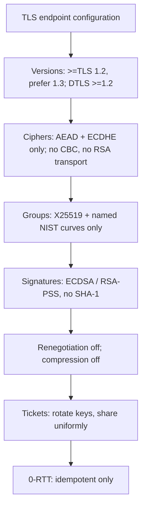
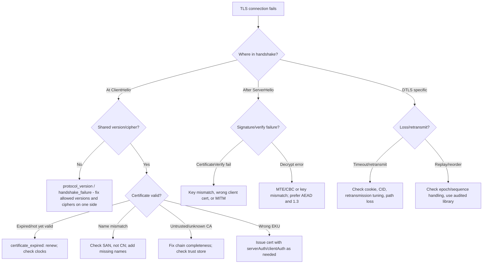

# TLS and DTLS in Production: Hardening, Debugging, and Failure Modes

## 1. Why This Chapter Exists

The previous chapters explain how TLS, TLS 1.3, DTLS, PKI, cryptography, and mTLS work. This chapter is about making them work in real systems, where traffic must be terminated, certificates must rotate, failures must be diagnosed under pressure, and configuration must stay defensible over years. The gap between "understand the protocol" and "operate it reliably" is where most production incidents live.

The chapter is organized around four practical activities: hardening configuration so that only safe options are negotiable, placing TLS termination appropriately in the architecture, diagnosing the failure modes that actually occur, and observing the right signals so failures are caught before users notice. It draws on every earlier chapter and connects them to operational practice, because a configuration decision is only correct relative to the threat model, the deployment topology, and the identity requirements established earlier.

---

## 2. Hardening the Negotiation

Hardening means shrinking the set of things that can be negotiated to only safe choices, so that security does not depend on a client behaving well.

**Protocol versions.** Set a floor of TLS 1.2 and a preference for TLS 1.3. Disable SSL 2.0, SSL 3.0, TLS 1.0, and TLS 1.1 entirely. The historical attacks on the older versions mean there is no safe reason to keep them, and the compatibility cost is now small. For DTLS, set a floor of DTLS 1.2 and prefer DTLS 1.3, disabling older DTLS versions.

**Cipher suites.** Restrict to AEAD suites with ECDHE or DHE key exchange: for example, `TLS_AES_128_GCM_SHA256` and `TLS_AES_256_GCM_SHA384` and `TLS_CHACHA20_POLY1305_SHA256` for TLS 1.3, plus their TLS 1.2 ECDHE equivalents. Explicitly exclude CBC suites and anything using RSA key transport or static DH. Order suites so TLS 1.3 and forward-secret AEAD options are preferred. This is the configuration-level expression of the forward-secrecy and AEAD conclusions from earlier chapters.

**Key-exchange groups and curves.** Allow only vetted named groups: X25519, and the NIST P-curves as needed. Exclude small or custom DH groups. This closes the Logjam class.

**Signature algorithms.** Allow modern schemes: ECDSA with P-256/P-384 and RSA-PSS with adequate key sizes; avoid SHA-1 signatures entirely.

**Renegotiation.** Disable insecure renegotiation; on TLS 1.2, ensure `RFC 5746` secure renegotiation is in effect, or disable renegotiation where possible.

**Compression.** Disable TLS compression to avoid the CRIME class.

**Session resumption and tickets.** Enable 1.3 session resumption for performance, but rotate ticket keys across a fleet, share them uniformly, and monitor resumption success. On TLS 1.2, prefer session tickets over session IDs for statelessness, with the same key rotation discipline.

**0-RTT.** Enable only for genuinely idempotent operations, and disable it for state-changing methods. Accept that early data is replayable, and never treat it as authenticated for consequential actions.

---

## 3. TLS Termination Placement

A recurring architectural decision is where TLS ends. The three patterns have distinct security, observability, and performance consequences.

**TLS termination at the edge (load balancer or CDN).** The edge holds the certificate and private key, decrypts client traffic, and forwards plaintext or re-encrypted traffic upstream. This centralizes certificate management, enables layer-7 routing, WAF, and caching, and offloads crypto from backends. The cost is that the "last mile" inside the data center may be unencrypted unless re-encryption is configured, which matters for compliance and for internal zero-trust posture. The rejected default, terminating and leaving internals plaintext, is convenient but weakens defense in depth.

**TLS passthrough.** The load balancer forwards encrypted bytes without decrypting, and the backend holds the certificate. This preserves end-to-end encryption and allows the backend to see client certificates for mTLS. The cost is that the edge cannot do layer-7 routing, inspection, or caching based on request content, and certificate management is distributed across backends.

**Re-encryption (TLS termination plus re-origination).** The edge terminates the client connection and initiates a new TLS connection to the backend. This gives both edge inspection and encrypted internal transit, at the cost of two handshakes and two certificate lifecycles. In mTLS meshes this is the norm: the client-to-edge leg may be one-way TLS, and the edge-to-service and service-to-service legs are mTLS.

The choice is driven by the threat model and compliance requirements, not by performance alone. A useful heuristic: terminate where you need layer-7 policy and centralized key management; re-encrypt where the internal network is untrusted; pass through where the backend must authenticate the client directly or where end-to-end encryption is mandated.

#### In-Line Glossary: TLS Termination

**What it is:** the architectural point at which encrypted client traffic is decrypted, whether at an edge proxy, at the backend, or twice for re-encryption.

**Why here:** it determines who holds the private key, where layer-7 policy can act, and whether internal transit is plaintext or encrypted.

**Systemic implication:** termination placement is a trust-boundary decision, because whichever component decrypts traffic and holds the key must be protected to the level of the data it exposes.

---

## 4. A Diagnostic Tree for Handshake Failures

Most TLS failures present as a generic connection error and a vague alert. Decoding them quickly requires knowing the classes.

The key diagnostic insight is that the **alert or error type points at the failing stage**. A version or cipher failure occurs before certificates are even examined; a certificate alert occurs during validation; a decrypt or bad-record-MAC error occurs after key installation and usually indicates a key mismatch, a CBC/MTE problem, or an active tamper. Confusing these classes—for example, treating a certificate error as a cipher error—wastes the most valuable minutes of an incident.

### 4.1 The Most Common Real Failures

**Expiry.** Renewal did not happen or did not propagate. Check with a client, not just the server.

**Incomplete chain.** The server omitted intermediates; some clients fail, others succeed. Inspect the presented chain and compare to what a clean client requires.

**Hostname mismatch.** The requested name is not in the SAN, or CN was used by mistake. Test every name the service is reachable by.

**Protocol or cipher mismatch.** One side dropped a version or suite the other requires, often after a hardening change. Check negotiated parameters, not assumed ones.

**Clock skew.** `notBefore`/`notAfter` checks fail when host time is wrong; time sync failures masquerade as certificate failures.

**Trust-store divergence.** The certificate validates in one runtime but not another because the CA root is present in one trust store and absent in another.

**mTLS identity mismatch.** The client certificate is present but its identity is not accepted by the server's policy, or it chains to a CA the server does not trust.

### 4.2 Tools and Evidence

The most important habit is to **observe the handshake from the client's perspective**. `openssl s_client` shows the presented chain, the negotiated version and cipher, the verification result, and any stapled OCSP response. `curl -v` shows the same from an HTTP client's point of view. For DTLS, `openssl s_client -dtls` and packet captures are essential, because there is no stream to inspect. Endpoint-side logging of negotiated parameters is more reliable than any network capture once TLS 1.3 encrypts the handshake. When diagnosing intermittently, remember that a difference between "works here" and "fails there" almost always means a difference in trust store, network path, or which server behind a load balancer answered.

#### In-Line Glossary: ALPN

**What it is:** an extension that negotiates the application-layer protocol (for example `h2` or `http/1.1`) inside the TLS handshake.

**Why here:** it lets a TLS listener route a connection to the correct protocol handler before any application byte is sent, and a mismatch is a common cause of otherwise-correct connections failing.

**Systemic implication:** ALPN makes the TLS handshake carry application intent, so hardening and diagnostics must inspect it alongside version and cipher when explaining why a connection reached the wrong backend or protocol.

---

## 5. Observability: What to Instrument

TLS is too often unobserved until it fails. The following signals should be first-class metrics.

**Negotiated parameters by connection or aggregate.** Track the distribution of protocol versions and cipher suites in use. This surfaces silent downgrades, legacy client populations, and the effect of configuration changes. Without it, "we disabled TLS 1.0" is unverifiable.

**Handshake success and failure rates, by error class.** Distinguish version/cipher failures, certificate failures, and post-handshake record failures, because they have different causes and owners. A sudden spike in certificate failures after a renewal window is a strong signal.

**Certificate expiry and rotation health.** For every certificate (server and client, leaf and intermediate), track days-to-expiry and renewal status. Alert with enough lead time for human intervention, and alert on rotation pipeline failures, not just on the expiry date.

**Resumption rates.** Track full versus resumed handshakes, and 0-RTT acceptance and rejection. Falling resumption rates increase latency and CPU and can indicate ticket key problems.

**OCSP stapling status.** Track whether staples are present and fresh; a missing staple can silently degrade revocation behavior.

**DTLS-specific signals.** Track handshake retransmission rates, cookie challenge rates, reassembly timeouts, and CID usage. Rising retransmissions indicate path problems; rising cookie challenges can indicate reflection probing.

**Latency of handshake.** Separate handshake latency from request latency, because TLS overhead hides in the former and is invisible if only request latency is measured.

The principle is that security properties which are not measured tend to erode. Configuration drift, partial rollouts, and legacy clients all silently reintroduce weaknesses unless the negotiated reality is observed continuously.

---

## 6. Invariants, Assumptions, and Boundaries

**Invariant: hardened configuration is enforced by the server, not requested of the client.** Never rely on clients to avoid weak suites; the server must refuse them.

**Invariant: certificate lifecycle is automated and monitored.** Manual renewal does not scale and fails predictably; automation without monitoring fails silently.

**Invariant: diagnostics are performed from the client's perspective.** Server-side success is insufficient evidence that clients can connect.

**Assumption: the termination point is a trust boundary you control.** Whichever component holds the private key must be as protected as the data it protects.

**Boundary: hardening cannot fix application vulnerabilities carried inside the tunnel.** Encryption does not sanitize input.

**Boundary: observability shrinks as TLS evolves.** TLS 1.3 encrypts more, so network-based monitoring is weaker; endpoint and control-plane telemetry must compensate.

**Boundary: mTLS and hardening address authentication and confidentiality, not authorization logic.** Authorization must be designed separately, over the identities mTLS provides.

---

## 7. Trade-offs and Rejected Alternatives

**Why not keep legacy versions for old clients?** Because each retained version is an attack surface and a downgrade target, and modern client populations rarely require anything below TLS 1.2. The cost of dropping them is small and shrinking; the security benefit is eliminating whole vulnerability classes. Exceptions should be isolated, monitored endpoints, not the default.

**Why not disable session resumption for maximum freshness?** Because full handshakes cost round trips and CPU at scale, and short-lived resumable sessions with rotated tickets retain forward secrecy. The rejected alternative, always-full-handshake, is secure but needlessly expensive. The rejected opposite, permanent resumption, sacrifices forward secrecy.

**Why not terminate TLS far inside and run plaintext across the fleet?** Because internal networks are not trustworthy in a zero-trust posture, and plaintext in transit is exposed to lateral movement. Re-encryption costs extra handshakes but preserves defense in depth. The rejected alternative is cheaper and weaker.

**Why not rely on a WAF at the edge and skip TLS hardening?** Because the WAF operates on decrypted traffic and does not control which protocol version or cipher a client negotiates; it cannot compensate for weak transport security. The two are complementary.

**Why not monitor only request latency and error rates?** Because handshake failures and downgrades are invisible in application metrics; they appear as connection errors at best and as silent weaknesses at worst. Transport-level observability is a separate, necessary discipline.

---

## 8. Failure Stories and Their Lessons

**The renewal that did not propagate.** A certificate was renewed on one server behind a load balancer but not on its peers, so a fraction of connections failed intermittently depending on which server answered, while the others looked healthy. The lesson is to treat certificate deployment as a fleet-wide, verified operation with per-instance checks, not a single-file update.

**The chain that worked in the browser.** A server presented only its leaf certificate. Browsers with the intermediate cached succeeded; automation tools and new clients failed. The lesson is to serve the full chain and to test from a clean client, because the most common environment (a warm browser) hides the bug.

**The hardening that broke a partner.** A cipher policy was tightened without inventorying external clients, and a partner integration that negotiated an older suite failed at the next connection. The lesson is that negotiation is a contract; hardening must be preceded by measurement of who is negotiating what, and staged with overlap.

**The mesh mTLS that locked out batch jobs.** Strict mTLS was enforced mesh-wide, and non-mesh batch jobs that had been calling services directly lost connectivity. The lesson is that identity requirements at the transport layer have clients beyond the obvious ones, and edges and exceptions must be designed, not discovered in an incident.

**The 0-RTT duplicate.** Early data was enabled for a mutating endpoint, and a retried request was replayed, causing a duplicate write. The lesson is that 0-RTT replay is a protocol property, and its safe use is an application-semantics decision.

---

## 9. Operational Checklist

The following checklist distills the chapter into reviewable items for a production TLS/DTLS deployment.

Version and cipher posture: TLS floor 1.2, prefer 1.3, DTLS floor 1.2; AEAD and ECDHE only; no CBC, no RSA transport, no static DH; named groups and modern signature algorithms only; renegotiation and compression disabled.

Certificate lifecycle: automated issuance and renewal; full chain served; SANs cover every reachable name; expiry and rotation monitored with lead time; trust-store parity across runtimes verified.

Identity: mTLS where both endpoints are controlled workloads; granular workload identities; authorization based on full identity; private keys protected and short-lived.

Termination: chosen deliberately among edge termination, passthrough, and re-encryption based on threat model and compliance; internal transit encrypted where the network is untrusted.

Observability: negotiated version and cipher distributions; handshake failure rates by class; resumption and 0-RTT rates; OCSP stapling status; DTLS retransmission and cookie metrics; handshake latency separated from request latency.

Failure readiness: client-perspective diagnostics in runbooks; alert decoding practiced; capacity sized for handshake cost; rollback plans for hardening changes.

---

## 10. External References

- [RFC 8446: The Transport Layer Security (TLS) Protocol Version 1.3](https://www.rfc-editor.org/rfc/rfc8446)
- [RFC 5246: The Transport Layer Security (TLS) Protocol Version 1.2](https://www.rfc-editor.org/rfc/rfc5246)
- [RFC 7301: TLS Application-Layer Protocol Negotiation (ALPN) Extension](https://www.rfc-editor.org/rfc/rfc7301)
- [RFC 6797: HTTP Strict Transport Security (HSTS)](https://www.rfc-editor.org/rfc/rfc6797)
- [RFC 7525: Recommendations for Secure Use of TLS and DTLS (BCP 195)](https://www.rfc-editor.org/rfc/rfc7525)
- [OWASP Transport Layer Security Cheat Sheet](https://cheatsheetseries.owasp.org/cheatsheets/Transport_Layer_Security_Cheat_Sheet.html)
- [nginx SSL/TLS Module Reference](https://nginx.org/en/docs/http/ngx_http_ssl_module.html)
- [PKI, X.509, and Certificate Trust Chains](./05-pki-x509-and-certificate-trust-chains.md)
- [Mutual TLS (mTLS): Identity, Zero Trust, and Service-to-Service Authentication](./07-mutual-tls-identity-and-zero-trust.md)
