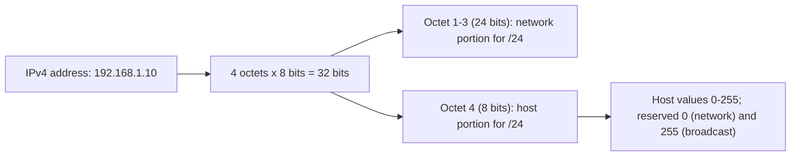

# IPv4 Addressing Fundamentals

## 1. Why This Chapter Exists

Every routing, firewall, subnetting, and cloud-network decision is expressed in IP addresses and prefixes. Engineers who treat addresses as opaque strings hit a wall when asked to carve a network, diagnose an overlap, or explain why two hosts that "look" adjacent cannot communicate. This chapter builds the number-sense that everything else depends on: how a 32-bit address is represented, how the historical class system worked and why it failed, which ranges are special and non-routable, and why the address space is exhausted.

The chapter is deliberately quantitative. Subnetting later in this section is arithmetic on these foundations, so the binary relationships introduced here—octets, powers of two, and the meaning of the network/host boundary—must be fluent before masks and CIDR make sense.

---

## 2. Addresses as 32-Bit Numbers

An IPv4 address is a 32-bit unsigned integer, written for humans as four decimal octets separated by dots (`192.168.1.10`). Each octet is 8 bits, so each ranges from 0 to 255. The dotted form is a convenience; the network operates on the 32-bit value.

| Octet | 192 | 168 | 1 | 10 |
|---|---|---|---|---|
| Binary | 11000000 | 10101000 | 00000001 | 00001010 |

The most significant bits are on the left. This matters because prefixes (masks) operate from the left. A `/24` fixes the first 24 bits as the network portion and leaves the last 8 for hosts, which is why a `/24` contains 256 addresses. Understanding that prefixes count bits from the left is the single most important fact for subnetting.



#### In-Line Glossary: Octet

**What it is:** an 8-bit field; IPv4 has four, giving 32 bits total.

**Why here:** it is the unit in which addresses are written and the natural boundary for many subnet sizes (each octet is 256 addresses).

**Systemic implication:** because masks rarely align perfectly to octets for anything other than /8, /16, /24, engineers must be comfortable with prefixes that split an octet, which is where most subnetting errors arise.

---

## 3. The Classful System and Why It Failed

Early IPv4 used **classful addressing**, where the leading bits of the address determined a fixed network/host split:

- **Class A**: leading bit `0`, first octet 1-126, a /8 network with 24 host bits (16M+ hosts).
- **Class B**: leading bits `10`, first octet 128-191, a /16 network with 16 host bits (65K hosts).
- **Class C**: leading bits `110`, first octet 192-223, a /24 network with 8 host bits (254 hosts).
- **Class D**: leading bits `1110`, multicast.
- **Class E**: leading bits `11110`, reserved/experimental.

Classful addressing failed because it offered only three network sizes. An organization needing 300 hosts could not use a /24 (too small) and was forced to a /16 (65,534 hosts), wasting tens of thousands of addresses. Allocation at class granularity, combined with growth forecasts that proved wrong, burned through the space quickly. The fix was **Classless Inter-Domain Routing (CIDR)**, which allows arbitrary prefix lengths and made the class system obsolete for allocation—though the class boundaries survive in common defaults and in legacy documentation, a frequent source of confusion.

#### In-Line Glossary: CIDR

**What it is:** Classless Inter-Domain Routing, a scheme that expresses networks as an address plus a prefix length of arbitrary size (e.g. `/22`), removing the fixed class sizes.

**Why here:** it is the modern basis for all addressing and subnetting, and it is what allows efficient, right-sized allocations.

**Systemic implication:** CIDR enables route aggregation (one summary route for many contiguous networks), which is essential to keeping global routing tables manageable; without aggregation, the internet's routing table would be far larger than it already is.

---

## 4. Special and Reserved Ranges

Several ranges carry special meaning and must be recognized on sight.

**Private (RFC 1918)** addresses are not globally routable and may be reused in every private network: `10.0.0.0/8` (16.7M addresses), `172.16.0.0/12` (1M addresses), and `192.168.0.0/16` (65K addresses). These are the backbone of internal and cloud networks, and overlapping use of them across networks is the reason NAT and careful address planning exist.

**Loopback** is `127.0.0.0/8`; `127.0.0.1` is "this host". Traffic to loopback never leaves the host.

**Link-local** is `169.254.0.0/16`, auto-assigned when DHCP fails (APIPA). Seeing a `169.254.x.x` address is a strong signal that DHCP did not succeed.

**Multicast** is `224.0.0.0/4`; these addresses target groups and is used by routing protocols and discovery.

**Broadcast** `255.255.255.255` is the limited broadcast to the local subnet; each subnet also has a directed broadcast (all-ones host portion).

**`0.0.0.0`** means "unspecified" (e.g. a host with no address, or a default route target) or "any address" as a bind address.

**`240.0.0.0/4`** (Class E) is reserved and not usable as unicast.

#### In-Line Glossary: RFC 1918 Private Address

**What it is:** a range (10/8, 172.16/12, 192.168/16) reserved for private networks and not routed on the public internet.

**Why here:** it is what makes internal and cloud addressing possible without consuming public addresses, at the cost of needing NAT or explicit routing to reach the internet.

**Systemic implication:** because private ranges are reused everywhere, connecting two networks that both use `10.0.0.0/8` without planning causes overlapping-prefix conflicts that break routing and require translation or renumbering to resolve.

#### In-Line Glossary: Link-Local Address

**What it is:** the `169.254.0.0/16` range used for automatic self-assignment when no address is otherwise available (IPv4 APIPA).

**Why here:** it is the classic symptom of a DHCP failure and is not routable beyond the local link.

**Systemic implication:** a host with a link-local address can talk only on its local segment, so seeing `169.254.x.x` immediately narrows the diagnosis to address assignment rather than connectivity.

---

## 5. Address Exhaustion and Allocation Governance

IANA allocates address blocks to Regional Internet Registries (RIRs: ARIN, RIPE, APNIC, LACNIC, AFRINIC), which allocate to ISPs and organizations. The pool of unallocated IPv4 addresses reached exhaustion at IANA in 2011 and at most RIRs in subsequent years. Today, new public IPv4 addresses come mainly from the transfer market at rising cost.

This scarcity is why NAT, private addressing, and IPv6 exist. It also means that internal address planning is a scarce-resource discipline: wasteful allocation of public space is expensive, and RFC 1918 space, while free, is not infinite in a governance sense because overlaps must be avoided across the whole organization.

---

## 6. Invariants, Assumptions, and Boundaries

**Invariant: an IPv4 address is always interpreted together with a prefix length.** An address without a mask is ambiguous; the mask defines which bits are network and which are host.

**Invariant: the network and broadcast addresses of a subnet are reserved and cannot be assigned to hosts.** This is why a /24 has 254 usable hosts, not 256.

**Assumption: addresses within a routable scope are unique.** Duplicate addresses break delivery and cause conflicts.

**Boundary: private ranges are not globally routable by definition.** Reaching the internet from them requires NAT or a proxy.

**Boundary: an address is not a stable identity.** It changes with DHCP, mobility, NAT, and renumbering, so it should not be treated as an enduring identifier for access policy.

**Boundary: the class system is historical.** Do not infer network size from the first octet; always use the prefix.

---

## 7. Trade-offs and Rejected Alternatives

**Why not keep classful addressing?** It was simple but inflexible and wasteful, and it drove the exhaustion it could not solve. CIDR's arbitrary prefixes allow right-sized allocation and route aggregation. The rejected alternative—fixed classes—could not represent a 300-host network without wasting a /16.

**Why not use public addresses internally to avoid NAT?** Using globally unique public addresses internally removes NAT's complications and restores end-to-end connectivity, but it consumes scarce, costly address space. The rejected approach is clean in theory and economically impractical at scale; most organizations use RFC 1918 internally and NAT at the edge, accepting the complexity.

**Why allocate IPv4 carefully when IPv6 has unlimited space?** Because IPv6 is not universally deployed, mixed environments persist, and internal IPv4 plans must not overlap across the organization's networks. Careful planning remains necessary during the transition.

---

## 8. Failure Modes and Operational Consequences

**Overlapping private ranges.** Two networks both using `10.0.0.0/8` cannot route to each other without translation or renumbering. Symptom: traffic goes to the wrong host or nowhere. Operational consequence: maintain a global address plan or IPAM and allocate non-overlapping ranges.

**Address conflicts.** Duplicate IP assignment breaks connectivity for both hosts intermittently. Symptom: one or both hosts flap. Operational consequence: centralize allocation and use address conflict detection.

**Assuming classful sizes.** A `/16` assumed to be "class B" logic leads to off-by-a-factor errors in capacity and masks. Symptom: subnet sizing errors. Operational consequence: derive sizes from the prefix, not the first octet.

**Treating a public address as private or vice versa.** A route or firewall built on a wrong assumption fails confusingly. Symptom: unreachable resources with apparently correct config. Operational consequence: validate the address plan against authoritative allocation data.

**Ignoring reserved addresses in sizing.** Forgetting network/broadcast/cloud-reserved addresses under-provisions a subnet. Symptom: capacity runs out earlier than expected. Operational consequence: always subtract reserved addresses when sizing (five are reserved in many cloud subnets).

---

## 9. Hands-On: Reading and Reasoning About Addresses

Convert between dotted-decimal and binary (mental practice or with a tool):

```bash
ipcalc -b 192.168.1.10/24      # if ipcalc is installed
python3 -c "print(bin(int('c0a8010a',16)))"
```

Show a host's addresses and confirm whether they are private, loopback, or link-local:

```bash
ip -br addr
```

Inspect routing to see which prefixes are considered directly connected:

```bash
ip route show
```

Practice recognizing reserved ranges by checking a few addresses:

```bash
for ip in 10.5.5.5 172.16.9.1 172.32.9.1 192.168.1.1 192.169.1.1 169.254.1.1 127.0.0.1; do
  printf '%s -> ' "$ip"; ipcalc -n "$ip/8" 2>/dev/null | head -1 || echo "$ip"
done
```

Interpretation: a `172.32.0.0` address is **not** private (private is `172.16.0.0/12`, i.e. 172.16–172.31), and a `169.254.x.x` address means autoconfiguration occurred. Recognizing these boundaries on sight prevents a large class of configuration errors.

---

## 10. Related Documents

- [CIDR and Subnet Masks](./02-cidr-and-subnet-masks.md)
- [Subnetting by Design: VLSM and Route Summarization](./03-subnetting-by-design-vlsm-and-summarization.md)
- [IPv6 Addressing](./04-ipv6-addressing.md)
- [Models and Encapsulation](../01-network-fundamentals/01-models-and-encapsulation.md)

## 11. External References

- [RFC 791: Internet Protocol](https://www.rfc-editor.org/rfc/rfc791)
- [RFC 1918: Address Allocation for Private Internets](https://www.rfc-editor.org/rfc/rfc1918)
- [RFC 4632: Classless Inter-Domain Routing (CIDR)](https://www.rfc-editor.org/rfc/rfc4632)
- [IANA IPv4 Special-Purpose Address Registry](https://www.iana.org/assignments/iana-ipv4-special-registry/iana-ipv4-special-registry.xhtml)
