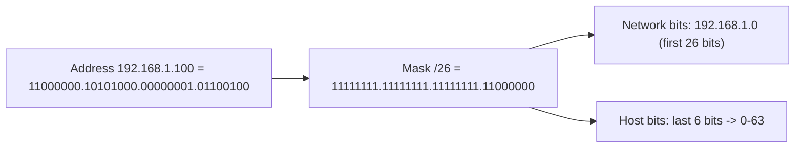

# CIDR and Subnet Masks

## 1. Why This Chapter Exists

CIDR notation and subnet masks are the language in which all IP planning, routing, and firewalling is expressed. A firewall rule, a route table entry, a cloud subnet, and a peering policy are all written as address/prefix pairs, and being able to reason about what a prefix contains—how many hosts, which addresses are network and broadcast, whether two prefixes overlap—is a core competency for any engineer touching networks.

This chapter builds that competency from the bit level. It explains how a mask encodes the network/host boundary, how to compute the network address, broadcast address, and usable range for any prefix, and how to do it quickly with the "block size" and "magic number" techniques. It deliberately includes worked arithmetic because the skill is procedural: recognizing the answer by sight is what makes designs and incidents move quickly.

---

## 2. From Mask to Prefix

A **subnet mask** is a 32-bit value with a contiguous run of 1 bits from the left (the network portion) followed by a run of 0 bits (the host portion). A `/24` is written as `255.255.255.0`: the first 24 bits are 1, the last 8 are 0. A `/26` is `255.255.255.192`: 26 ones then 6 zeros (`11111111.11111111.11111111.11000000`).

CIDR notation (`/n`) is simply the count of leading 1 bits. The mask and the prefix length are two representations of the same boundary. The network portion is identical for every host in the subnet; the host portion varies.



#### In-Line Glossary: Subnet Mask

**What it is:** a 32-bit value whose leading 1 bits mark the network portion of an address and whose trailing 0 bits mark the host portion.

**Why here:** it is the arithmetic operator that separates "which network" from "which host", and it underlies every routing and subnetting decision.

**Systemic implication:** a mask mismatch between two devices is invisible in configuration screens yet breaks communication silently; consistency of masks across a subnet is an invariant that must be verified, not assumed.

---

## 3. Computing the Network, Broadcast, and Usable Range

Given an address and prefix, three derived values follow:

- **Network address:** the address with all host bits set to 0. This identifies the subnet and cannot be assigned to a host.
- **Broadcast address:** the address with all host bits set to 1. This addresses all hosts in the subnet and cannot be assigned.
- **Usable host range:** every address strictly between network and broadcast.

The number of addresses in a subnet is `2^(32 - prefix)`. The number of usable hosts is that minus 2 (network and broadcast), except for special cases.

**Worked example — `192.168.1.100/26`:**

- Prefix `/26` → 6 host bits → `2^6 = 64` addresses.
- Block size is 64, so subnets step in multiples of 64 in the last octet: `.0`, `.64`, `.128`, `.192`.
- `100` falls in the `64–127` block.
- Network: `192.168.1.64`. Broadcast: `192.168.1.127`. Usable: `192.168.1.65 – 192.168.1.126` (62 hosts).

`2^6 = 64` addresses yields 62 usable, which is the arithmetic that trips people up when they request "a /26 for 64 servers" and discover they only have 62.

#### In-Line Glossary: Network Address

**What it is:** the lowest address of a subnet, with all host bits zero, used to identify the subnet itself.

**Why here:** routing entries and subnet identities are expressed as network addresses; mistaking a host address for a network address causes overlap errors.

**Systemic implication:** because the network address is not assignable, address-planning tools and documents should state subnets by their network address to avoid ambiguity.

#### In-Line Glossary: Broadcast Address

**What it is:** the highest address of a subnet, with all host bits one, delivered to every host in the subnet.

**Why here:** it is reserved and cannot be assigned, and it defines the top of the usable range.

**Systemic implication:** forgetting the broadcast (and network) reservation when sizing produces shortfalls; in cloud networks additional addresses are reserved, so the usable count is even lower.

---

## 4. Block Sizes and the Magic Number

The **block size** of a subnet is `256 - (last non-255 mask octet)`. For a `/26` (`255.255.255.192`), the block size is `256 - 192 = 64`. Subnets then begin at multiples of the block size. This "magic number" method lets you find the containing subnet quickly without converting to binary.

| Prefix | Mask | Block size | Addresses | Usable hosts |
|---|---|---|---|---|
| /24 | 255.255.255.0 | 256 | 256 | 254 |
| /25 | 255.255.255.128 | 128 | 128 | 126 |
| /26 | 255.255.255.192 | 64 | 64 | 62 |
| /27 | 255.255.255.224 | 32 | 32 | 30 |
| /28 | 255.255.255.240 | 16 | 16 | 14 |
| /29 | 255.255.255.248 | 8 | 8 | 6 |
| /30 | 255.255.255.252 | 4 | 4 | 2 |
| /31 | 255.255.255.254 | 2 | 2 | 2 (point-to-point, RFC 3021) |
| /32 | 255.255.255.255 | 1 | 1 | 1 (single host) |

Each step down halves the block size and halves the usable hosts. Memorizing the powers of two (2, 4, 8, 16, 32, 64, 128, 256) and the corresponding prefixes is the fastest path to fluency.

#### In-Line Glossary: Block Size

**What it is:** the number of addresses in a subnet, equal to `2^(32-prefix)` and to `256 - (mask octet that is not 255)`.

**Why here:** it gives a fast mental method to locate subnet boundaries without binary arithmetic.

**Systemic implication:** because subnets start at block-size multiples, an address that seems "close" to a boundary can belong to a surprising subnet; always confirm with the block size before assigning.

---

## 5. Special Prefixes

Two prefixes deserve explicit mention. **`/31`** (RFC 3021) defines a point-to-point link with exactly two usable addresses (no network/broadcast reservation), used on router-to-router links where only two endpoints exist. **`/32`** denotes a single host, used in host routes, loopback interfaces, and firewall allowlists.

**`/30`** (two usable hosts) is the traditional point-to-point choice; **`/31`** doubles efficiency on such links. **`/127`** is the IPv6 equivalent of `/31` for point-to-point links.

---

## 6. Reading Prefixes and Detecting Overlap

Two prefixes **overlap** if one contains the other, which is fatal in routing and in cloud VPC design. A quick test: expand to network addresses and compare bit ranges, or check whether the network address of one lies within the other's range. Overlap detection is central to address planning: the same `10.0.0.0/16` used in two networks to be connected cannot be routed between them.

Summarization (covered next) is the inverse: combining several contiguous prefixes into one larger prefix. A set of `/24`s can often be summarized by a shorter prefix, reducing routing table size—provided they are contiguous and correctly aligned.

---

## 7. Invariants, Assumptions, and Boundaries

**Invariant: the mask must be contiguous ones then zeros.** Non-contiguous masks are invalid in practice and unsupported by most systems.

**Invariant: all hosts in a subnet share the same prefix and thus the same network/broadcast.** A mismatched mask splits the intended subnet into overlapping networks.

**Invariant: network and broadcast addresses are reserved (except /31 and /32).** Usable host count is `2^(32-prefix) - 2` for normal prefixes.

**Assumption: prefixes are assigned from a coherent, non-overlapping plan.** Overlaps break routing and are difficult to unwind.

**Boundary: CIDR describes ranges, not topology.** Two hosts in the same prefix may or may not be on the same physical segment; the prefix describes addressing, not reachability.

**Boundary: a route's prefix is not the same as a subnet's mask.** A route can point to any prefix, not only a locally configured subnet.

---

## 8. Trade-offs and Rejected Alternatives

**Why not size every subnet as a /24 for simplicity?** Uniform /24s are easy to reason about but waste addresses badly on point-to-point links (a /30 is plenty) and cap large subnets at 254 hosts. Right-sizing with variable prefixes (VLSM, next chapter) uses space efficiently at the cost of more careful planning.

**Why not use /24 everywhere and accept waste?** In small networks this is pragmatic and common. At scale, or when public addresses are scarce, waste is unacceptable, and the operational cost of planning correctly is lower than the cost of renumbering later.

**Why prefer larger prefixes than needed?** Over-provisioning (a /22 for 200 hosts) reduces future renumbering risk but consumes scarce contiguous space and can block summarization. The rejected extremes—just-enough today versus wildly oversized—both create problems; the skill is matching allocation to realistic growth.

**Why is summarization worth the discipline?** Aggregating contiguous prefixes into summaries keeps routing tables small and stable, which is critical at the internet's edges. The cost is the requirement to allocate contiguously, which constrains planning; the benefit is scalability.

---

## 9. Failure Modes and Operational Consequences

**Mask mismatch within a subnet.** Hosts configured with different masks disagree about which destinations are local, causing some pairs to communicate and others not. Symptom: "reaches A but not B, though both are on the same subnet." Operational consequence: enforce consistent prefix configuration and audit it.

**Network/broadcast assigned to a host.** Some systems accept it, others conflict with broadcast behavior. Symptom: intermittent connection loss or broadcast storms. Operational consequence: never assign the network or broadcast address; validate with tooling.

**Overlapping prefixes.** Two connected networks use the same range. Symptom: traffic to the "wrong" host, or routing that ignores one network. Operational consequence: maintain IPAM and detect overlap before connecting networks.

**Off-by-one sizing.** A `/26` requested for 64 hosts yields only 62 usable, or fewer in clouds with reserved addresses. Symptom: address exhaustion earlier than planned. Operational consequence: size with the reserved-address subtraction in mind.

**Assuming /24 boundaries for non-octet masks.** A `/26` carved from a /24 does not align to intuitive decimal points. Symptom: wrong subnet assigned. Operational consequence: use block-size arithmetic and verify with `ipcalc`.

---

## 10. Hands-On: Prefix Arithmetic

Compute network, broadcast, and usable range for an arbitrary prefix:

```bash
ipcalc 192.168.1.100/26
sipcalc 192.168.1.100/26      # alternative
```

Show binary breakdown to see the boundary:

```bash
ipcalc -b 192.168.1.100/26
```

Test several prefixes to build intuition for block sizes:

```bash
for p in 24 25 26 27 28 29 30 31 32; do
  echo "== /$p =="; ipcalc "10.0.0.130/$p" | grep -E 'Network|Broadcast|Hosts/Net|HostMin|HostMax'
done
```

Interpretation: `Hosts/Net` reports the usable count; comparing `/30` (2 hosts) with `/31` (2 hosts but no reservations) shows why point-to-point links prefer `/31`. Repeating the exercise with different starting octets builds the pattern recognition needed to size subnets and design summaries quickly.

---

## 11. Related Documents

- [IPv4 Addressing Fundamentals](./01-ipv4-addressing-fundamentals.md)
- [Subnetting by Design: VLSM and Route Summarization](./03-subnetting-by-design-vlsm-and-summarization.md)
- [IPv6 Addressing](./04-ipv6-addressing.md)
- [Cloud Virtual Networks: Subnets and Availability](../05-cloud-virtual-networks/02-subnets-and-availability.md)

## 12. External References

- [RFC 4632: Classless Inter-Domain Routing (CIDR)](https://www.rfc-editor.org/rfc/rfc4632)
- [RFC 3021: Using 31-Bit Prefixes on IPv4 Point-to-Point Links](https://www.rfc-editor.org/rfc/rfc3021)
- [RFC 950: Internet Standard Subnetting Procedure](https://www.rfc-editor.org/rfc/rfc950)
- [IANA IPv4 Address Space Registry](https://www.iana.org/assignments/ipv4-address-space/ipv4-address-space.xhtml)
