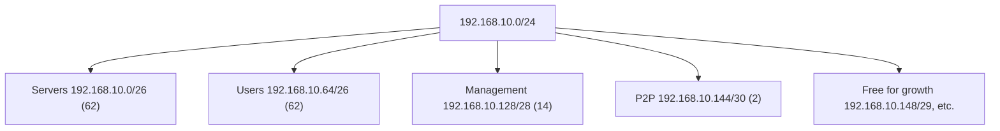

# Subnetting by Design: VLSM and Route Summarization

## 1. Why This Chapter Exists

Knowing how to read a mask is not the same as being able to design an addressing plan. Real networks need subnets of different sizes—a large subnet for servers, smaller ones for point-to-point links, medium ones for user segments—carved from limited address space without waste or overlap, and they need those subnets arranged so that routing tables can be summarized. This chapter turns mask arithmetic into a design discipline.

It covers two essential techniques. **Variable Length Subnet Masking (VLSM)** allows different prefixes within the same larger block, so each subnet is sized to its actual need. **Route summarization (supernetting)** arranges allocations so that many subnets can be advertised as one aggregate, shrinking routing tables. Together they define professional address planning. The chapter includes a full worked allocation to make the process concrete.

---

## 2. FLSM Versus VLSM

**Fixed Length Subnet Masking (FLSM)** assigns the same prefix length to every subnet. If you split a `/24` into equal parts, every part is the same size. FLSM is simple but wasteful when needs differ: a point-to-point link needs 2 addresses, yet receives the same 62 as a small LAN under FLSM.

**Variable Length Subnet Masking (VLSM)** allows different prefixes for different subnets, so a /30 serves the point-to-point link while a /26 serves the LAN. VLSM is the modern default because it matches allocation to need, conserving addresses—critical given IPv4 scarcity and cloud subnet constraints.

The cost of VLSM is more planning: allocations must be tracked to avoid overlaps, and the ordering of allocations matters (largest blocks must be placed first to avoid fragmentation of large contiguous runs).

#### In-Line Glossary: VLSM

**What it is:** subnetting a parent block into child subnets of differing prefix lengths, each sized to its requirement.

**Why here:** it is how real address plans avoid both waste (oversized subnets) and shortfall (undersized subnets) simultaneously.

**Systemic implication:** VLSM conserves address space but requires disciplined bookkeeping and a non-overlapping plan, which is why IPAM tools exist; ad hoc VLSM without a registry reliably produces overlaps.

#### In-Line Glossary: Route Summarization

**What it is:** advertising a group of contiguous, aligned subnets as a single shorter-prefix route (supernetting).

**Why here:** it reduces the number of routes and stabilizes routing by hiding internal changes behind one aggregate.

**Systemic implication:** summarization requires contiguous, correctly aligned allocations; poor address planning can make summarization impossible, forcing large routing tables and reducing stability.

---

## 3. Borrowing Bits

Subnetting is the act of borrowing bits from the host portion to create more networks. If you borrow `b` bits from a parent prefix, you create `2^b` subnets, each with `2^(remaining) - 2` usable hosts.

For a `/24` (8 host bits):

| Borrowed bits | New prefix | Subnets | Usable hosts each |
|---|---|---|---|
| 1 | /25 | 2 | 126 |
| 2 | /26 | 4 | 62 |
| 3 | /27 | 8 | 30 |
| 4 | /28 | 16 | 14 |
| 5 | /29 | 32 | 6 |
| 6 | /30 | 64 | 2 |

Each borrowed bit doubles the number of subnets and halves the hosts per subnet. This is the core relationship to internalize.

---

## 4. A VLSM Design Workflow

A reliable VLSM plan follows a fixed order:

1. **Inventory requirements.** List every subnet with its host count, including room for growth.
2. **Add headroom.** Round each requirement up to the next power of two (plus 2 for network/broadcast; plus cloud reservations if applicable).
3. **Sort largest to smallest.** Allocate the largest blocks first from the parent to avoid fragmenting a contiguous run.
4. **Assign block sizes.** Choose the prefix whose block size fits the requirement.
5. **Place blocks consecutively.** Keep allocations contiguous and aligned to enable summarization.
6. **Record everything.** Maintain a registry (IPAM) of every assignment, including gateways and reserved addresses.
7. **Reserve for growth.** Keep unallocated, aligned space for future subnets, especially larger ones.

Skipping the sort step is the most common cause of an unallocatable plan: a small block placed first splits a large free run, preventing a later large subnet from fitting.

---

## 5. Worked Example: Subnetting `192.168.10.0/24`

Requirements:

- Servers: 50 hosts
- Users: 40 hosts
- Management: 10 hosts
- Point-to-point link: 2 hosts

**Step 1-2 — size each requirement:**

| Segment | Hosts needed | +2 (net/bcast) | Next power of two | Block size | Prefix |
|---|---|---|---|---|---|
| Servers | 50 | 52 | 64 | 64 | /26 |
| Users | 40 | 42 | 64 | 64 | /26 |
| Management | 10 | 12 | 16 | 16 | /28 |
| P2P link | 2 | 4 | 4 | 4 | /30 |

**Step 3-5 — allocate largest first, contiguously:**

| Subnet | Prefix | Network | Broadcast | Usable range |
|---|---|---|---|---|
| Servers | /26 | 192.168.10.0 | 192.168.10.63 | .1 - .62 |
| Users | /26 | 192.168.10.64 | 192.168.10.127 | .65 - .126 |
| Management | /28 | 192.168.10.128 | 192.168.10.143 | .129 - .142 |
| P2P link | /30 | 192.168.10.144 | 192.168.10.147 | .145 - .146 |
| Free (growth) | /28 + more | 192.168.10.148 ... | ... | reserved |



The remaining space (`.148` onward) can host more small subnets or a future /27 if contiguous space is preserved. Note that the two /26s can be summarized as `192.168.10.0/25`, and the /28 and /30 sit below it; if alignment permitted, larger aggregates could be formed.

#### In-Line Glossary: IPAM

**What it is:** IP Address Management—the practice and tooling for tracking allocations, reservations, and utilization across an address space.

**Why here:** VLSM and summarization are only reliable if every allocation is recorded; IPAM is what prevents overlap and drift.

**Systemic implication:** without IPAM, overlapping prefixes accumulate silently until two networks are connected and routing breaks; IPAM is a governance control, not merely documentation.

---

## 6. Route Summarization by Hand

Summarization finds the shortest prefix that contains a set of contiguous subnets. A block of four contiguous `/24`s (`10.0.0.0/24` through `10.0.3.0/24`) sums to `10.0.0.0/22`. The rule: count the subnets, take `log2`, and subtract that many bits from the per-subnet prefix. Four subnets → 2 bits → `/24 - 2 = /22`.

**Worked example:** summarize `10.0.0.0/24`, `10.0.1.0/24`, `10.0.2.0/24`, `10.0.3.0/24`.

- They are contiguous and aligned to `/22` (the third octet ranges 0-3, fitting in the low 2 bits).
- Summary: `10.0.0.0/22` (contains 1,024 addresses / 4×/24).

If the set is not contiguous or not aligned, no single shorter prefix works, or the summary would over-cover (include addresses not belonging to the set), which is dangerous—an over-broad summary can black-hole or leak routes.

---

## 7. Invariants, Assumptions, and Boundaries

**Invariant: child subnets must be disjoint and contained within the parent.** Overlap is a design error with routing consequences.

**Invariant: a summary must not include addresses outside the intended set unless that is deliberate and safe.** Over-summarization can misroute traffic.

**Assumption: allocations are from a governed, non-overlapping plan.** VLSM without a registry degrades into overlap.

**Boundary: VLSM conserves addresses but not necessarily contiguity.** Aggressive VLSM can fragment space and block summarization; planning must balance conservation against aggregation.

**Boundary: summarization is a routing concept that depends on address allocation.** You cannot summarize what is not arranged for it; planning must precede configuration.

**Boundary: cloud subnets may impose reservations and size constraints.** Provider-neutral as the concept is, the reserved addresses per subnet reduce usable counts and must be subtracted.

---

## 8. Trade-offs and Rejected Alternatives

**Why not FLSM for simplicity?** FLSM is easier to reason about and less error-prone initially, but it wastes addresses on small segments and caps large ones. In address-scarce or cloud environments the waste is unacceptable; VLSM's planning cost buys efficiency.

**Why not allocate large blocks freely to avoid future renumbering?** Oversizing consumes contiguous space needed for summarization and may exceed quotas (especially public or cloud space). The rejected extreme trades present waste for hypothetical future convenience; the balanced approach reserves aligned growth space deliberately.

**Why not skip summarization and advertise every subnet?** Flat advertisement scales poorly and destabilizes routing when any subnet changes. Summarization hides churn but requires disciplined, contiguous allocation. The trade is planning discipline now versus routing scalability later.

**Why maintain IPAM manually versus "just document it in a wiki"?** A wiki decays; IPAM enforces allocation and detects conflict. The rejected lightweight approach works until the organization grows, then fails at the moment it matters.

---

## 9. Failure Modes and Operational Consequences

**Overlapping allocations.** Two teams assign the same range. Symptom: routing prefers one, breaking the other. Operational consequence: central IPAM and overlap checks before connecting networks.

**Fragmented space blocking growth.** Small allocations scattered through a parent prevent a needed large subnet. Symptom: cannot allocate a requested prefix without renumbering. Operational consequence: allocate largest-first and preserve contiguous runs.

**Unsummarizable plans.** Non-contiguous allocation forces flat routing. Symptom: large routing tables and instability. Operational consequence: plan contiguous blocks per region/site from the start.

**Off-by-one at block boundaries.** A subnet placed at an unaligned offset overlaps its neighbor. Symptom: intermittent addressing conflicts. Operational consequence: verify alignment with block-size arithmetic and tools.

**Forgetting reserved addresses.** Sizing a subnet without subtracting network/broadcast (and cloud reservations) shortens usable capacity. Symptom: exhaustion with "spare" addresses visible. Operational consequence: size with reservations in mind.

---

## 10. Hands-On: Designing and Verifying Subnets

Plan a VLSM allocation and verify each subnet:

```bash
# Servers /26
ipcalc 192.168.10.0/26
# Users /26
ipcalc 192.168.10.64/26
# Management /28
ipcalc 192.168.10.128/28
# P2P /30
ipcalc 192.168.10.144/30
```

Check a summary prefix to see everything it covers:

```bash
ipcalc 10.0.0.0/22
```

Detect overlap between two candidate subnets by comparing their computed ranges:

```bash
ipcalc 10.0.2.0/23 | grep -E 'Network|Broadcast'
ipcalc 10.0.3.0/24 | grep -E 'Network|Broadcast'
```

Interpretation: run the same tools over your planned allocations and confirm no two ranges intersect; a summary whose `HostMin/HostMax` extends beyond your intended subnets is over-broad and unsafe for routing.

---

## 11. Related Documents

- [IPv4 Addressing Fundamentals](./01-ipv4-addressing-fundamentals.md)
- [CIDR and Subnet Masks](./02-cidr-and-subnet-masks.md)
- [IPv6 Addressing](./04-ipv6-addressing.md)
- [Cloud Virtual Networks: Subnets and Availability](../05-cloud-virtual-networks/02-subnets-and-availability.md)

## 12. External References

- [RFC 4632: Classless Inter-Domain Routing (CIDR)](https://www.rfc-editor.org/rfc/rfc4632)
- [RFC 1519: Classless Inter-Domain Routing (CIDR): an Address Assignment and Aggregation Strategy](https://www.rfc-editor.org/rfc/rfc1519)
- [RFC 3021: Using 31-Bit Prefixes on IPv4 Point-to-Point Links](https://www.rfc-editor.org/rfc/rfc3021)
- [RFC 1918: Address Allocation for Private Internets](https://www.rfc-editor.org/rfc/rfc1918)
