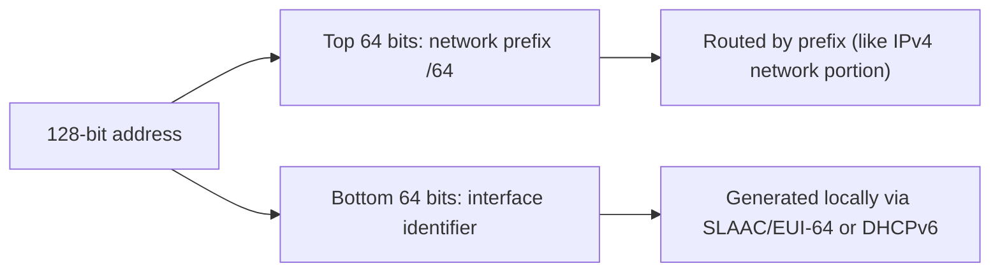

# IPv6 Addressing

## 1. Why This Chapter Exists

IPv6 is the long-term answer to IPv4 exhaustion and is already the default transport for much of the mobile internet and an increasing share of cloud and data-center traffic. Engineers who only know IPv4 are increasingly blindsided by IPv6-specific behavior: link-local addresses appearing unbidden, `A` and `AAAA` records resolving differently, firewalls that assume IPv4 addresses, and connectivity that works on one IP family and not the other. This chapter builds IPv6 address fluency and the operational awareness that dual-stack reality demands.

The chapter treats IPv6 as its own design, not "IPv4 with bigger numbers". The address structure, the `/64` convention, stateless autoconfiguration, and the restoration of end-to-end addressing all change assumptions that IPv4 engineers carry by default. Understanding those differences prevents the common error of applying IPv4 habits (NAT, class boundaries, ARP) where IPv6 does something else.

---

## 2. Address Structure and Notation

An IPv6 address is 128 bits, written as eight groups of four hexadecimal digits separated by colons: `2001:0db8:0000:0000:0000:ff00:0042:8329`. Two compression rules apply:

- Leading zeros within a group may be omitted: `2001:db8:0:0:0:ff00:42:8329`.
- One contiguous run of zero groups may be replaced by `::` exactly once: `2001:db8::ff00:42:8329`.

The `::` may appear only once; using it twice is ambiguous and invalid. Hex digits are case-insensitive by convention written lowercase. A common mistake is miscounting groups after compression—there must be enough groups for the implicit zeros to total eight.

```text
|---- 64-bit network prefix ----|---- 64-bit interface identifier ----|
2001:0db8:0000:0000 : 0000:ff00:0042:8329
```



#### In-Line Glossary: /64

**What it is:** the almost universal boundary in IPv6 between the network prefix (top 64 bits) and the interface identifier (bottom 64 bits) for on-link subnets.

**Why here:** it is fixed by design for SLAAC and Neighbor Discovery to work, so subnet plans are built on /64 boundaries.

**Systemic implication:** because a /64 contains `2^64` addresses—effectively unlimited for host assignment—the address-planning problem shifts from "conserve hosts" to "allocate enough /64s", upending IPv4 sizing habits.

---

## 3. The `/64` Convention and Subnet Planning

Unlike IPv4, where subnet sizes vary to conserve addresses, IPv6 expects on-link subnets to be `/64`. This is because stateless autoconfiguration builds a 64-bit interface identifier and combines it with the advertised /64 prefix; a different prefix length breaks SLAAC unless DHCPv6 is used throughout. As a result, IPv6 address plans allocate `/64`s to each subnet, and address space is managed at the level of how many `/64`s a site needs, not how many hosts a subnet holds.

Typical hierarchy: a site might receive a `/48` (65,536 `/64` subnets) or a `/56` (256 `/64`s) from an ISP, and the enterprise carves the site's allocation into `/64`s per VLAN or segment. Because the numbers are astronomically larger than needed, planning emphasizes structure, summarization, and stable boundaries rather than conservation.

#### In-Line Glossary: Global Unicast Address (GUA)

**What it is:** a globally routable IPv6 address from the range `2000::/3`, equivalent in role to a public IPv4 address.

**Why here:** it is the address a host uses to reach and be reached from the internet, without NAT.

**Systemic implication:** because GUAs restore end-to-end addressing, IPv6 removes NAT's reachability breakage, but it also means hosts are directly reachable and firewalls—not NAT—must enforce inbound policy; assuming NAT provides protection is a serious IPv6 misconfiguration.

---

## 4. Address Types

IPv6 defines several address scopes and purposes.

**Global Unicast (`2000::/3`)** addresses are globally routable and analogous to public IPv4.

**Unique Local (`fc00::/7`, commonly `fd00::/8`)** addresses are the closest analog to RFC 1918 private space: not globally routable, used for internal addressing. Unlike IPv4 private ranges, ULA space is large enough to avoid overlap in practice, though organizations still plan it.

**Link-Local (`fe80::/10`)** addresses exist automatically on every IPv6 interface and are used for Neighbor Discovery, routing protocol adjacencies, and next-hop resolution. They are never routed beyond the link. Every interface has one, even before any global address is assigned.

**Multicast (`ff00::/8`)** is used heavily in IPv6 (there is no broadcast in IPv6). Solicited-node multicast addresses, derived from the target address, make Neighbor Discovery efficient.

**Anycast** addresses are assigned to multiple nodes, with routing delivering to the nearest; they are an ordinary unicast address used in multiple places.

**Special:** `::1/128` is loopback, `::/128` is unspecified.

#### In-Line Glossary: Link-Local Address (IPv6)

**What it is:** an automatically configured `fe80::/10` address, unique per interface and valid only on the local link.

**Why here:** it is how IPv6 performs next-hop resolution and protocol adjacencies, and it is always present.

**Systemic implication:** because link-local addresses appear on every interface and are scoped per-link, tools and firewalls must specify the interface (`%eth0`) and must not treat link-local addresses as routable; confusing scopes is a common source of IPv6 policy errors.

---

## 5. Autoconfiguration and Neighbor Discovery

IPv6 hosts commonly configure themselves via **SLAAC**: they listen for Router Advertisements carrying a prefix and form a GUA by appending an interface identifier to the /64. Interface identifiers can be derived from the MAC address (modified EUI-64) or, more privately, via stable/privacy extensions that randomize the identifier to reduce tracking. **Neighbor Discovery (ND)**, built on ICMPv6, handles address resolution (the IPv6 analog of ARP), Router Advertisements, Redirect, and Duplicate Address Detection, which confirms an address is unique before use.

DHCPv6 can complement or replace SLAAC, especially for delivering options such as DNS servers and for stateful assignment. A common pattern uses RAs for the prefix/default route plus DHCPv6 for DNS.

---

## 6. Dual-Stack and Transition

Most networks run **dual-stack**: hosts have both IPv4 and IPv6 addresses and prefer IPv6 when available (per RFC 6724). This introduces the operational reality that a service can be reachable over one family and not the other, and that DNS must return both `A` and `AAAA` records—or deliberately omit one. A broken IPv6 path can cause connection delays while the client attempts IPv6 first and waits for failure (the "Happy Eyeballs" algorithm mitigates this by racing both families).

Transition mechanisms include **tunnels** (carrying IPv6 over IPv4 or vice versa), **NAT64/DNS64** (translating IPv6 clients to IPv4-only servers), and **464XLAT** (used in mobile networks). These exist because not every endpoint supports both families; understanding them matters because translation reintroduces the reachability and application-compatibility issues discussed in the NAT chapter.

---

## 7. Invariants, Assumptions, and Boundaries

**Invariant: `::` may appear at most once in an address.** Ambiguity otherwise.

**Invariant: every IPv6 interface has a link-local address.** It exists even without global connectivity.

**Invariant: on-link subnets are /64 for SLAAC-based autoconfiguration.** Other lengths require DHCPv6 and coordination.

**Assumption: IPv6 has no broadcast and no NAT by default.** Multicast replaces broadcast, and end-to-end addressing is the design intent.

**Boundary: link-local addresses are link-scoped and not routable.** They must be used with an interface identifier and are not globally meaningful.

**Boundary: larger addresses do not mean simpler operations.** IPv6 changes discovery, security policy, and DNS behavior; treating it as "IPv4 with more digits" leads to gaps (especially firewall policy that ignores IPv6).

**Boundary: dual-stack is two networks to secure.** Every firewall, ACL, and monitoring rule must cover both families or risk a blind spot.

---

## 8. Trade-offs and Rejected Alternatives

**Why /64 everywhere instead of conserving with variable prefixes?** The address space is vast enough that conservation is unnecessary, and a fixed boundary simplifies SLAAC, ND, and planning. Variable-length IPv6 subnets (other than point-to-point /127) add complexity for no benefit at the scale IPv6 offers.

**Why ULA if GUAs are available?** ULA (like private IPv4) provides stable internal addressing independent of provider-assigned prefixes, which matters for internal-only communication and renumbering. The cost is a second addressing scheme to manage; the benefit is insulation from provider changes.

**Why not rely on NAT for IPv6 security?** NAT was never a security control, and IPv6's design removes the need for translation. The rejected approach—carrying NAT habits to IPv6—produces false confidence and misconfigured firewalls; explicit stateful firewalling is the correct model.

**Why dual-stack rather than IPv6-only?** IPv6-only is simpler but breaks when reaching IPv4-only services, requiring translation. Dual-stack preserves reachability during the long transition at the cost of running and securing two families.

---

## 9. Failure Modes and Operational Consequences

**Firewall blind spots.** IPv4 rules exist but no IPv6 rules are defined, so hosts are either fully blocked or, worse, unintentionally exposed. Symptom: inconsistent reachability between families. Operational consequence: maintain policy for both families in parallel.

**Broken IPv6 path with IPv4 fallback.** A partial IPv6 deployment causes connection stalls as clients try IPv6 first and wait. Symptom: slow connections that eventually succeed. Operational consequence: implement Happy Eyeballs on clients and ensure IPv6 paths are either working or cleanly absent.

**DNS returning AAAA without a working path.** AAAA records published but IPv6 unreachable cause delays for dual-stack clients. Symptom: intermittent slowness. Operational consequence: only publish AAAA when IPv6 is genuinely reachable, and monitor both families.

**Link-local confusion.** Configurations or captures mixing `fe80::` addresses without scope lead to misdiagnosis. Symptom: "the address is there but unreachable." Operational consequence: specify interfaces and keep scopes straight.

**Renumbering churn.** Provider prefix changes disrupt addressing if not using stable internal (ULA) addressing and dynamic updates. Symptom: breaks after a provider change. Operational consequence: use stable internal addressing and automated DNS/RA updates.

---

## 10. Hands-On: Working with IPv6

Show IPv6 addresses (including link-local) per interface:

```bash
ip -6 -br addr
```

Inspect the IPv6 routing table and the default route learned from RAs:

```bash
ip -6 route
```

Ping link-local (note the interface scope) and global addresses:

```bash
ping -6 -c3 fe80::1%eth0
ping -6 -c3 2001:4860:4860::8888
```

Query AAAA records and observe dual-stack DNS:

```bash
dig AAAA example.com
```

Inspect neighbor discovery (the IPv6 analog of ARP):

```bash
ip -6 neigh show
```

Interpretation: the presence of a `fe80::/64` address on every interface is normal; a missing global address with a working link-local suggests RA/DHCPv6 is not providing a prefix; comparing `dig A` and `dig AAAA` reveals whether both families are published.

---

## 11. Related Documents

- [IPv4 Addressing Fundamentals](./01-ipv4-addressing-fundamentals.md)
- [CIDR and Subnet Masks](./02-cidr-and-subnet-masks.md)
- [Naming and Address Assignment: DNS, DHCP, and SLAAC](../01-network-fundamentals/05-naming-and-address-assignment-dns-dhcp-and-slaac.md)
- [The IP Layer: Packet Delivery, TTL, MTU, and ICMP](../01-network-fundamentals/03-the-ip-layer-delivery-ttl-mtu-and-icmp.md)

## 12. External References

- [RFC 8200: Internet Protocol, Version 6 (IPv6) Specification](https://www.rfc-editor.org/rfc/rfc8200)
- [RFC 4291: IP Version 6 Addressing Architecture](https://www.rfc-editor.org/rfc/rfc4291)
- [RFC 4862: IPv6 Stateless Address Autoconfiguration](https://www.rfc-editor.org/rfc/rfc4862)
- [RFC 4193: Unique Local IPv6 Unicast Addresses](https://www.rfc-editor.org/rfc/rfc4193)
- [RFC 6724: Default Address Selection for Internet Protocol Version 6 (IPv6)](https://www.rfc-editor.org/rfc/rfc6724)
- [RFC 8305: Happy Eyeballs Version 2](https://www.rfc-editor.org/rfc/rfc8305)
