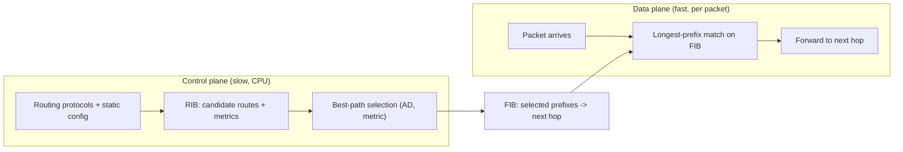
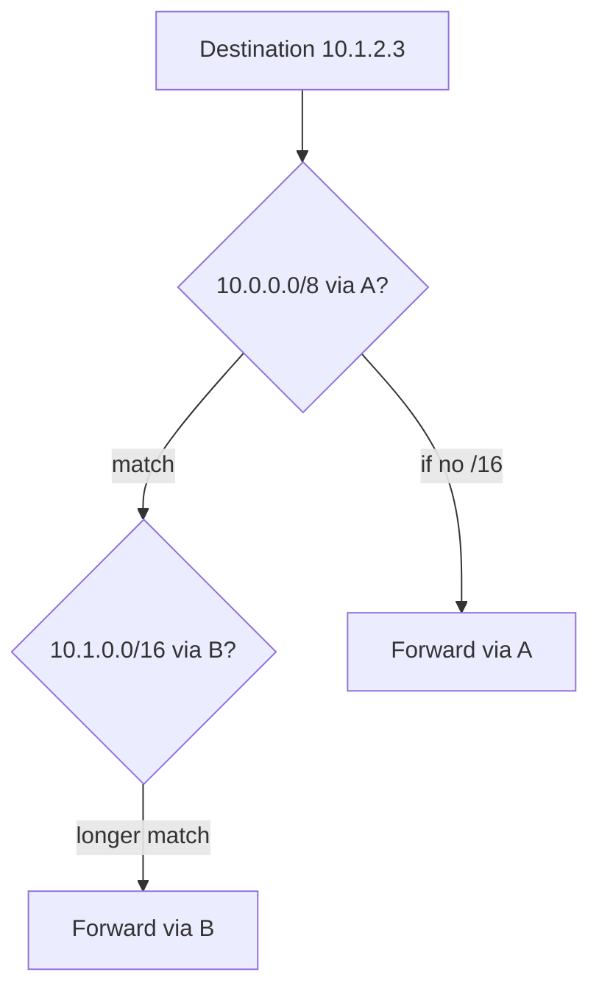

# Routing Fundamentals: Control Plane, Data Plane, and Longest-Prefix Match

## 1. Why This Chapter Exists

Routing is the decision that turns a destination address into a next hop. Every packet that leaves a host relies on a routing decision—first at the host, then at every router along the path. When connectivity fails, the cause is often a routing problem: a missing route, a wrong next hop, a more-specific route that shadows a summary, or asymmetric paths that break stateful devices. Understanding routing at the mechanism level is essential to diagnosing these failures rather than guessing.

This chapter separates the two planes that routing spans: the **control plane**, which learns and selects routes and populates tables, and the **data plane**, which performs the per-packet forwarding lookup against those tables. It explains the longest-prefix-match algorithm that governs which route wins, the metrics and administrative distances that rank candidate routes, and how static and dynamic routing differ. Protocol-specific mechanics (OSPF, BGP) follow in later chapters; here the goal is the shared machinery they all feed into.

---

## 2. Control Plane and Data Plane

Routing operates on two cooperating planes. The **control plane** runs routing protocols and static configuration, exchanges reachability information with neighbors, and computes the best path to each destination. Its output is a routing table (the **RIB**, Routing Information Base): a set of prefixes mapped to next hops, each with a metric and an administrative distance. The control plane is where policy, protocol, and convergence live.

The **data plane** is the fast path: for each packet, the router performs a longest-prefix-match lookup and forwards to the recorded next hop. To do this quickly, the control plane compiles the RIB into a **FIB** (Forwarding Information Base), a lookup-optimized structure (often a trie) that hardware and fast software paths use. The FIB contains only the selected routes, not all candidates.



The separation matters operationally: the control plane can be down or unstable while the FIB continues forwarding existing traffic (a "stale forwarding" window), and a control-plane change does not take effect until the FIB is updated. When debugging, distinguishing "the route is in the RIB but not the FIB" from "the route is missing entirely" localizes the problem.

#### In-Line Glossary: RIB and FIB

**What it is:** the RIB (Routing Information Base) is the control-plane table of candidate routes; the FIB (Forwarding Information Base) is the data-plane table of selected routes used per packet.

**Why here:** routing correctness is evaluated in the RIB but forwarding performance and behavior come from the FIB.

**Systemic implication:** a mismatch between RIB and FIB (a route present but not installed, or installed but stale) produces behavior that contradicts configuration, so both must be inspected during incidents.

---

## 3. Longest-Prefix Match

When multiple routes match a destination, the router chooses the one with the **longest prefix** (most specific). A `/28` beats a `/24`, which beats a `/16`, which beats a `/0` default route. This is not a tie-break; it is the fundamental selection rule, and it makes routing hierarchical and summarizable: a summary route provides reachability while more-specific routes override it where needed.

Consider routes for `10.0.0.0/8` via gateway A and `10.1.0.0/16` via gateway B. A packet to `10.1.2.3` matches both, but the `/16` is longer, so it goes to B. Traffic to `10.2.0.0/16` matches only the `/8` and goes to A. This layering is how aggregates and exceptions coexist.



Longest-prefix match is also the mechanism behind several failure modes. A too-specific route (a leftover host route `/32`) can silently override correct routing, and an over-aggressive summary can black-hole traffic for specific destinations that should have been routed elsewhere. Both are common after migrations and in hand-configured environments.

#### In-Line Glossary: Longest-Prefix Match

**What it is:** the rule that, among all routes matching a destination, the one with the longest (most specific) prefix is used.

**Why here:** it is the core forwarding decision and the reason routing is hierarchical and summarizable.

**Systemic implication:** because specificity always wins regardless of metric, a stale or mistaken specific route defeats an otherwise-correct summary; audits must look for unexpected specific routes, not just missing ones.

---

## 4. Metrics and Administrative Distance

When two routes to the same prefix come from the same source, the **metric** decides. Metrics differ by protocol: hop count (RIP), cost derived from bandwidth (OSPF), or path attributes (BGP). Lower is generally better, but the scales are not comparable across protocols.

When routes to the same prefix come from different sources (a static route versus OSPF versus BGP), **administrative distance (AD)** decides which source is preferred, before metrics are compared. AD is a local preference ranking: connected routes are most trusted, then static routes, then dynamic protocols in a defined order. This is why a static route overrides a learned route by default, and why an engineer can force a particular source to win by adjusting AD.

The practical insight is that "best route" is a two-stage decision: first choose the most trustworthy source by AD, then choose the best path within that source by metric. Confusing the two leads to misdiagnosis when, for example, OSPF is learning a route correctly but a stale static route with lower AD is actually forwarding traffic.

#### In-Line Glossary: Administrative Distance

**What it is:** a locally configured ranking that determines which route source is preferred when multiple sources offer the same prefix.

**Why here:** it resolves conflicts across protocols and static configuration, where metrics are not comparable.

**Systemic implication:** because AD is local and not exchanged, different routers can prefer different sources for the same prefix, producing asymmetric routing that breaks stateful inspection and is hard to see without per-router inspection.

---

## 5. Static Versus Dynamic Routing

**Static routes** are configured by hand and do not change until edited. They are simple, deterministic, and impose no protocol overhead, which makes them ideal for small, stable topologies, stub networks, and default routes. Their weakness is that they do not react to failures: if the next hop goes away, the static route still points at it, and traffic is black-holed until an operator intervenes.

**Dynamic routing** uses protocols to learn routes and react to topology changes. It provides automatic failover, adapts to new links, and scales to large, changing networks. The cost is complexity, protocol overhead, potential for instability (route flapping, loops during convergence), and a new class of failure modes (misconfiguration, adjacency loss, redistribution errors).

The choice is a trade-off between determinism and adaptivity. Small, predictable networks often prefer static routing for control; large or fault-tolerant networks require dynamic routing despite its complexity. Many production networks combine them: static defaults and specific exceptions alongside dynamic protocols for the bulk of reachability.

---

## 6. Forwarding, Next Hop, and Asymmetry

A route maps a prefix to a **next hop**: the neighbor to which matching packets are handed. The next-hop resolution itself depends on the link layer (ARP/ND), which is why a correct route with an unresolvable next hop still fails.

Because routing is per-router and per-prefix, forward and return paths need not be symmetric. **Asymmetric routing** is common and often harmless for stateless protocols, but it breaks stateful devices (firewalls, NAT, load balancers) that expect to see both directions of a flow. This is why "the connection times out though both directions are reachable" is a classic symptom of asymmetry, and why validating path symmetry is part of diagnosing stateful middlebox failures.

---

## 7. Invariants, Assumptions, and Boundaries

**Invariant: longest-prefix match always wins, regardless of metric.** Specificity precedes preference.

**Invariant: the FIB is derived from the RIB after best-path selection.** Forwarding reflects the selected route, not all candidates.

**Assumption: the next hop is resolvable.** A route is useless if the layer-2 resolution of its next hop fails.

**Assumption: the topology converges.** During convergence, transient loops or black holes are possible.

**Boundary: routing determines reachability, not policy.** Filters, firewalls, and ACLs decide whether permitted traffic is allowed; a route existing does not mean traffic will be accepted.

**Boundary: a route is not a guarantee of delivery.** It directs traffic toward a destination; loss, filtering, or failure downstream still applies.

**Boundary: metrics are protocol-local.** Cross-protocol comparison is by administrative distance, not metric value.

---

## 8. Trade-offs and Rejected Alternatives

**Why not make every route static?** Static routing is deterministic and overhead-free but cannot fail over automatically, which is unacceptable for anything requiring availability. The rejected extreme—fully static—is manageable only in small, stable networks.

**Why not let dynamic routing decide everything, including defaults?** Dynamic protocols can advertise defaults, but a purely dynamic posture removes the operator's ability to pin critical paths and can propagate misconfigurations widely. The balanced approach uses static policy where determinism matters and dynamic learning where adaptivity matters.

**Why is longest-prefix match preferable to a single flat table?** Specificity-based selection enables summarization and exception handling simultaneously, which is what allows the internet's routing table to remain manageable. A hypothetical rule based on metric alone would not allow a specific exception to cleanly override an aggregate.

**Why tolerate asymmetric routing?** Enforcing symmetry requires coordination across the topology (for example, careful IGP metrics or policy) and can be operationally expensive. Tolerance is pragmatic where no stateful device is in the path; where stateful devices exist, symmetry must be engineered.

---

## 9. Failure Modes and Operational Consequences

**Missing route.** No prefix matches, so the packet is dropped (or follows the default route to the wrong place). Symptom: destination unreachable from some sources. Operational consequence: compare routing tables on the sending and intermediate routers.

**Black-holing via specifics or summaries.** A specific route pointing to a dead next hop, or a summary covering unrouted space, discards traffic silently. Symptom: reachable by ping from one place, not another. Operational consequence: audit for unexpected specific routes and validate summary coverage.

**Asymmetric routing breaking stateful paths.** Return traffic bypasses a firewall/NAT and is dropped. Symptom: connection establishes then times out. Operational consequence: check both directions and preserve symmetry for stateful devices.

**Route flapping.** A link or adjacency oscillates, causing repeated reconvergence. Symptom: intermittent loss and CPU spikes. Operational consequence: dampen flapping, stabilize the underlying cause, and monitor route churn.

**Redirect/ICMP dependency.** Some routers send ICMP redirects to optimize paths; a host that ignores or is denied them may take suboptimal paths. Symptom: traffic takes an unexpected route. Operational consequence: understand redirect behavior and disabling decisions.

**AD-induced divergence.** Different routers prefer different sources for a prefix. Symptom: inconsistent forwarding. Operational consequence: standardize AD policy across the topology.

---

## 10. Hands-On: Inspecting Routing

Show the host routing table and default route:

```bash
ip route show
ip route get 10.1.2.3
```

`ip route get` reveals the exact next hop and source address the kernel would use, which is the fastest way to confirm a routing decision.

Show the kernel's FIB-oriented cache view and per-route details:

```bash
ip route show table main
ip -details route show
```

On a Linux router with multiple tables or policy routing:

```bash
ip rule show
ip route show table 100
```

Trace the path to observe each routing decision:

```bash
traceroute 10.1.2.3
mtr -rwzbc 10 10.1.2.3
```

Interpretation: if `ip route get` shows a next hop that is unreachable (next hop resolution fails), the problem is layer 2; if it selects an unexpected next hop, a more-specific route is likely shadowing the intended one.

---

## 11. Related Documents

- [The IP Layer: Packet Delivery, TTL, MTU, and ICMP](../01-network-fundamentals/03-the-ip-layer-delivery-ttl-mtu-and-icmp.md)
- [Interior Gateway Protocols: OSPF and Link-State/Distance-Vector Routing](./02-interior-gateway-protocols.md)
- [BGP and Internet Routing](./03-bgp-and-internet-routing.md)
- [Overlays and Tunnels: VXLAN, GRE, IPsec, and WireGuard](./04-overlays-and-tunnels.md)

## 12. External References

- [RFC 1812: Requirements for IP Version 4 Routers](https://www.rfc-editor.org/rfc/rfc1812)
- [RFC 4632: Classless Inter-Domain Routing (CIDR)](https://www.rfc-editor.org/rfc/rfc4632)
- [RFC 791: Internet Protocol](https://www.rfc-editor.org/rfc/rfc791)
- [RFC 8200: Internet Protocol, Version 6 (IPv6) Specification](https://www.rfc-editor.org/rfc/rfc8200)
