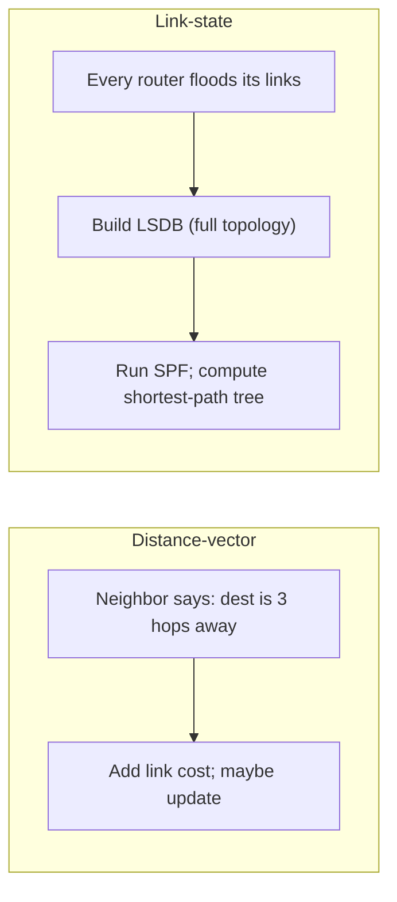
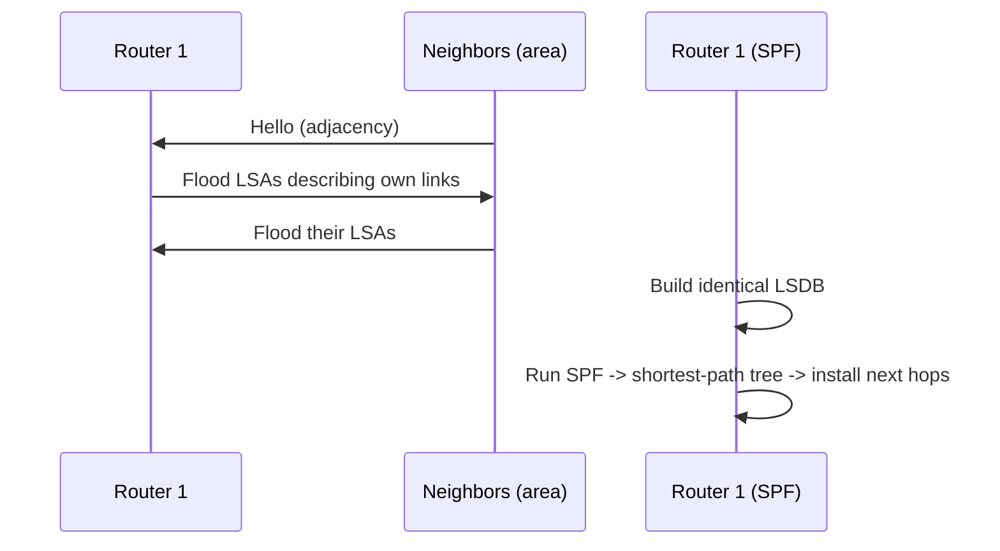

# Interior Gateway Protocols: OSPF and Link-State/Distance-Vector Routing

## 1. Why This Chapter Exists

Inside an autonomous network—a data center, a campus, an enterprise, a cloud region's internal fabric—routers learn paths to each other through an **Interior Gateway Protocol (IGP)**. The IGP is the control plane that keeps internal reachability correct and converging after failures. When an internal link fails or a rack is added, it is the IGP that reroutes traffic, and when it misbehaves, internal connectivity degrades in ways that are subtle and topology-dependent.

This chapter explains the two dominant IGP families, distance-vector and link-state, and then examines OSPF, the most widely deployed link-state IGP, in enough depth to reason about areas, costs, designated routers, and convergence. It also covers the recurring operational hazards of redistribution and route leaks. The goal is to understand not just what an IGP advertises but how it decides, why it converges, and how it fails.

---

## 2. Distance-Vector Versus Link-State

The two families differ in what routers know and how they compute paths.

**Distance-vector** protocols (RIP, EIGRP in a distance-vector mode) have each router advertise its distance (metric) to each destination to its neighbors. A neighbor adds its own link cost and, if the result is better than what it currently knows, updates its table. Routers therefore know only the direction and distance to a destination ("it is that way, N hops"), not the full topology. This is simple and low-overhead but converges slowly and is prone to loops, because a router can be misled by a neighbor that still believes a failed path is valid (the **count-to-infinity** problem, mitigated but not eliminated by split horizon and route poisoning).

**Link-state** protocols (OSPF, IS-IS) have each router flood information about its own links and neighbors to all routers in an area. Every router builds an identical **Link-State Database (LSDB)** representing the full topology, then independently runs **Dijkstra's Shortest Path First (SPF)** algorithm to compute a shortest-path tree. Because each router reasons over the complete topology, link-state protocols converge faster and avoid distance-vector loops, at the cost of more memory, CPU, and flooding overhead.



#### In-Line Glossary: Distance-Vector

**What it is:** a routing approach where each router knows only the distance and direction to destinations, learned from neighbors' advertisements.

**Why here:** it explains RIP's simplicity and its convergence and loop pathologies.

**Systemic implication:** because distance-vector routers lack a global view, they can transiently agree on invalid paths, producing routing loops during convergence that must be bounded by mechanisms like split horizon and triggered updates.

#### In-Line Glossary: Link-State

**What it is:** a routing approach where each router floods its link information so all routers build an identical topology database and compute shortest paths independently.

**Why here:** it is the basis of OSPF and IS-IS and the reason they converge fast and avoid classic loops.

**Systemic implication:** link-state's speed and loop-freedom depend on consistent databases; a router with a stale or partitioned LSDB computes a wrong tree, so flooding reliability and area design are correctness concerns, not just performance ones.

---

## 3. RIP in Brief

**RIP (Routing Information Protocol)** is the canonical distance-vector protocol: it uses hop count as its metric, with a maximum of 15 (16 = infinity/unreachable), and advertises the full table every 30 seconds. Its simplicity makes it easy to reason about and suitable for very small networks, but hop count ignores bandwidth and latency, the 15-hop limit caps network diameter, and it converges slowly. Its historical pathologies—count-to-infinity, and the "good news travels fast, bad news travels slowly" asymmetry—are textbook. RIP persists mainly in legacy and trivial topologies.

---

## 4. OSPF Mechanics

**OSPF (Open Shortest Path First)** is a link-state IGP that computes least-cost paths. Its key mechanisms are:

**Link-State Advertisements (LSAs)** are the units each router floods. A router originates a router-LSA describing its links and costs and a network-LSA for broadcast segments. LSAs are flooded reliably to all routers in the same **area**.

**Areas** partition an OSPF domain to bound flooding and SPF computation. Area 0 (the **backbone**) must be contiguous, and all other areas connect to it (directly or via virtual links). Routers on area boundaries (**ABRs**) summarize between areas. The area design is the primary lever for scaling OSPF: a well-designed hierarchy keeps LSDBs small and SPF cheap.

**Cost** is the OSPF metric, by default proportional to the inverse of link bandwidth (higher bandwidth = lower cost). Costs are cumulative along a path, so SPF chooses the path with the smallest total cost. Cost is configurable, which is how operators influence path selection.

**Designated Router (DR) and Backup DR (BDR)** are elected on broadcast segments to reduce adjacency count: rather than every router forming an adjacency with every other, each forms one with the DR, which represents the segment. This bounds the number of adjacencies (O(n²) becomes O(n)).

**SPF** runs over the LSDB to build the shortest-path tree rooted at the local router, and the resulting next hops are installed in the RIB. When an LSA changes, the router recomputes (or incrementally updates) the tree.



#### In-Line Glossary: OSPF Area

**What it is:** a group of OSPF routers that share a common link-state database, with flooding and SPF confined to the area.

**Why here:** areas bound the cost of link-state operation, which is what makes OSPF scale beyond a single flat domain.

**Systemic implication:** area design mistakes (discontiguous area 0, mis-summarization at ABRs) cause reachability gaps that look like random failures; the hierarchy must be correct for summaries and exceptions to propagate as intended.

---

## 5. Metrics, Path Selection, and Fast Convergence

IGP path selection is "lowest total cost," but cost is only half the story. **Convergence**—how quickly the network agrees on new paths after a change—is often more important operationally than optimality. Mechanisms such as hello/hold timers, incremental SPF, and fast-reroute (precomputed backup paths) reduce the disruption window. Aggressive timers speed convergence but risk false failures under load; conservative timers are stable but slow. This timer tuning is a recurring trade-off in IGP design.

---

## 6. Redistribution and Route Leaks

IGPs rarely run alone. An organization may run OSPF internally, redistribute into BGP at the edge, and have static routes for specific prefixes. **Redistribution** injects routes from one source into another, and it is a common source of outages because it can create loops, advertise unintended prefixes, or trigger feedback between protocols. Careless redistribution can leak internal routes outward or external routes inward where they shadow correct paths via longest-prefix match.

The discipline is to redistribute narrowly (with route maps and filters), to be explicit about which prefixes and which metrics, and to verify what actually propagates rather than assuming the filter took effect.

---

## 7. Invariants, Assumptions, and Boundaries

**Invariant: in link-state protocols, all routers in an area have an identical LSDB.** Divergence means inconsistent routing.

**Invariant: OSPF area 0 is the backbone to which all other areas attach.** A discontiguous backbone breaks inter-area routing.

**Invariant: metrics accumulate along the path.** The chosen path minimizes total cost.

**Assumption: hellos/adjacencies are stable.** Flapping adjacencies cause repeated reconvergence and instability.

**Boundary: an IGP optimizes within a domain, not across administrative boundaries.** Inter-domain policy is BGP's job.

**Boundary: an IGP provides reachability, not security or policy.** Authentication exists but does not make an IGP a trust boundary; redistribution filters do policy.

**Boundary: convergence is not instantaneous.** Transient loops and black holes are inherent to distributed reconvergence.

---

## 8. Trade-offs and Rejected Alternatives

**Why link-state rather than distance-vector at scale?** Link-state converges faster, avoids loops, and scales better with hierarchy (areas). The cost is memory, CPU, and flooding. Distance-vector remains viable only for small or simple domains.

**Why hierarchical areas rather than one flat OSPF domain?** Flat OSPF makes every router carry the full topology and run SPF over it, which does not scale. Areas trade a more complex design for bounded resource use. The rejected alternative—flat—works only for small networks.

**Why configure costs rather than trust defaults?** Default costs derived from bandwidth are a good baseline but rarely match intended traffic engineering. Manual costs let operators steer traffic, at the cost of maintaining intent as topology changes. The trade is control versus simplicity.

**Why not avoid redistribution entirely?** Avoiding it requires a single protocol end to end, which is often impractical when boundaries, mergers, or vendor differences exist. Redistribution with strict filtering is the pragmatic compromise.

---

## 9. Failure Modes and Operational Consequences

**Adjacency flapping.** Unstable links or timer mismatches cause repeated down/up. Symptom: intermittent loss and high SPF churn. Operational consequence: fix the physical/timer cause and monitor adjacency stability.

**Area design errors.** Discontiguous area 0 or a broken ABR summary causes reachability gaps. Symptom: some prefixes reachable, others not, across a boundary. Operational consequence: validate area topology and summarize deliberately.

**Redistribution loops and leaks.** Routes propagate where they should not, or feedback loops form. Symptom: unexpected paths, or internal prefixes seen externally. Operational consequence: filter redistribution with route maps and test propagation.

**Cost misconfiguration.** A wrong cost steers traffic onto a suboptimal or congested link. Symptom: latency or congestion on a path that "should not" carry that traffic. Operational consequence: review costs against intended traffic flow.

**MTU and unicast issues.** Some IGP adjacencies require reliable exchange and can be sensitive to MTU or unicast reachability. Symptom: adjacency stuck in a partially formed state. Operational consequence: verify MTU and unicast connectivity between neighbors.

**Authentication mismatch.** OSPF authentication disabled on one side causes adjacency failure. Symptom: neighbor stuck, no routes exchanged. Operational consequence: keep authentication configuration consistent.

---

## 10. Hands-On: Observing an IGP

On a Linux host running an OSPF daemon (e.g. FRRouting), inspect neighbors, LSDB, and routes:

```bash
vtysh -c 'show ip ospf neighbor'
vtysh -c 'show ip ospf database'
vtysh -c 'show ip ospf route'
```

Check the kernel routes that the IGP installed and their protocol:

```bash
ip route show proto ospf
ip route show
```

Reveal which next hop is chosen for a destination:

```bash
ip route get 10.20.30.40
```

Monitor adjacency or route changes (tools vary by daemon):

```bash
vtysh -c 'show ip ospf interface'
```

Interpretation: if neighbors are `FULL` but a prefix is missing from `show ip ospf route`, the issue is likely summarization or filtering; if an adjacency is stuck at `EXSTART` or `INIT`, the issue is at the transport/MTU or authentication layer, before any topology information is exchanged.

---

## 11. Related Documents

- [Routing Fundamentals: Control Plane, Data Plane, and Longest-Prefix Match](./01-routing-fundamentals.md)
- [BGP and Internet Routing](./03-bgp-and-internet-routing.md)
- [Overlays and Tunnels: VXLAN, GRE, IPsec, and WireGuard](./04-overlays-and-tunnels.md)
- [Cloud Virtual Networks: Connectivity Topologies](../05-cloud-virtual-networks/05-connectivity-topologies.md)

## 12. External References

- [RFC 2328: OSPF Version 2](https://www.rfc-editor.org/rfc/rfc2328)
- [RFC 5340: OSPF for IPv6 (OSPFv3)](https://www.rfc-editor.org/rfc/rfc5340)
- [RFC 2453: RIP Version 2](https://www.rfc-editor.org/rfc/rfc2453)
- [RFC 1195: Use of OSI IS-IS for Routing in TCP/IP](https://www.rfc-editor.org/rfc/rfc1195)
