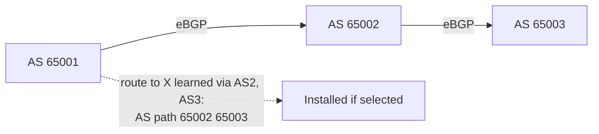
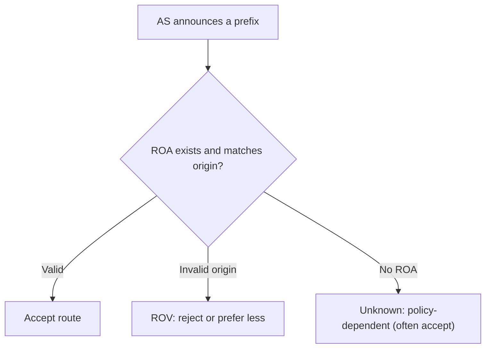

# BGP and Internet Routing

## 1. Why This Chapter Exists

The internet is a network of networks, each independently operated and each with its own policies. The protocol that stitches them together—that lets one operator's prefix be reachable from every other operator—is the **Border Gateway Protocol (BGP)**. BGP is not merely a routing protocol; it is a policy engine. Its decisions encode business relationships, traffic-engineering intent, and contractual obligations, and its failures (misconfigurations, leaks, hijacks) can redirect or black-hole traffic for entire regions of the internet.

This chapter explains BGP's path-vector model, the terminology of autonomous systems and peering, the decision process that selects a route among many candidate paths, the scaling mechanisms (route reflectors) that make BGP viable inside large networks, the special technique of anycast, and the security failures that make BGP the internet's most consequential trust problem. It is the capstone of the routing section because BGP is where internal routing meets global policy.

---

## 2. BGP as a Path-Vector Protocol

BGP exchanges reachability for prefixes between routers, carrying an **AS path**: the sequence of Autonomous System numbers a route has traversed. An **Autonomous System (AS)** is a network under a single administrative control with a unique number (public ASNs are allocated by RIRs; private ranges exist for internal use). BGP uses the AS path both for loop prevention (a router rejects a route whose AS path already contains its own ASN) and as a coarse metric (shorter paths are generally preferred, though policy usually dominates).

Two flavors exist. **eBGP** runs between different autonomous systems (external peers) and is how the global routing table is built. **iBGP** runs between routers within the same AS to distribute externally learned routes internally. eBGP sessions are typically directly connected; iBGP sessions require full-mesh reachability or a scaling mechanism because iBGP-learned routes are not re-advertised to other iBGP peers by default (to prevent loops).



#### In-Line Glossary: Autonomous System (AS)

**What it is:** a collection of IP prefixes and routers under one administrative authority, identified by an AS number (ASN).

**Why here:** BGP routing policy is expressed between autonomous systems, and the AS path encodes the sequence of systems a route traversed.

**Systemic implication:** because the AS is the unit of policy, a single misconfiguration within one AS can affect reachability for many others; the internet's resilience depends on operators configuring policy correctly and filtering their peers.

#### In-Line Glossary: AS Path

**What it is:** the ordered list of autonomous systems a BGP route has passed through.

**Why here:** it provides loop prevention and is a primary input to BGP's best-path selection.

**Systemic implication:** because path length is visible and often used as a tie-breaker, operators can manipulate it (path prepending) to influence inbound traffic, which is a traffic-engineering lever and a potential source of unintended routing changes.

---

## 3. The BGP Decision Process

BGP can learn multiple paths to the same prefix from different peers. It selects one best path through a defined sequence of steps, roughly:

1. Highest **local preference** (a local policy knob, often used to prefer one exit).
2. Shortest **AS path**.
3. Lowest **origin** type (IGP < EGP < incomplete).
4. Lowest **MED** (Multi-Exit Discriminator, a hint to a neighboring AS).
5. Prefer eBGP over iBGP.
6. Lowest IGP metric to the next hop.
7. Tie-breakers (router ID, peer address).

The order matters because earlier steps dominate. Local preference, set by policy, almost always determines the outcome before the AS path is even considered, which is why BGP is described as policy-first and shortest-path second.

#### In-Line Glossary: Route Reflector

**What it is:** an iBGP router designated to reflect routes learned from iBGP peers to other iBGP peers, removing the need for a full mesh.

**Why here:** full-mesh iBGP scales as O(n²) sessions; route reflectors reduce this to a hierarchy, which is how large networks run BGP internally.

**Systemic implication:** route reflectors introduce a design that can create suboptimal paths and requires correct cluster configuration; misconfigured reflection can drop or loop routes internally.

---

## 4. Peering and Transit: BGP Encodes Business Relationships

BGP routes flow according to commercial relationships, and the routing policy encodes them:

- **Transit:** a customer pays a provider for reachability to the whole internet. The provider advertises routes to the customer and vice versa.
- **Peering:** two networks exchange routes for their own customers (and often their customers' customers) without payment, typically because it saves both parties transit costs.
- **Settlement-free peering vs paid peering:** variants that affect which routes are exchanged.

The classic rule of thumb, encoded in routing policy, is that a network advertises to a peer only its own routes and those of its customers—**not** routes learned from other peers or providers—to prevent becoming an unpaid transit path. Violating this is a **route leak**, and it is one of the most common ways traffic is accidentally rerouted.

---

## 5. Anycast

**Anycast** assigns the same prefix (often the same address) to multiple locations and lets BGP route users to the topologically nearest instance. This is how global DNS resolvers and CDNs place points of presence that share addresses, achieving low latency and DDoS resilience without changing client configuration. The trade-off is that routing changes (a BGP withdrawal or a path change) can shift traffic between instances, and anycast is unsuitable for stateful protocols that require session affinity to a specific server.

#### In-Line Glossary: Anycast

**What it is:** advertising the same address or prefix from multiple locations so routing delivers users to the nearest instance.

**Why here:** it is a core mechanism for global-scale DNS, CDN, and DDoS resilience.

**Systemic implication:** because the "nearest" instance is chosen by BGP and can change, anycast works best for stateless or replicated services; stateful affinity across anycast is fragile because the client can be rerouted mid-session.

---

## 6. BGP Security: Hijacks, Leaks, and RPKI

BGP has no built-in authentication of prefix ownership. Any AS can announce any prefix, and the internet will generally believe it if it looks like a better path. This produces two failure classes. A **route hijack** is the announcement of a prefix by an AS not authorized to originate it, diverting traffic; sometimes accidental (a fat-finger prefix) and sometimes malicious. A **route leak** is the propagation of routes beyond intended policy boundaries, often making one network an unintended transit path and degrading performance widely.

Defenses are gradually being deployed. **Prefix filtering** (bogon and IRR-based filters) blocks obviously invalid announcements. **RPKI (Resource Public Key Infrastructure)** with **ROAs (Route Origin Authorizations)** cryptographically authorizes which AS may originate a prefix, enabling **Route Origin Validation (ROV)** so routers can reject invalid origins. **BGPsec** would authenticate the path itself but has limited deployment. **Max-prefix limits** protect a router from being overwhelmed by a peer that leaks the entire table.



#### In-Line Glossary: RPKI and ROA

**What it is:** RPKI is a cryptographic framework binding prefixes to their authorized originating AS; a ROA is a signed statement of which AS may originate a prefix.

**Why here:** it is the leading defense against accidental and malicious BGP hijacks, enabling route origin validation.

**Systemic implication:** RPKI only secures origin (who may originate), not the full path, so it does not stop all leaks; partial deployment means an invalid route may still be accepted by peers that do not validate, so value grows with adoption.

---

## 7. Invariants, Assumptions, and Boundaries

**Invariant: BGP is policy-driven; local preference and filters dominate before path metrics.**

**Invariant: the AS path prevents loops.** A route containing the receiver's own ASN is rejected.

**Invariant: iBGP does not re-advertise iBGP-learned routes by default.** Scaling requires route reflectors or confederations.

**Assumption: peers behave according to policy and filter their announcements.** BGP trusts announcements far more than it should.

**Boundary: BGP provides reachability, not security, integrity, or correctness of origin.** Those require RPKI and filtering.

**Boundary: the "best" path is locally optimal, not globally optimal.** Each AS optimizes its own policy; global optimality is not a goal and not achieved.

**Boundary: BGP convergence is slow relative to IGPs.** Withdrawals and path changes can take time to propagate, and flapping is dampened to protect the network.

---

## 8. Trade-offs and Rejected Alternatives

**Why policy-first rather than shortest-path-first?** The internet is a commercial ecosystem; operators must be able to express business intent (prefer a cheaper transit, avoid a competitor's network). Shortest-path-only routing cannot express this. The cost is that routing is not globally optimal and can be manipulated.

**Why route reflectors rather than a full iBGP mesh?** Full mesh scales quadratically and is unmanageable beyond modest sizes. Reflectors trade a more complex design and potential suboptimality for scalability. The rejected alternative—full mesh—does not scale.

**Why is RPKI origin validation partial and incremental?** Because it requires every prefix owner to publish ROAs and every network to validate, and a strict policy of rejecting "unknown" routes would break connectivity during the long deployment tail. The pragmatic posture is to reject invalid, accept unknown, and roll out gradually.

**Why not replace BGP with a global link-state protocol?** A global link-state system would require a single topology database for the entire internet, which is neither scale-feasible nor compatible with independent policy. BGP's path-vector, policy-driven design is the only workable model at internet scale.

---

## 9. Failure Modes and Operational Consequences

**Route hijack.** An unauthorized origin diverts traffic. Symptom: traffic for a prefix flows through an unexpected network, or is black-holed. Operational consequence: deploy ROV, monitor for unexpected origin AS changes, and register ROAs.

**Route leak.** A network propagates routes beyond policy, becoming unintended transit. Symptom: widespread latency and congestion as traffic reroutes. Operational consequence: filter announcements to customers, and use max-prefix limits and RPKI.

**BGP session flapping.** Unstable sessions cause repeated reconvergence. Symptom: intermittent reachability and route churn. Operational consequence: dampen flapping, stabilize the session transport, and monitor.

**Black-holes via more-specifics.** A more-specific announcement overrides an aggregate and can drop traffic. Symptom: parts of a prefix unreachable. Operational consequence: monitor for unexpected more-specifics and validate with ROV.

**MED/local-pref mistakes.** Policy misconfiguration sends traffic out an expensive or congested path. Symptom: cost or performance surprises. Operational consequence: review policy with tooling and test before deployment.

**Full-table exhaustion.** A peer sends more prefixes than a router can hold. Symptom: router memory exhaustion and session resets. Operational consequence: set max-prefix limits and size routing hardware for the table.

---

## 10. Hands-On: Looking at BGP

On a Linux host running a BGP daemon (e.g. FRRouting, BIRD), inspect peers and the table:

```bash
vtysh -c 'show bgp summary'
vtysh -c 'show bgp ipv4 unicast'
vtysh -c 'show bgp ipv4 unicast 203.0.113.0/24'
```

Inspect a specific path's attributes:

```bash
vtysh -c 'show bgp ipv4 unicast 203.0.113.0/24 bestpath'
```

Observe public-looking routing data indirectly (with a public route collector or looking glass), and check a prefix's origin authorization:

```bash
# Example: query a public RPKI validator or looking glass for a prefix
echo "Use a provider looking glass or an RPKI validator to verify origin AS"
```

Inspect whether a route is eBGP or iBGP and its next hop:

```bash
vtysh -c 'show ip route bgp'
```

Interpretation: in `show bgp ... bestpath`, the winning attributes show why one path was chosen; comparing the received `AS path` with the expected origin reveals possible hijacks, and an origin that does not match the ROA indicates an invalid announcement.

---

## 11. Related Documents

- [Routing Fundamentals: Control Plane, Data Plane, and Longest-Prefix Match](./01-routing-fundamentals.md)
- [Interior Gateway Protocols: OSPF and Link-State/Distance-Vector Routing](./02-interior-gateway-protocols.md)
- [Overlays and Tunnels: VXLAN, GRE, IPsec, and WireGuard](./04-overlays-and-tunnels.md)
- [Cloud Virtual Networks: Connectivity Topologies](../05-cloud-virtual-networks/05-connectivity-topologies.md)

## 12. External References

- [RFC 4271: A Border Gateway Protocol 4 (BGP-4)](https://www.rfc-editor.org/rfc/rfc4271)
- [RFC 4272: BGP Security Vulnerabilities Analysis](https://www.rfc-editor.org/rfc/rfc4272)
- [RFC 6480: An Infrastructure to Support Secure Internet Routing (RPKI)](https://www.rfc-editor.org/rfc/rfc6480)
- [RFC 7454: BGP Operations and Security](https://www.rfc-editor.org/rfc/rfc7454)
- [RFC 4786: Operation of Anycast Services](https://www.rfc-editor.org/rfc/rfc4786)
