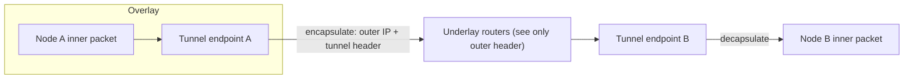
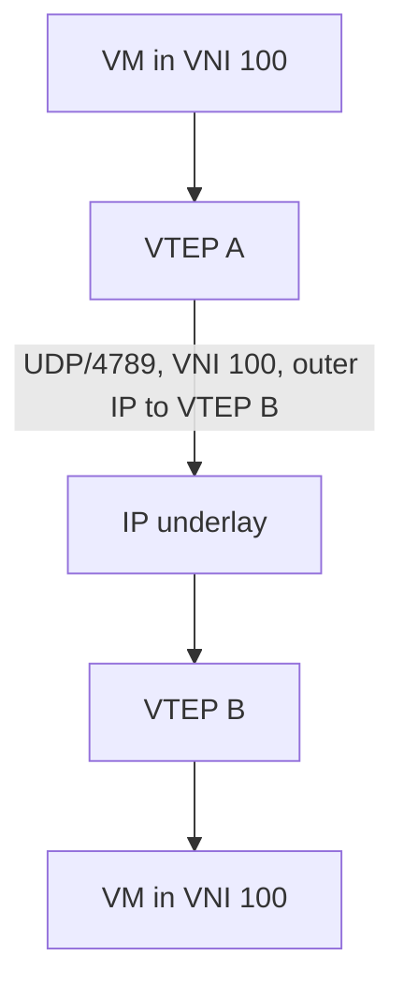

# Overlays and Tunnels: VXLAN, GRE, IPsec, and WireGuard

## 1. Why This Chapter Exists

Modern networks increasingly run **overlays**: logical topologies built on top of an existing physical network by encapsulating one protocol inside another. Data-center fabrics use VXLAN to stretch layer-2 segments across an IP underlay; site-to-site connectivity uses GRE or IPsec tunnels; Kubernetes and service meshes tunnel pod traffic; SD-WAN builds policy overlays across cheap internet links. Overlays are how networks gain flexibility and policy independence from the physical topology, and they are also a recurring source of hard-to-diagnose failures because they nest packets, shrink the usable MTU, and hide the real path.

This chapter explains what an overlay is, the mechanics of the dominant tunneling protocols (VXLAN, GRE, IPsec, WireGuard), the operational consequences of encapsulation (especially MTU and visibility), and where overlays fit versus underlay routing. It closes the routing section by connecting internal routing, internet routing, and the tunneling techniques that let operators build their own topologies above them.

---

## 2. What an Overlay Is: Underlay and Encapsulation

An **overlay** is a logical network whose links are provided by tunnels carried over an **underlay** (the physical or base network). The tunnel wraps each payload packet in an outer header addressed in the underlay; intermediate underlay devices forward by the outer header and never inspect the inner one. At the tunnel endpoint, the outer header is stripped and the inner packet is processed normally.



This gives the overlay several powerful properties: the overlay can use its own addressing independent of the underlay; overlays can span underlay topology changes; and policy can be applied at tunnel endpoints without reconfiguring the underlay. The costs are encapsulation overhead (a smaller effective MTU), reduced visibility (underlay devices cannot see inner traffic), and added complexity in control and troubleshooting.

#### In-Line Glossary: Underlay and Overlay

**What it is:** the underlay is the transport network actually forwarding packets; the overlay is the logical network carried over it via tunnels.

**Why here:** overlays decouple logical topology from physical topology, which is their purpose and their main source of complexity.

**Systemic implication:** because underlay devices cannot see overlay traffic, failures can be invisible to the very network that carries them, so observability must be designed at the endpoints and at multiple layers.

---

## 3. VXLAN

**VXLAN (Virtual eXtensible LAN)** encapsulates layer-2 Ethernet frames inside UDP/IP packets, allowing layer-2 segments to span a layer-3 underlay. Each segment is identified by a **24-bit VNI (VXLAN Network Identifier)**, which scales far beyond VLAN's 12 bits and is what makes multi-tenant data-center fabrics possible. The tunnel endpoints are **VTEPs (VXLAN Tunnel Endpoints)**, typically on hypervisors or top-of-rack switches, which encapsulate frames from a local segment and send them to the VTEP owning the destination.

VXLAN carries unicast, and also must handle broadcast/unknown-unicast/multicast (BUM) traffic. Early VXLAN used multicast in the underlay to flood BUM; modern designs use a control plane, commonly **EVPN (Ethernet VPN)**, to learn MAC and IP reachability and avoid flooding. The VNI maps to a tenant or segment, and the underlay just routes UDP packets between VTEPs.



---

## 4. GRE

**GRE (Generic Routing Encapsulation)** is a simple, generic tunneling protocol: it wraps almost any network-layer protocol inside IP. GRE itself provides no encryption or authentication—it is a plain encapsulation—so it is often combined with IPsec to secure the tunnel. Its simplicity (no per-tenant identifiers, minimal overhead) makes it useful for straightforward point-to-point tunnels, but it has no built-in security and no native scaling mechanism for many tenants, which is why VXLAN/EVPN dominates large multi-tenant fabrics.

---

## 5. IPsec and WireGuard

**IPsec** secures IP traffic with encryption and authentication. It has two modes: **transport mode**, which protects the payload between two hosts, and **tunnel mode**, which encapsulates the entire original packet inside a new IP packet (used for VPN gateways). IPsec provides confidentiality, integrity, and authentication, and runs in the kernel or hardware. Its trade-offs are configuration complexity (security associations, IKE negotiation) and the fact that it is often coupled with NAT traversal complications.

**WireGuard** is a modern, deliberately simple tunnel that provides encrypted, authenticated point-to-point links. It uses a small, fixed set of modern cryptography, is configured with public-key peers and allowed-IP lists, and is significantly easier to operate than classic IPsec. It omits some IPsec features (for example, dynamic routing integration is simpler but less rich) but covers the common VPN and mesh use cases with far less configuration and attack surface.


---

## 6. MPLS and L3VPN (Context)

**MPLS (Multiprotocol Label Switching)** predates the modern overlay wave and takes a different approach: it adds a short label to packets, and label-switching routers forward based on the label rather than the IP destination. MPLS enables traffic engineering and **L3VPNs** (provider-carried virtual private networks) using **VRFs (Virtual Routing and Forwarding instances)** to keep tenant routing tables separate. While data centers moved toward VXLAN/EVPN, MPLS remains foundational in carrier and wide-area networks, and its label-stacking concept (nesting headers to separate tenant, transport, and service context) is the intellectual ancestor of modern tunnel overlays.

#### In-Line Glossary: VRF

**What it is:** a virtual routing and forwarding instance: an independent routing table and forwarding context on a router, isolating one tenant's or segment's routes from another's.

**Why here:** VRFs are how a single physical router serves multiple isolated virtual networks, the routing equivalent of a VLAN.

**Systemic implication:** VRFs make multi-tenant routing possible on shared hardware, but route leaking between VRFs must be deliberate and controlled, or tenants lose isolation.

---

## 7. SD-WAN and Modern Overlays

**SD-WAN** builds an overlay over multiple underlays (internet, MPLS, LTE) and applies centralized policy to steer traffic per application across the best path. It uses tunnels (often IPsec) to encrypt and abstract the links, and a controller to distribute policy. The overlay hides link heterogeneity and allows application-aware routing (send voice over the low-latency path, bulk backups over the cheap path). The trade-off is dependence on the controller and the overlay's forwarding intelligence; when connectivity to policy or key management fails, the overlay must have a defined behavior.

---

## 8. MTU and Tunnel Overhead

Encapsulation shrinks the usable MTU. Each tunnel header consumes bytes: VXLAN adds outer IP, UDP, and VXLAN headers (roughly 50 bytes); GRE adds a variable amount; IPsec adds its own; WireGuard adds its own. A path that carried 1500-byte packets natively may only support 1450 or less once tunneled, and stacking tunnels compounds the loss.

This is the single most common operational problem with overlays. Symptoms are the classic PMTU black-hole signature: small packets and handshakes succeed, full-size packets are dropped, and large transfers or TLS sessions stall. The remedies are to lower the tunnel interface MTU, clamp TCP MSS at the tunnel endpoints, and ensure ICMP fragmentation-needed messages are allowed through. IPv6's assumption that PMTUD works makes MTU planning even more important in dual-stack overlays.

#### In-Line Glossary: Tunnel MTU Overhead

**What it is:** the number of bytes encapsulation adds, reducing the maximum payload the overlay can carry relative to the underlay.

**Why here:** it directly causes size-dependent failures that are among the most confusing to diagnose.

**Systemic implication:** overlays must always account for their overhead in MTU/MSS configuration; forgetting it turns working connectivity into an intermittent failure that only affects larger transfers.

---

## 9. Invariants, Assumptions, and Boundaries

**Invariant: the outer header is what the underlay forwards on.** Underlay devices do not act on inner addressing.

**Invariant: the overlay MTU is smaller than the underlay MTU by the encapsulation overhead.** Ignoring this breaks large packets.

**Assumption: tunnel endpoints are reachable in the underlay.** If the outer path fails, the overlay fails regardless of inner correctness.

**Assumption: BUM handling has a defined mechanism.** Without a control plane (e.g. EVPN), flooding behavior must be designed (multicast or head-end replication).

**Boundary: overlays do not add security unless they encrypt.** VXLAN and GRE are encapsulation, not encryption; IPsec and WireGuard provide confidentiality.

**Boundary: overlays reduce end-to-end visibility.** Troubleshooting must account for the fact that middle devices see only outer headers.

**Boundary: overlays compound.** Stacked tunnels multiply overhead and complexity, and each layer can fail independently.

---

## 10. Trade-offs and Rejected Alternatives

**Why use overlays rather than reconfigure the underlay?** The underlay may be outside the operator's control (carrier, cloud, shared fabric) or too expensive to change per tenant. Overlays let operators build their own topology above it. The rejected alternative—directly coupling logical topology to physical—does not scale for multi-tenancy or rapid change.

**Why VXLAN/EVPN rather than VLANs across a fabric?** VLAN's 12-bit ID (4096 segments) is too small for large multi-tenant clouds, and layer-2 VLANs do not span layer-3 underlays cleanly. VXLAN's 24-bit VNI plus a control plane scales. The rejected alternative—stretching VLANs—cannot reach the required scale.

**Why WireGuard in addition to IPsec?** IPsec is capable but complex and has a large configuration surface. WireGuard trades some advanced features for simplicity, a small codebase, and modern cryptography, which reduces operational and security risk for common cases. The rejected "one tunnel to rule them all" approach ignores the different fit of each.

**Why accept the MTU cost of encapsulation?** Because the flexibility and isolation benefits outweigh the overhead, and the overhead is manageable with correct MTU/MSS configuration. The alternative—no overlay—forfeits the isolation and mobility that modern architectures require.

---

## 11. Failure Modes and Operational Consequences

**PMTU black holes.** Large packets dropped after encapsulation. Symptom: handshake succeeds, bulk transfer stalls. Operational consequence: size tunnel MTU correctly, clamp MSS, and allow fragmentation-needed ICMP.

**Control-plane dependency loss.** VXLAN/EVPN or SD-WAN control failure prevents learning or policy distribution. Symptom: new endpoints unreachable while existing flows work (stale data plane). Operational consequence: design control-plane redundancy and define data-plane behavior when the control plane is down.

**Interference between overlapping tenant addressing.** Two tenants with the same private ranges must be isolated by VNI/VRF. Symptom: cross-tenant reachability or wrong routing. Operational consequence: enforce tenant isolation boundaries and verify they hold.

**Key management failures (IPsec/WireGuard).** Expired or mismatched keys break tunnels. Symptom: tunnel down, no traffic. Operational consequence: monitor key/SA lifetime and rotate keys deliberately.

**Asymmetric tunnel paths.** Forward and return traffic use different tunnels/endpoints, breaking stateful inspection. Symptom: one-way connectivity. Operational consequence: keep tunnel paths symmetric for stateful devices.

**Visibility gaps.** Underlay captures show only outer headers. Symptom: diagnosis stalls because inner traffic is invisible. Operational consequence: capture at tunnel endpoints and correlate inner and outer views.

---

## 12. Hands-On: Inspecting Tunnels and MTU

List tunnel interfaces (VXLAN, GRE, WireGuard, IPsec):

```bash
ip -d link show type vxlan
ip -d link show type gre
ip -d link show type wireguard
ip link show | grep -iE 'tun|vxlan|wg|ipsec'
```

Check the MTU of a tunnel interface versus the underlay:

```bash
ip -d link show vxlan0 | grep mtu
ip link show eth0 | grep mtu
```

Probe the effective MTU through the tunnel and detect a black hole:

```bash
ping -M do -s 1472 <peer-over-underlay>   # native
ping -M do -s 1400 <peer-in-overlay>      # account for overhead
```

Inspect WireGuard peers and handshakes:

```bash
sudo wg show
```

Interpretation: if the tunnel interface MTU is not reduced to account for overhead, large packets will fragment or drop; if `ping -M do` fails at a size below the interface MTU, a PMTU black hole exists along the path.

---

## 13. Related Documents

- [Routing Fundamentals: Control Plane, Data Plane, and Longest-Prefix Match](./01-routing-fundamentals.md)
- [BGP and Internet Routing](./03-bgp-and-internet-routing.md)
- [The IP Layer: Packet Delivery, TTL, MTU, and ICMP](../01-network-fundamentals/03-the-ip-layer-delivery-ttl-mtu-and-icmp.md)
- [Cloud Virtual Networks: Connectivity Topologies](../05-cloud-virtual-networks/05-connectivity-topologies.md)

## 14. External References

- [RFC 7348: Virtual eXtensible Local Area Network (VXLAN)](https://www.rfc-editor.org/rfc/rfc7348)
- [RFC 2784: Generic Routing Encapsulation (GRE)](https://www.rfc-editor.org/rfc/rfc2784)
- [RFC 4301: Security Architecture for the Internet Protocol (IPsec)](https://www.rfc-editor.org/rfc/rfc4301)
- [RFC 4364: BGP/MPLS IP Virtual Private Networks (L3VPN)](https://www.rfc-editor.org/rfc/rfc4364)
- [WireGuard: Protocol and whitepaper](https://www.wireguard.com/papers/wireguard.pdf)
