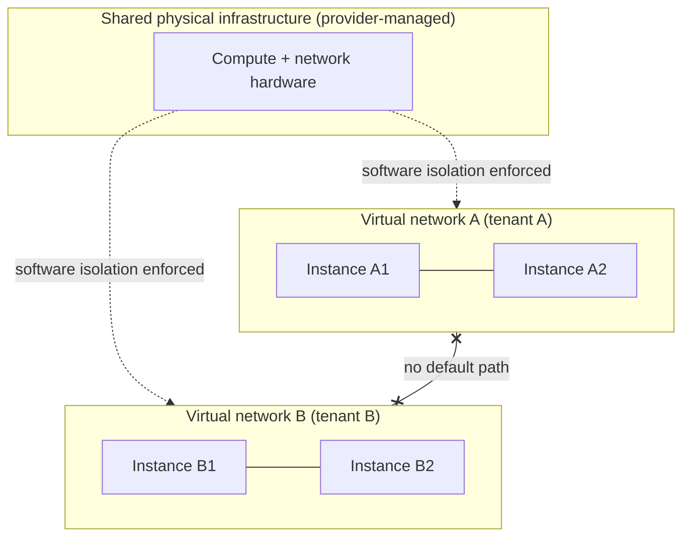

# Cloud Virtual Networks: Fundamentals

## 1. Why This Chapter Exists

Cloud networking begins with a fundamental abstraction: the **virtual network**. Instead of physical switches and cables under your control, a cloud provider gives you a software-defined, isolated network that you design, and the provider enforces it across shared physical infrastructure. Every subnet, route, firewall rule, load balancer, and connectivity option in a cloud environment is built on top of this abstraction. Engineers who treat cloud networking as "the same as physical networking" misjudge where isolation is enforced, what the provider manages versus what they manage, and which constraints are fixed.

This chapter is deliberately provider-agnostic. It describes the virtual network as a concept—its isolation model, its addressing plan, and its management boundaries—using neutral terminology. The subsequent chapters layer on subnets, gateways, security controls, and topologies. Although different platforms name these constructs differently, the mechanisms and trade-offs are shared, and understanding them abstractly makes any specific platform's documentation faster to absorb.

Terminology note: platforms differ in naming. Some call the isolated network a "virtual private cloud" (VPC), others a "virtual network." This chapter uses **virtual network** throughout and notes where names diverge, without favoring any provider.

---

## 2. The Virtual Network as an Isolation Boundary

A **virtual network** is a logically isolated layer-3 domain that you define with your own address range. Instances inside it can communicate (subject to your rules); instances in other virtual networks cannot, unless you explicitly connect them. The provider enforces this isolation in software—at the hypervisor or in a software-defined network (SDN) fabric—so that two customers sharing the same physical rack remain fully separated.



The critical insight is that **isolation is a provider guarantee enforced in software, not a physical property**. This changes the failure model: a bug in the provider's control plane or a misconfiguration in your own network can create reachability that should not exist. It also means you do not control the enforcement mechanism; you control the intent (address ranges, routes, policies) and rely on the provider to realize it. Understanding what you own versus what the provider owns is the foundation of cloud network design.

#### In-Line Glossary: Virtual Network (VPC)

**What it is:** a software-defined, logically isolated layer-3 network with a customer-chosen address range, implemented over shared physical infrastructure.

**Why here:** it is the container for all other cloud networking constructs and the unit of isolation.

**Systemic implication:** because isolation is enforced in software by the provider, network design becomes a matter of declaring intent correctly; a mistake in the declared address range or connectivity model can silently create overlap or exposure that no physical inspection would reveal.

#### In-Line Glossary: Tenant Isolation

**What it is:** the guarantee that one customer's virtual network cannot access another's, even on shared hardware.

**Why here:** it is the security and blast-radius foundation of multi-tenant cloud.

**Systemic implication:** tenant isolation is a provider responsibility you must still validate for your own resources; overlapping address ranges and over-permissive connectivity are the customer-side ways isolation is accidentally undermined.

---

## 3. Address Planning Is a Foundational Decision

Because a virtual network has a customer-chosen address range (CIDR), address planning is the first and most consequential design decision. The range must be large enough for current and future subnets, must not overlap with any other network you might connect (other virtual networks, on-premises networks, partner networks), and should be allocated to enable summarization and clear segmentation.

Overlap is the classic cloud networking mistake. If two virtual networks both use `10.0.0.0/16` and later must be connected, they cannot be routed to each other without translation, because the same address means different hosts in each. This forces costly renumbering or a translation layer. Mature organizations treat cloud address space as a scarce, governed resource, allocated from a central plan (often via IP Address Management) with room reserved for growth.

A practical hierarchy: allocate a private range per environment (production, staging, development) and per region, sized so that each virtual network has room for many subnets, and arranged so that a region's networks can be summarized. The specific numbers matter less than the discipline of non-overlap and headroom.

#### In-Line Glossary: IPAM (Cloud Context)

**What it is:** centralized management of IP address allocations across virtual networks, accounts, and regions to prevent overlap and track utilization.

**Why here:** cloud sprawl without IPAM reliably produces overlapping ranges that block connectivity and force renumbering.

**Systemic implication:** IPAM is a governance control that becomes essential as the number of virtual networks grows; retrofitting it after overlaps exist is expensive and disruptive.

---

## 4. Default Versus Custom Networks

Most platforms create a **default** virtual network (with pre-built subnets, routes, and gateways) to make getting started easy. Convenient as it is, the default network embeds assumptions—subnets in each availability zone, an internet gateway, permissive baseline routes—that are rarely appropriate for production. Production designs typically use **custom** virtual networks where every subnet, route, gateway, and policy is deliberate.

The trade-off is speed versus control. The default network speeds experimentation but encourages sprawl and implicit connectivity. A custom network requires planning but yields predictable isolation, correct addressing, and auditable policy. The recommendation, broadly, is to use the default for learning and disposable environments and custom networks for anything that matters.

---

## 5. Limits, Quotas, and the Provider Boundary

Cloud networking is constrained by **quotas**: limits on virtual networks per account, subnets per network, routes per table, rules per security group, and peering connections. These limits are higher-level design constraints that must be planned around; hitting a quota mid-deployment causes failures that look like bugs but are capacity ceilings.

Equally important is the **shared responsibility boundary**: the provider owns the physical network, the isolation enforcement, and the availability of the underlying fabric; you own the addressing plan, the subnet design, the routes, and the security policy inside your network. Ambiguity about who owns what produces both security gaps (assuming the provider filters traffic it does not) and operational confusion (waiting on the provider to fix a route table you own).

---

## 6. Invariants, Assumptions, and Boundaries

**Invariant: a virtual network is isolated by default.** Cross-network communication requires explicit configuration.

**Invariant: the address range is customer-chosen and must not overlap with networks it will connect to.** Overlap blocks routing.

**Assumption: the provider correctly enforces isolation and availability.** You depend on the provider's control and data planes for the fabric.

**Assumption: quotas are known and planned against.** Unplanned growth hits ceilings.

**Boundary: the provider does not secure your network for you.** Security groups, network ACLs, and firewall policy are your responsibility.

**Boundary: the provider's control plane can fail.** Your design should degrade predictably (for example, existing data-plane flows may continue while new changes cannot be applied).

**Boundary: a virtual network is a layer-3 construct; layer-2 semantics are emulated or unavailable.** Designs must respect the layer-3 model.

---

## 7. Trade-offs and Rejected Alternatives

**Why a virtual network rather than flat networking with firewalls?** Isolation at the network boundary limits blast radius and makes policy tractable. A flat network with only firewall rules is harder to reason about and offers weaker containment. The rejected alternative—one big shared network—fails the isolation and auditability requirements that multi-tenant and regulated environments demand.

**Why custom rather than default networks?** Default networks embed assumptions that are wrong for production (permissive routes, fixed subnets). Custom networks cost planning but yield control. The rejected approach—default everywhere—is fast and dangerous.

**Why non-overlapping address planning rather than NAT for connectivity?** A clean, non-overlapping plan makes future connectivity trivial; NAT to bridge overlaps adds complexity, breaks end-to-end addressing, and complicates debugging. The rejected NAT-first approach is a workaround that becomes permanent technical debt.

**Why centralized IPAM rather than per-team allocation?** Per-team allocation is faster initially but reliably creates overlaps as teams grow. Central IPAM costs coordination but prevents the expensive failures that overlap causes. The rejected decentralized model does not scale.

---

## 8. Failure Modes and Operational Consequences

**Overlapping address ranges.** Two virtual networks cannot be connected cleanly. Symptom: peering or connectivity fails, or traffic routes to the wrong host. Operational consequence: central IPAM, overlap checks before connecting.

**Exhausted address space.** A too-small range leaves no room for new subnets. Symptom: cannot create a subnet where design requires one. Operational consequence: plan headroom, and choose ranges that leave expansion room.

**Default-network sprawl.** Unmanaged default networks accumulate with implicit connectivity. Symptom: unexpected reachability and hard-to-audit policy. Operational consequence: standardize on custom networks and remove unused defaults.

**Quota surprises.** A deployment hits a limit (subnets, rules, routes). Symptom: resource creation fails late in a rollout. Operational consequence: track quotas and request increases in advance; treat limits as design inputs.

**Shared-responsibility confusion.** A team assumes the provider filters inbound traffic that is actually open. Symptom: unintended exposure. Operational consequence: document ownership explicitly and validate exposure from outside.

**Control-plane degradation.** Provider control-plane issues block configuration changes. Symptom: cannot modify routes/policies; data plane may still forward. Operational consequence: design for control-plane outage behavior and avoid designs that require frequent control-plane changes.

---

## 9. Hands-On: Observing a Cloud Instance's Network View

Inside a cloud instance, the OS sees a normal network interface, and standard tools reveal the addressing and routing the provider has configured. This is provider-agnostic.

Show addresses (including the provider-assigned private address and any secondary addresses):

```bash
ip -br addr
```

Show the routes the instance knows, including the default route toward the provider's gateway:

```bash
ip route show
```

Reveal the exact next hop used for a destination:

```bash
ip route get 10.0.0.5
```

Test reachability to a peer in the same subnet and to the internet (subject to your policy):

```bash
ping -c2 <peer-private-ip>
curl -sS https://example.com -o /dev/null -w '%{http_code}\n'
```

Interpretation: the default route almost always points to a provider-managed virtual router or gateway; the instance's own route table is only the guest view—the authoritative control is the virtual network's route tables, not the OS routing table. A guest route change has no authority over the provider's routing; the provider's route table is what steers traffic between subnets and gateways.

---

## 10. Related Documents

- [Subnets and Availability Zones](./02-subnets-and-availability.md)
- [Gateways and Connectivity Primitives](./03-gateways-and-connectivity-primitives.md)
- [Security Groups, Network ACLs, and Firewalls](./04-security-groups-nacls-and-firewalls.md)
- [IPv4 Addressing Fundamentals](../02-ip-addressing-and-subnetting/01-ipv4-addressing-fundamentals.md)

## 11. External References

- [RFC 7348: Virtual eXtensible Local Area Network (VXLAN)](https://www.rfc-editor.org/rfc/rfc7348)
- [RFC 1918: Address Allocation for Private Internets](https://www.rfc-editor.org/rfc/rfc1918)
- [NIST SP 800-145: The NIST Definition of Cloud Computing](https://csrc.nist.gov/publications/detail/sp/800-145/final)
- [NIST SP 800-125: Guide to Security for Full Virtualization Technologies](https://csrc.nist.gov/publications/detail/sp/800-125/final)
