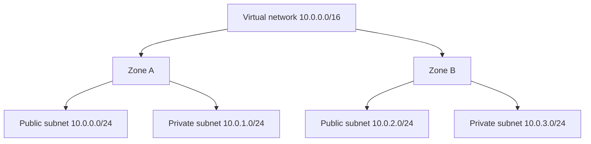

# Subnets and Availability Zones

## 1. Why This Chapter Exists

A virtual network is partitioned into **subnets**: contiguous address ranges that group resources and, crucially, bind them to a physical failure domain (the **availability zone**). Subnet design therefore encodes two decisions at once: address layout and fault tolerance. A subnet placed in one zone fails if that zone fails; spreading tiers across zones is what makes an application survive a zone outage. Getting subnets wrong produces address exhaustion, cross-zone latency surprises, and single points of failure that only surface during an incident.

This chapter explains how subnets work in a provider-agnostic virtual network, how the **route table** attached to a subnet determines whether it is "public" or "private," how reserved addresses reduce usable capacity, and how to design subnets per tier and per zone. It continues the abstraction of the previous chapter: the mechanisms are shared across platforms even when the names differ.

---

## 2. Subnets as CIDR Segments Bound to a Zone

A **subnet** is a CIDR block carved from the virtual network's range. Every resource (an instance, a managed service endpoint) is placed in exactly one subnet, which fixes its address and its failure domain. In most platforms a subnet belongs to a single **availability zone** (or zone), so the subnet is the unit at which zonal placement is expressed.

Because subnets must come from the parent range and cannot overlap, the virtual network's CIDR must be large enough to contain all subnets across all zones and tiers. A common pattern is a `/16` virtual network with `/24` subnets, giving room for many subnets and allowing route summarization. The subnet size must account for the reserved addresses the platform withholds (covered below), so a `/24` yields fewer usable addresses than 254.



#### In-Line Glossary: Availability Zone

**What it is:** an isolated failure domain within a region, typically a distinct data-center cluster with independent power, cooling, and network, connected to peer zones by low-latency links.

**Why here:** it is the unit of fault isolation for subnet placement and the basis for high availability.

**Systemic implication:** duplicating resources across zones tolerates a zone outage, but only if the application's architecture is stateless or replicates state; placing everything in one zone concentrates risk regardless of subnet design.

---

## 3. Public Versus Private Subnets

The distinction between a "public" and "private" subnet is not a property of the subnet itself; it is determined by the **route table** associated with it.

- A **public subnet** has a route table with a route to a provider-managed **internet gateway**, allowing resources with public addresses to communicate with the internet.
- A **private subnet** has no route to the internet gateway. Its resources can reach the internet (if needed) only outbound through a **NAT gateway** or not at all, and they cannot be reached from the internet directly.

This is an important subtlety: the same subnet can be made public or private by changing its associated route table, and a resource "having a public address" is separate from "being reachable," because security rules and routes both gate access. The common design places load balancers and bastion hosts in public subnets and application and database tiers in private subnets.

#### In-Line Glossary: Public vs Private Subnet

**What it is:** a subnet is public if its route table has a path to an internet gateway, private if it does not.

**Why here:** it is the primary mechanism for controlling internet exposure at the network level.

**Systemic implication:** because "public" is a routing property, moving a subnet's route table changes its exposure; treat route-table associations as security-relevant configuration subject to review.

#### In-Line Glossary: Route Table Association

**What it is:** the link between a subnet and a route table that determines how traffic leaving the subnet is directed.

**Why here:** it is what gives a subnet its behavior (internet reachable or not, which gateway, which peer).

**Systemic implication:** every subnet must have an explicit, intended association; a missing or wrong association silently changes reachability, and a route table shared by too many subnets can force unintended common routing.

---

## 4. Reserved Addresses and Effective Capacity

Cloud subnets reserve a small number of addresses for platform use, commonly five per subnet: the network address, the router/gateway address, two for DNS or future use, and the broadcast address. Consequently a `/24` yields about 251 usable addresses, not 254, and a `/28` yields about 11, not 14. This reservation is provider-consistent in spirit and must be subtracted when sizing.

Sizing discipline: choose subnet sizes based on peak concurrent resource count plus headroom, remembering that a subnet also limits how many resources can live in that zone-tier cell. Undersized subnets cause "out of IP addresses" failures during scaling—often during an incident when you most need to add capacity against a ceiling rather than a hard failure.

---

## 5. Zone Mapping and Failure Domains

Platforms expose zones with names that are not guaranteed to map to the same physical zones across accounts (zone-name remapping). This means "zone A" in one account may be a different physical data center than "zone A" in another. Designs that assume name equivalence across accounts can accidentally place "highly available" resources in the same physical zone. The safe pattern is to place redundant resources across the distinct zones available in the account and to verify zone independence rather than assume it from names.

---

## 6. Designing Subnets per Tier and Zone

A durable design places each application tier in its own subnet, replicated per zone, with route tables that reflect the tier's exposure. A typical layout:

| Tier | Zone A | Zone B | Exposure |
|---|---|---|---|
| Public (LB/bastion) | 10.0.0.0/24 | 10.0.2.0/24 | Internet gateway |
| Application | 10.0.1.0/24 | 10.0.3.0/24 | Private (NAT for egress) |
| Data | 10.0.4.0/24 | 10.0.5.0/24 | Private, no internet |

This gives failure isolation per tier and zone, clear boundaries for security policy, and address space that can be summarized by zone for connectivity. The design is provider-agnostic; only the construct names change.

---

## 7. Invariants, Assumptions, and Boundaries

**Invariant: subnets are non-overlapping and contained within the virtual network range.**

**Invariant: a subnet maps to one zone (availability domain) in platforms that expose zones.** Cross-zone redundancy requires multiple subnets.

**Invariant: reserved addresses reduce usable capacity.** Sizing must subtract them.

**Assumption: route tables and associations express the intended reachability.** A missing association or wrong route changes behavior silently.

**Boundary: subnet placement alone does not provide high availability.** The application must replicate across zones to survive a zone failure.

**Boundary: a public subnet is not automatically secure.** Reachability and permission are separate; public subnets still require restrictive security policy.

**Boundary: zone names are not stable identifiers of physical zones across accounts.** Do not infer physical collocation from names.

---

## 8. Trade-offs and Rejected Alternatives

**Why separate subnets per tier rather than one big subnet?** Tier separation enables distinct security policy, routing, and blast-radius containment. A single flat subnet makes policy coarse and mingles exposure. The rejected alternative—one subnet—is simpler but weakens isolation and auditability.

**Why small subnets rather than a few huge ones?** Many right-sized subnets improve isolation and route clarity but consume the parent range less efficiently in terms of summarization and can hit per-network subnet quotas. The balance is a modest number of well-sized subnets per tier per zone.

**Why place databases in private subnets with no internet route?** Databases should not be reachable from the internet and rarely need outbound internet, so the strongest posture is no internet route at all. The rejected alternative—leaving a path that is only protected by security rules—relies on policy alone for a critical asset.

**Why not rely on a single zone with strong internal redundancy?** Some platforms offer high intra-zone resilience, but a zonal outage still takes the zone down. Multi-zone is the robust default for anything with availability requirements; single-zone is acceptable only for non-critical or easily recreated workloads.

---

## 9. Failure Modes and Operational Consequences

**Address exhaustion in a subnet.** Scaling fails at the address ceiling. Symptom: cannot launch new instances in a zone-tier. Operational consequence: size subnets with headroom and monitor utilization.

**Public subnet unintended exposure.** A route table change or misassociation exposes private workloads. Symptom: unexpected internet reachability. Operational consequence: review route-table associations and validate exposure externally.

**Zone-name confusion across accounts.** Redundant resources land in the same physical zone. Symptom: correlated failures that should not correlate. Operational consequence: verify zone independence and design around name remapping.

**Overlapping subnet ranges.** Overlaps break internal routing and connectivity. Symptom: unreachable resources or wrong routing. Operational consequence: allocate from IPAM and validate before connecting.

**Forgotten reserved addresses.** Sizing assumes 254 for a /24 and runs short. Symptom: exhaustion with apparently free addresses. Operational consequence: subtract reserved addresses in planning.

**Single-subnet critical service.** A database in one subnet/zone becomes a single point of failure. Symptom: outage when that zone fails. Operational consequence: replicate or use multi-zone managed services.

---

## 10. Hands-On: Inspecting Subnets and Routes from Inside

From an instance, observe the guest view of addressing and routing, which reflects the provider's configuration:

```bash
ip -br addr
ip route show
```

Focus on the default route and any route to a metadata or DNS endpoint:

```bash
ip route get 169.254.169.254    # common metadata endpoint; may vary by platform
ip route get 10.0.0.1           # common virtual router address; verify per platform
```

Test same-subnet and cross-subnet reachability (subject to security rules):

```bash
ping -c2 <same-subnet-peer>
ping -c2 <cross-subnet-peer>
```

Count usable addresses in a subnet to internalize reserved overhead:

```bash
python3 - <<'PY'
for prefix in (24, 25, 26, 28):
    total = 2 ** (32 - prefix)
    print(f"/{prefix}: {total} total, ~{total - 5} usable after 5 reserved")
PY
```

Interpretation: the guest routes point to a provider virtual router, not to the OS controlling inter-subnet traffic; the authoritative route tables live in the virtual network. Cross-subnet failures usually indicate route-table or security-rule issues, not guest routing.

---

## 11. Related Documents

- [Cloud Virtual Networks: Fundamentals](./01-virtual-network-fundamentals.md)
- [Gateways and Connectivity Primitives](./03-gateways-and-connectivity-primitives.md)
- [Security Groups, Network ACLs, and Firewalls](./04-security-groups-nacls-and-firewalls.md)
- [Subnetting by Design: VLSM and Route Summarization](../02-ip-addressing-and-subnetting/03-subnetting-by-design-vlsm-and-summarization.md)

## 12. External References

- [RFC 1918: Address Allocation for Private Internets](https://www.rfc-editor.org/rfc/rfc1918)
- [RFC 4632: Classless Inter-Domain Routing (CIDR)](https://www.rfc-editor.org/rfc/rfc4632)
- [NIST SP 800-145: The NIST Definition of Cloud Computing](https://csrc.nist.gov/publications/detail/sp/800-145/final)
