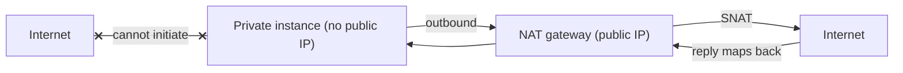

# Gateways and Connectivity Primitives

## 1. Why This Chapter Exists

A virtual network is isolated; connectivity to the internet, to provider services, and to other networks is provided by **gateways** and **connectivity primitives** that you attach and route through. Choosing the wrong primitive, or misunderstanding whether it is inbound, outbound, or private, produces either unintended exposure or broken egress—both of which are common in cloud networks. This chapter maps the core primitives, what each is for, and the trade-offs between them.

The primitives fall into three families: **internet plumbing** (internet gateway, NAT gateway, egress-only gateway), **private service access** (gateway endpoints and interface endpoints / private service links), and **inter-network connectivity** (VPN and transit/hub gateways, covered in depth in the topologies chapter). The goal here is to know which primitive solves which problem and where the security boundaries are.

---

## 2. The Internet Gateway

An **internet gateway** is a horizontally scaled, provider-managed component that connects a virtual network to the internet. It performs network address translation for resources that have public addresses and enables inbound connections to them (subject to security rules). Attaching an internet gateway is necessary for a subnet to be "public," but it is not sufficient by itself: the subnet's route table must route internet-bound traffic to the gateway.

A crucial distinction: the internet gateway does **not** mask a resource without a public address. A private instance with no public address cannot reach or be reached via the internet gateway even if the route exists, because there is no public address to translate. This is why public subnets and public addresses are separate levers.

#### In-Line Glossary: Internet Gateway

**What it is:** a provider-managed component providing bidirectional internet connectivity for a virtual network, performing address translation for resources with public addresses.

**Why here:** it is the primitive that makes a subnet public and is a primary exposure surface.

**Systemic implication:** because reachability requires both a route to the gateway and a public address, exposure can be introduced by either lever; security review must inspect both routing and address assignment.

---

## 3. The NAT Gateway

A **NAT gateway** lets resources in private subnets initiate outbound connections to the internet without being reachable from it. It performs source NAT, so a private instance's address is translated to the NAT gateway's public address for the outbound flow, and return traffic is mapped back. Because it is outbound-only, it is the standard way to give private workloads internet access (for updates, API calls, package installs) without exposing them.

A NAT gateway is provider-managed and scales automatically, but it is zonal in many platforms (a zonal NAT gateway fails with its zone, so production designs deploy one per zone for resilience). It also has cost implications, because data processed through it is billed, which makes unnecessarily routing intra-region traffic through NAT an expensive mistake. An older alternative, the **NAT instance**, is a self-managed VM performing NAT; it is cheaper at very small scale but must be patched, scaled, and made highly available manually, so the managed gateway is usually preferred.



#### In-Line Glossary: NAT Gateway

**What it is:** a provider-managed, outbound-only NAT service that gives private subnets internet egress without inbound reachability.

**Why here:** it is the standard egress mechanism and a recurring source of cost and zonal-resilience considerations.

**Systemic implication:** because NAT is outbound-only and often zonal, designs must deploy per zone for resilience and avoid routing intra-region traffic through it to control cost.

---

## 4. The Egress-Only Gateway

For IPv6, where NAT is generally unnecessary and addresses are globally routable, an **egress-only gateway** provides outbound-only internet access: instances can initiate connections outbound, but the gateway blocks inbound connections initiated from the internet. It is the IPv6 analog of the NAT gateway's outbound-only property without the address translation, reflecting IPv6's design where hosts are directly addressable but inbound policy is enforced by the gateway and security rules.

#### In-Line Glossary: Egress-Only Gateway

**What it is:** a gateway that permits outbound IPv6 connectivity while preventing inbound connections initiated from the internet.

**Why here:** it provides the outbound-only property for IPv6 without NAT, matching IPv6's stateless addressing model.

**Systemic implication:** because IPv6 hosts are globally addressable, inbound control depends on the egress-only gateway plus security rules; assuming IPv6 is "private" like IPv4 NAT space is a dangerous misconception.

---

## 5. Private Endpoints and Service Links

Provider-managed services (object storage, key management, databases) often live outside your virtual network. By default, reaching them may traverse the internet or a shared public endpoint. **Private endpoints** (also called interface endpoints or private service links) place a private address inside your virtual network that maps to the provider service, so traffic stays on the provider's private backbone and never traverses the internet. A **gateway endpoint** is a variant used for a specific class of services (historically object storage) that routes via a route-table entry rather than an in-network address.

The benefits are security (no internet exposure), simplicity (no NAT or public addresses needed), and often cost (avoiding NAT data processing). The considerations are that private endpoints have per-endpoint cost and per-zone placement (for interface endpoints, one per zone for resilience), and that DNS must be configured to resolve the service name to the private address.

#### In-Line Glossary: Private Endpoint / Private Service Link

**What it is:** a private address inside a virtual network that provides access to a provider-managed service without traversing the public internet.

**Why here:** it is the secure, often cheaper way to reach provider services and avoids NAT and public exposure.

**Systemic implication:** because private endpoints are per-zone and depend on DNS resolution, resilience and correct DNS configuration are required; a missing zonal endpoint or unresolved name reintroduces the internet path or breaks access entirely.

---

## 6. Inter-Network Connectivity Gateways (Preview)

Connecting one virtual network to another or to on-premises uses different primitives: **virtual private network (VPN) gateways** for encrypted tunnels over the internet, **transit/hub gateways** for centralized many-to-many connectivity, and **dedicated interconnects** for private, high-bandwidth physical links. These are covered in the topologies chapter because their value and complexity lie in how they are arranged, not only in what they are.

---

## 7. Invariants, Assumptions, and Boundaries

**Invariant: reachability requires both a route to the gateway and the appropriate address/endpoint.** A route alone is insufficient.

**Invariant: NAT gateways and egress-only gateways are outbound-only; internet gateways are bidirectional (subject to rules).**

**Invariant: private endpoints keep traffic off the internet by mapping a service to a private address.**

**Assumption: gateways are correctly placed per zone for resilience.** Zonal gateways are single points of failure for their zone.

**Boundary: gateways do not replace security policy.** Internet gateways expose resources; security rules and route design still govern who reaches what.

**Boundary: gateway choices have cost implications.** NAT data processing and per-endpoint charges can dominate cloud networking cost if used indiscriminately.

**Boundary: DNS is part of the connectivity path.** Private endpoints and many gateways depend on correct DNS resolution to function.

---

## 8. Trade-offs and Rejected Alternatives

**Why a managed NAT gateway rather than a NAT instance?** The managed gateway scales and is resilient without patching, at higher per-GB cost. A NAT instance is cheaper at tiny scale but must be operated as a production service (HA, patching, scaling). The managed gateway is usually the right default; NAT instances persist only in cost-optimized edge cases.

**Why private endpoints rather than routing through NAT or the internet?** Private endpoints improve security (no exposure), often reduce cost (no NAT processing), and simplify addressing. The cost is per-endpoint charges and per-zone configuration. The rejected default—everything over the internet—is simpler to set up and weaker and often more expensive.

**Why deploy a NAT gateway per zone rather than one?** A single zonal NAT gateway centralizes cost but fails with its zone, breaking egress for other zones' private subnets. Per-zone deployment trades cost for resilience. The rejected single-gateway design is a hidden availability risk.

**Why an internet gateway at all if NAT exists?** Some workloads must accept inbound connections (public APIs, load balancers). NAT cannot provide inbound reachability. The two coexist with different purposes.

---

## 9. Failure Modes and Operational Consequences

**Missing route to a gateway.** Egress or ingress silently fails. Symptom: no internet access or unreachable public endpoint. Operational consequence: verify route tables and gateway attachment.

**Zonal NAT/resilience failure.** The zone hosting the NAT gateway fails and egress breaks for other zones. Symptom: outbound failures correlated with a zone event. Operational consequence: deploy per zone and monitor gateway health per zone.

**Cost blowups via NAT.** Intra-region or high-volume traffic routed through NAT is billed. Symptom: unexpectedly high networking cost. Operational consequence: use private endpoints and direct routing for intra-region service access; monitor NAT data processed.

**Private endpoint DNS misconfiguration.** The service name resolves to the public endpoint, bypassing the private path. Symptom: traffic leaves the private network despite an endpoint. Operational consequence: verify DNS resolution to the private address per zone.

**IPv6 exposure assumption.** Treating IPv6 like NAT'd IPv4 leaves instances reachable. Symptom: unexpected inbound connectivity over IPv6. Operational consequence: use egress-only gateways and security rules; never assume IPv6 is private.

**Single-zone endpoint.** Interface endpoints in one zone fail with the zone. Symptom: service access breaks during a zone event. Operational consequence: deploy endpoints per zone.

---

## 10. Hands-On: Tracing Egress Paths

Determine how an instance reaches the internet and whether it uses NAT:

```bash
# Observe the default route (toward the provider virtual router)
ip route show default

# Observe the public address the internet sees (NAT vs direct public IP)
curl -sS https://ifconfig.me/ip; echo
```

Check whether a provider service resolves to a private address (private endpoint) or a public one:

```bash
dig +short <provider-service-endpoint>
```

Compare with a well-known public name to see the difference:

```bash
dig +short example.com
```

Test outbound-only behavior: an inbound connection attempt from outside should fail while outbound succeeds.

```bash
# On the instance: confirm outbound works
curl -sS https://example.com -o /dev/null -w '%{http_code}\n'
# From another network: an inbound attempt to the private address should not connect
nc -vz <instance-private-ip> 22
```

Interpretation: if the internet-visible address differs from the instance's private address, NAT is in use; if a provider service resolves to a private address, a private endpoint is in place; an inbound failure with successful outbound confirms the outbound-only posture.

---

## 11. Related Documents

- [Cloud Virtual Networks: Fundamentals](./01-virtual-network-fundamentals.md)
- [Subnets and Availability Zones](./02-subnets-and-availability.md)
- [Connectivity Topologies: Peering, Transit, VPN, and Dedicated Links](./05-connectivity-topologies.md)
- [NAT and Address Translation](../01-network-fundamentals/06-nat-and-address-translation.md)

## 12. External References

- [RFC 3022: Traditional IP Network Address Translator (Traditional NAT)](https://www.rfc-editor.org/rfc/rfc3022)
- [RFC 1918: Address Allocation for Private Internets](https://www.rfc-editor.org/rfc/rfc1918)
- [NIST SP 800-145: The NIST Definition of Cloud Computing](https://csrc.nist.gov/publications/detail/sp/800-145/final)
