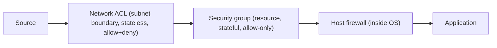

# Security Groups, Network ACLs, and Firewalls

## 1. Why This Chapter Exists

A virtual network isolates at the network boundary, but isolation is coarse: everything inside a virtual network can, by default, reach everything else. The controls that decide which traffic is actually permitted are the **security groups**, **network ACLs**, and host **firewalls**. These are the day-to-day tools of cloud security, and their misuse—a rule opened to the world, a stateless ACL that drops return traffic, a policy that allows more than intended—is the origin of a large share of cloud security incidents and connectivity bugs.

This chapter explains the layered model: resource-level security groups that are stateful and allow-only, subnet-level network ACLs that are stateless and can both allow and deny, and host firewalls inside the instance. It covers statefulness, ephemeral ports, default-deny design, referencing by group rather than address, the order in which controls are evaluated, and the mistakes that recur. The mechanisms are presented provider-agnostically.

---

## 2. The Layered Model

Three layers commonly apply, and understanding which is which prevents both gaps and confusion.

**Security groups** are attached to resources (instances, load balancers, managed services). They are **stateful** and typically **allow-only**: you add allow rules, and because the state is tracked, return traffic for an allowed connection is automatically permitted. There is an implicit deny for anything not allowed. A resource can usually have multiple security groups, and the effective permission is the union of their allow rules.

**Network ACLs (NACLs)** are attached to subnets. They are **stateless** and support both **allow and deny** rules, evaluated in order by rule number. Because they are stateless, you must allow traffic in both directions explicitly, including the return traffic's ephemeral ports. They act as a subnet-level guardrail and are evaluated before traffic reaches a resource.

**Host firewalls** run inside the instance's operating system (for example a kernel packet filter or a stateful host firewall). They are the final layer and are under your direct control, independent of the cloud provider.



#### In-Line Glossary: Security Group

**What it is:** a stateful, allow-only set of rules attached to resources that permits specified inbound and outbound traffic and implicitly denies the rest, tracking connection state to allow return traffic.

**Why here:** it is the primary resource-level access control and the main tool for least-privilege network policy in cloud.

**Systemic implication:** because it is stateful and allow-only, it is simpler to reason about than stateless ACLs, but it can only filter by the attributes it understands (address, port, protocol, and references to other groups), so application-layer policy still belongs elsewhere.

#### In-Line Glossary: Network ACL

**What it is:** a stateless, ordered set of allow and deny rules attached to a subnet, evaluated per subnet boundary and requiring explicit rules for both directions.

**Why here:** it provides subnet-level guardrails and the ability to deny (which stateful security groups typically cannot).

**Systemic implication:** because NACLs are stateless, forget the return path and you break otherwise-valid traffic; their deny capability is valuable as a backstop but their statelessness makes them error-prone, so they should be used deliberately, not as the primary policy.

---

## 3. Stateful Versus Stateless

The statefulness distinction is the single most important practical difference. A **stateful** control remembers that a connection started (an outbound SYN, say) and automatically permits the return packets for that established connection. A **stateless** control evaluates every packet in isolation, so return traffic must be explicitly allowed.

For TCP and UDP, the "return" traffic frequently uses **ephemeral ports** (the client's source port, which is high-numbered and selected by the OS). A stateless NACL that allows an outbound request must also allow the corresponding inbound replies on the ephemeral port range; if it does not, the connection fails despite the outbound rule being correct. This asymmetry is the classic NACL mistake.

A second practical difference: security groups are allow-only, so a workload that must block a specific address cannot do so with a security group alone—it needs a NACL (which can deny) or a host firewall, or it must restructure so that the denied source is simply not allowed.

#### In-Line Glossary: Ephemeral Port Range

**What it is:** the range of high-numbered source ports a client OS uses for outbound connections (commonly 32768-60999 on Linux, with provider ranges often 1024-65535).

**Why here:** stateless ACLs must allow return traffic to these ports, so misunderstanding them breaks connections.

**Systemic implication:** because the range varies by OS and provider, hard-coding the wrong range in a stateless rule causes intermittent or complete connection failures that are easy to misattribute to the application.

---

## 4. Default-Deny and Least Privilege

The correct posture is **default-deny**: start from no access and add only the specific allows each workload needs. In practice, security groups are default-deny by design (implicit deny), but the discipline is to keep rules narrow: reference specific ports, restrict source addresses or source groups, and avoid broad ranges.

A powerful, reusable pattern is **referencing by security group** rather than by CIDR. Instead of allowing `10.0.1.0/24` on port 5432, allow the database's security group to receive port 5432 from the application's security group. This ties policy to the identity of the workload rather than to an address that can change, and it keeps rules correct as addresses shift. It also expresses intent clearly ("the app may talk to the database") rather than implementation detail.

---

## 5. Evaluation Order and Interactions

Traffic reaching a resource typically passes the subnet NACL first, then the resource's security group, then the host firewall. Each layer can drop traffic, so "the rule is allowed in the security group but traffic is still blocked" often means a NACL or host firewall is the actual blocker. Diagnosing requires checking all layers, in order, rather than assuming the most visible one is authoritative.

The layers are complementary: NACLs as coarse subnet guardrails and explicit denials, security groups as fine resource policy, and host firewalls as the last line under your OS control. Defense in depth means a misconfiguration in one layer should not be the only thing standing between an attacker and the workload.

---

## 6. Invariants, Assumptions, and Boundaries

**Invariant: security groups are stateful and allow-only with implicit deny.** Return traffic for allowed flows is automatically permitted.

**Invariant: NACLs are stateless and ordered, with explicit allow and deny.** Return traffic needs its own rules.

**Invariant: a resource's effective permission is the union of its security groups' allow rules.**

**Assumption: rules reference the correct ports and sources.** A stale or overly broad source is a standing risk.

**Boundary: these controls filter by network attributes, not application content.** They are not a WAF or an application-layer policy engine.

**Boundary: a closed port is not the same as a safe application.** Network controls gate reachability, not vulnerability.

**Boundary: default networks may include permissive baseline rules.** Custom networks with explicit policy are preferred for production.

---

## 7. Trade-offs and Rejected Alternatives

**Why security groups as the primary policy rather than NACLs?** Security groups are stateful, resource-scoped, and referenceable by group, which makes them easier to reason about and to keep correct as topology changes. NACLs are used for coarse guardrails and denials. The rejected approach—relying on stateless NACLs as the main policy—produces ephemeral-port mistakes and hard-to-debug failures.

**Why reference by group rather than CIDR?** Group references bind policy to workload identity, surviving address changes and expressing intent. CIDR references are sometimes necessary (external sources) but drift out of date. The rejected CIDR-first approach is brittle in dynamic environments.

**Why keep a host firewall when the provider offers security groups?** Defense in depth: an OS-level filter is independent of the provider's control plane and can enforce policy even if cloud policy is misconfigured or must be temporarily relaxed. The cost is managing policy in two places; this is usually worth it for critical workloads.

**Why default-deny rather than allow-all with selective denies?** Default-deny fails safe: an omission blocks a flow (visible) rather than exposing a resource (invisible). The rejected allow-all posture makes exposure the default, which is the wrong direction for security.

---

## 8. Failure Modes and Operational Consequences

**Ephemeral-port omission in stateless rules.** Return traffic is dropped. Symptom: connections fail despite a correct-looking outbound allow. Operational consequence: allow return traffic to the ephemeral range or prefer stateful security groups for the flow.

**Overly broad ingress (`0.0.0.0/0`).** A service is exposed to the internet. Symptom: scanning traffic, intrusion attempts, or a breach. Operational consequence: restrict sources to specific CIDRs or groups and audit for `0.0.0.0/0` and `::/0` ingress.

**Rule drift.** Rules accumulate and are never pruned; the effective policy is broader than intended. Symptom: access that no one can justify. Operational consequence: periodically review rules against actual flow logs and remove unused ones.

**Layer confusion.** A NACL or host firewall blocks traffic the security group allows. Symptom: "the rule is there but it does not work." Operational consequence: check all layers in order.

**Union-of-groups surprise.** Multiple security groups grant more than intended. Symptom: a resource reachable on a port nobody meant to allow. Operational consequence: minimize the number of groups per resource and audit the union.

**Broad egress allowing data exfiltration.** Egress left open lets a compromised workload exfiltrate data. Symptom: unexpected outbound traffic. Operational consequence: restrict egress to needed destinations; treat egress policy as part of security.

---

## 9. Hands-On: Inspecting and Testing Policy

On the instance, confirm the host firewall state (usage varies by OS):

```bash
sudo iptables -S 2>/dev/null || echo "iptables not present"
sudo nft list ruleset 2>/dev/null || echo "nftables not present"
sudo ufw status verbose 2>/dev/null || echo "ufw not present"
```

Test reachability to a specific port from another host (subject to all layers):

```bash
nc -vz <target-private-ip> 443
nc -vz <target-private-ip> 5432
```

Observe connection tracking to see which return flows are permitted (Linux conntrack):

```bash
sudo conntrack -L | head
```

Confirm whether a port is open to the internet from an external vantage point (use a service or another network you control):

```bash
# From an external host, attempt to connect to the public endpoint
nc -vz <public-endpoint> 443
```

Interpretation: a port that connects internally but not externally suggests the security group or NACL restricts the source; a port that connects externally when it should not indicates an over-broad ingress rule; a connection that establishes partially and stalls suggests a stateless return-path issue.

---

## 10. Related Documents

- [Cloud Virtual Networks: Fundamentals](./01-virtual-network-fundamentals.md)
- [Subnets and Availability Zones](./02-subnets-and-availability.md)
- [Gateways and Connectivity Primitives](./03-gateways-and-connectivity-primitives.md)
- [TLS and DTLS in Production: Hardening, Debugging, and Failure Modes](../04-transport-security/08-tls-hardening-debugging-and-failure-modes.md)

## 11. External References

- [RFC 4890: Recommendations for Filtering ICMPv6 Messages in Firewalls](https://www.rfc-editor.org/rfc/rfc4890)
- [NIST SP 800-41 Rev. 1: Guidelines on Firewalls and Firewall Policy](https://csrc.nist.gov/publications/detail/sp/800-41/rev-1/final)
- [NIST SP 800-125: Guide to Security for Full Virtualization Technologies](https://csrc.nist.gov/publications/detail/sp/800-125/final)
