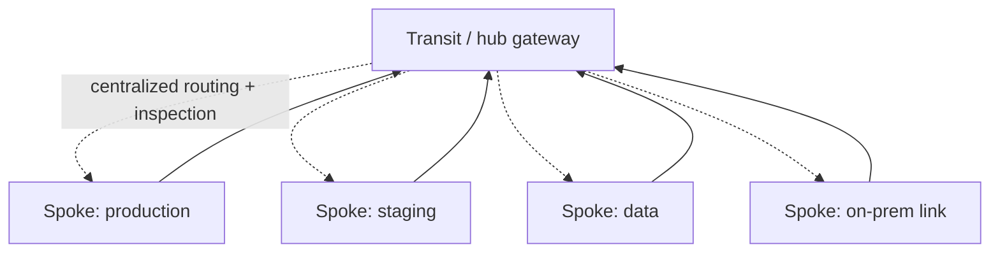

# Connectivity Topologies: Peering, Transit, VPN, and Dedicated Links

## 1. Why This Chapter Exists

Real cloud environments are never a single virtual network. Organizations run many networks across teams, environments, accounts, and regions, and they connect them to each other and to on-premises infrastructure. How those connections are arranged—full mesh, hub-and-spoke, transit—determines scalability, blast radius, cost, and operational complexity. A topology that works for three networks collapses at thirty, and the migration between topologies is expensive, which makes getting the shape right early a high-leverage decision.

This chapter explains the connectivity primitives (peering, transit gateways, VPNs, dedicated interconnects, shared networks), the topology patterns they compose into, and the properties—transitivity, segmentation, DNS—that govern correctness. It is the synthesis of the cloud section: subnets and gateways provide local connectivity, and topologies connect the pieces into an architecture.

---

## 2. Peering

**Peering** connects two virtual networks directly, allowing their resources to communicate over private addresses. Peering is typically **non-transitive**: if network A peers with B and B peers with C, A cannot reach C through B unless explicitly connected. This is a deliberate safety property (it prevents accidental transitive exposure) and a scaling challenge (every pair that must communicate needs its own peering).

Peering requires that the two networks have **non-overlapping address ranges**; overlapping ranges make peering impossible without translation. It is the simplest primitive and the right choice for a small number of closely related networks (for example, two environments that must share a service), but a full mesh of peerings grows quadratically: N networks need N(N-1)/2 peerings, which quickly becomes unmanageable.

#### In-Line Glossary: Peering

**What it is:** a direct, private connection between two virtual networks that permits communication over their address ranges without traversing the internet.

**Why here:** it is the most basic connectivity primitive and the building block for larger topologies.

**Systemic implication:** because peering is non-transitive and requires non-overlapping ranges, it does not scale to many networks and it forces address-planning discipline; these limits are precisely why transit gateways exist.

---

## 3. Transit Gateways and Hub-and-Spoke

A **transit gateway** (or hub) is a central routing component that many virtual networks attach to. It enables **transitive** connectivity (spokes can reach each other through the hub, if permitted) and centralizes connectivity, inspection, and routing policy. The resulting **hub-and-spoke** topology replaces the quadratic mesh with a linear number of attachments: N networks attach to the hub instead of peering with each other.



The power of the hub is also its risk: it centralizes routing and often security inspection, so it can become a **shared failure domain** and a choke point. Mature designs use **route domains** (segmentation within the transit gateway) so that not every spoke can reach every other spoke, and they deploy the hub's attachments and inspection path redundantly to avoid a single point of failure. The hub is where you decide transitive reachability deliberately, rather than by accident of mesh peerings.

#### In-Line Glossary: Transit Gateway / Hub

**What it is:** a central routing component that multiple virtual networks attach to, enabling transitive connectivity and centralized policy without a full mesh of peerings.

**Why here:** it is the scalable connectivity primitive that replaces a quadratic mesh with a linear hub-and-spoke.

**Systemic implication:** because the hub is shared, its failure and its policy affect every attached network; route domains and redundant attachments are required to keep it from becoming a single point of failure and an over-broad reachability zone.

---

## 4. VPN Gateways

A **site-to-site VPN** connects networks over the public internet using encrypted tunnels (typically IPsec, sometimes WireGuard). It is the flexible, quick-to-deploy option: no physical circuit is required, and connectivity can be established in minutes. The trade-offs are dependence on internet quality (variable latency, jitter, and bandwidth), the need to manage tunnel cryptography and keys, and usually lower throughput than dedicated links.

VPNs commonly carry routing protocols (often BGP) across the tunnel to exchange reachability automatically, so both sides learn each other's networks and can fail over between multiple tunnels. A single tunnel is a single point of failure; resilient designs use multiple tunnels over diverse paths and let routing converge around failures.

---

## 5. Dedicated Interconnects

A **dedicated interconnect** is a private physical connection (leased line or partner-provided circuit) between your infrastructure and the provider, bypassing the public internet. It offers higher, more predictable bandwidth, lower and more consistent latency, and better isolation from internet congestion, at the cost of lead time, expense, and physical location constraints (it exists only at specific provider locations).

Because it is physical and expensive, dedicated interconnect is typically combined with VPN for redundancy: the dedicated link carries production traffic, and a VPN over the internet provides failover. Routing (BGP) is used to prefer the dedicated path and fail over to the VPN. The classic trade-off is cost and lead time versus performance and reliability.

#### In-Line Glossary: Dedicated Interconnect

**What it is:** a private physical connection between on-premises infrastructure and a cloud provider, separate from the public internet.

**Why here:** it delivers predictable, high-bandwidth, low-latency connectivity for demanding or sensitive workloads.

**Systemic implication:** because it is physical and limited to specific locations, it requires planning and usually a VPN fallback for resilience; relying on a single dedicated link reintroduces a physical single point of failure.

---

## 6. Shared Networks

A **shared network** (shared VPC) is a model where one central virtual network's subnets are shared into other accounts, so multiple teams or projects deploy resources into a centrally managed network. This separates network administration (central team) from resource ownership (project teams), which enforces consistent address planning and security policy across the organization.

The benefit is governance and consistency; the cost is coordination and a central dependency, because the central network becomes shared infrastructure that project teams depend on. Shared networks are a common way to implement hub-and-spoke without each team managing its own network.

---

## 7. Cross-Network DNS

Connectivity is useless if names do not resolve. Connecting networks typically requires **cross-network DNS resolution** so that a name in one network resolves to a private address in another. Platforms offer mechanisms (private hosted zones associated across networks, or DNS forwarding) to enable this, and forgetting it produces the frustrating "the route works but the name does not resolve" failure. DNS must be considered part of every connectivity design, not an afterthought.

---

## 8. Topology Patterns

Three patterns dominate, and the choice is about scale and control:

- **Full mesh of peerings:** simplest for a few networks, quadratic growth, no central dependency but unmanageable at scale.
- **Hub-and-spoke via transit gateway:** scalable, centralizes policy and inspection, introduces a shared component to design for resilience and segmentation.
- **Hybrid with dedicated interconnect plus VPN:** for on-premises connectivity, combining performance and resilience.

Real environments often combine these: a transit hub for inter-network connectivity, peerings for a few tightly coupled networks, and dedicated interconnect plus VPN for on-premises.

---

## 9. Invariants, Assumptions, and Boundaries

**Invariant: peering requires non-overlapping address ranges.** Overlap blocks connectivity without translation.

**Invariant: peering is non-transitive by default; transit gateways provide transitivity.**

**Invariant: connectivity requires matching routes on both ends and working DNS for names.**

**Assumption: the hub or transit gateway is redundant and segmented.** Otherwise it is a single point of failure and an over-broad reachability zone.

**Boundary: connectivity is not permission.** Routes make addresses reachable; security policy still governs allowed traffic.

**Boundary: dedicated links are physical and location-bound.** They cannot be provisioned on demand anywhere.

**Boundary: DNS is part of the design.** Route-only connectivity leaves names unresolved.

---

## 10. Trade-offs and Rejected Alternatives

**Why a transit gateway rather than a full mesh?** A full mesh scales quadratically and is operationally heavy; a hub scales linearly and centralizes policy. The cost is a shared component and potential transit over-reach. The rejected mesh works only for small, stable sets.

**Why VPN rather than dedicated interconnect?** VPN is fast to deploy and flexible but subject to internet variability; dedicated interconnect is predictable but costly and slow to provision. Most serious deployments use both: interconnect primary, VPN fallback. The rejected "one or the other" forgoes either resilience or performance.

**Why shared networks rather than per-team networks?** Shared networks centralize address planning and policy, preventing the overlap and sprawl that per-team networks invite. The cost is a central dependency and coordination. The rejected per-team approach is autonomous and prone to inconsistency.

**Why segment the hub with route domains?** Transitive reachability by default is convenient but dangerous: it can expose production to development or one tenant to another. Segmentation constrains blast radius at the cost of more configuration. The rejected flat hub is a larger attack surface.

---

## 11. Failure Modes and Operational Consequences

**Overlapping ranges blocking peering.** Two networks cannot connect. Symptom: peering creation fails or routes are ambiguous. Operational consequence: allocate from central IPAM.

**Quadratic mesh sprawl.** Many peerings become unmanageable. Symptom: configuration drift and audit difficulty. Operational consequence: migrate to a transit hub before the mesh grows.

**Hub as single point of failure.** Hub or its attachments fail, severing connectivity broadly. Symptom: widespread reachability loss. Operational consequence: redundant hub attachments and inspection paths.

**Over-broad transitivity.** All spokes can reach all spokes unexpectedly. Symptom: unintended cross-environment access. Operational consequence: route domains and explicit policy.

**DNS not extended.** Routes work but names do not resolve. Symptom: "works by IP, fails by name." Operational consequence: include cross-network DNS in the connectivity design.

**VPN performance under internet congestion.** Variable latency and jitter degrade applications. Symptom: intermittent slowness on the VPN path. Operational consequence: prefer dedicated links for sensitive traffic and fail over via routing.

**Asymmetric paths across topologies.** Return traffic uses a different path, breaking stateful devices. Symptom: one-way connectivity after a topology change. Operational consequence: verify symmetry and routing intent.

---

## 12. Hands-On: Verifying Connectivity Across Networks

From a resource, confirm routes to the remote network's range:

```bash
ip route show
ip route get <remote-private-ip>
```

Test reachability by IP and then by name (DNS is the second step that often fails):

```bash
ping -c2 <remote-private-ip>
dig +short <remote-hostname>
getent hosts <remote-hostname>
```

Trace the path to see whether traffic transits a hub or a direct path:

```bash
traceroute <remote-private-ip>
mtr -rwzbc 10 <remote-private-ip>
```

Confirm a service is reachable privately (not over the internet):

```bash
nc -vz <remote-private-ip> 443
```

Interpretation: success by IP but failure by name points at cross-network DNS; reachability that appears only through a specific path suggests a hub route-domain or peering route; intermittent failure often indicates asymmetric paths or a non-redundant hub.

---

## 13. Related Documents

- [Gateways and Connectivity Primitives](./03-gateways-and-connectivity-primitives.md)
- [Cloud DNS, Load Balancing, and Service Discovery](./06-cloud-dns-load-balancing-and-service-discovery.md)
- [Multi-Account and Multi-Region Networking](./07-multi-account-and-multi-region-networking.md)
- [BGP and Internet Routing](../03-routing-and-switching/03-bgp-and-internet-routing.md)

## 14. External References

- [RFC 4301: Security Architecture for the Internet Protocol (IPsec)](https://www.rfc-editor.org/rfc/rfc4301)
- [RFC 4364: BGP/MPLS IP Virtual Private Networks (L3VPN)](https://www.rfc-editor.org/rfc/rfc4364)
- [RFC 1918: Address Allocation for Private Internets](https://www.rfc-editor.org/rfc/rfc1918)
- [NIST SP 800-77 Rev. 1: Guide to IPsec VPNs](https://csrc.nist.gov/publications/detail/sp/800-77/rev-1/final)
