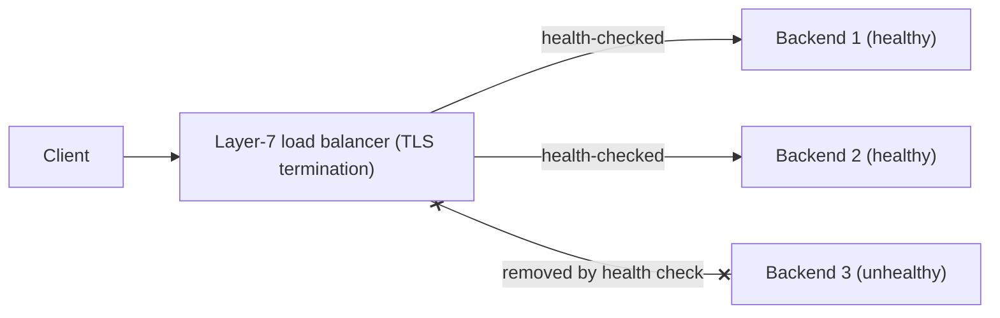

# Cloud DNS, Load Balancing, and Service Discovery

## 1. Why This Chapter Exists

Reachability is not the same as usefulness. Applications need to find each other by name, distribute traffic across healthy instances, and route requests intelligently by protocol. In the cloud these needs are met by managed DNS, load balancers, and service discovery—three systems that interact and that, when misconfigured, produce failures ranging from "the name does not resolve" to "traffic goes to a dead instance" to "half our requests fail because one backend is unhealthy."

This chapter explains private and split-horizon DNS, the distinction between layer-4 and layer-7 load balancing, internal versus external load balancers, health checks and failover, and service discovery patterns. It is provider-agnostic and focuses on the mechanisms and trade-offs that recur across platforms, so that any platform's specific offerings can be mapped onto the same mental model.

---

## 2. Private DNS and Split-Horizon Resolution

Cloud DNS lets you create **private hosted zones**—name spaces that resolve only from within associated virtual networks. Internal services use private names that resolve to private addresses and are invisible to the internet, while public names resolve publicly. **Split-horizon** resolution serves different answers for the same name depending on where the query originates: internal clients may get a private address (avoiding a round trip out to a public load balancer), while external clients get the public one.

Associating a private zone with the right networks is essential; a zone not associated with a network does not resolve there, and a zone associated too broadly leaks internal names. Cross-network resolution (covered in the topologies chapter) is part of this design.

#### In-Line Glossary: Private Hosted Zone

**What it is:** a DNS zone that resolves only within associated virtual networks, holding records for internal names and private addresses.

**Why here:** it gives internal services stable names without exposing them publicly.

**Systemic implication:** because resolution depends on zone-to-network associations, a missing association makes internal names unresolvable while everything else works; associations are security-relevant because an over-broad association exposes internal names.

---

## 3. Layer-4 Versus Layer-7 Load Balancing

Load balancers distribute traffic, but they operate at different layers with different capabilities.

A **layer-4 (transport) load balancer** balances TCP or UDP flows. It makes decisions based on address and port, forwards packets quickly, preserves the source IP (sometimes), and can handle any TCP/UDP protocol. It does not understand HTTP, so it cannot route by path or header or terminate TLS.

A **layer-7 (application) load balancer** understands the application protocol (typically HTTP/HTTPS). It can route by path, host, or header; terminate TLS; perform cookie-based session affinity; and integrate with WAFs. The cost is more processing per request and often higher cost. TLS termination at L7 is common, which is where the transport-security chapters meet cloud networking.

Both come in **internal** and **external** variants. An **internal** load balancer has only a private address and is reachable within the network; an **external** one has a public address and faces the internet (or a public entry point). The choice of internal versus external is a security boundary: exposing a service means placing an external load balancer in front of it.



#### In-Line Glossary: L4 vs L7 Load Balancer

**What it is:** an L4 load balancer balances transport flows by address/port; an L7 load balancer understands the application protocol and can route by content.

**Why here:** the choice determines routing granularity, TLS handling, and cost.

**Systemic implication:** because L7 balancers see application content, they are powerful (path routing, WAF, TLS termination) and also a performance and cost consideration; L4 balancers are faster and protocol-agnostic but blind to content.

---

## 4. Health Checks and Failover

Load balancers route only to **healthy** backends, determined by **health checks**: periodic probes (TCP connection, HTTP request to a health endpoint) that mark an instance in or out of service. Health checks are how the load balancer stops sending traffic to a failed instance, and how rolling deployments drain instances gracefully as they are replaced.

Health-check design matters. A check that is too shallow (a TCP connect) may pass while the application is unable to serve requests; a check that is too aggressive causes flapping; a check interval that is too long leaves a window of errors after a failure. A dedicated health endpoint that verifies critical dependencies (database reachability, cache) is a common pattern, but it must avoid turning a dependency blip into a full outage (cascading health). The classic trap is a health check that fails because of a downstream dependency, causing the load balancer to remove every backend and produce a self-inflicted outage.

#### In-Line Glossary: Health Check

**What it is:** a periodic probe used by a load balancer to determine whether a backend should receive traffic.

**Why here:** it is the mechanism that removes failed instances and enables graceful deploys.

**Systemic implication:** poorly designed health checks either miss failures (too shallow) or cause outages (too strict, cascading dependency failures); health-check semantics are a reliability-critical design decision.

---

## 5. Service Discovery

**Service discovery** lets services find each other's current addresses without hard-coding them. Patterns include:

- **DNS-based discovery:** services register in DNS and clients resolve names. Simple, but DNS TTL and caching make rapid changes lag.
- **Registry-based discovery:** a registry (like a service registry) holds instances and their health; clients query it through a library or sidecar. More dynamic and control over metadata, at the cost of running the registry and client integration.
- **Proxy/sidecar:** a local proxy handles discovery and load balancing transparently, as in service meshes. Powerful and language-agnostic, at the cost of additional infrastructure.

The trade-off is between simplicity and dynamism. DNS-based discovery is simplest but slower to react; registry and mesh approaches react faster and carry more metadata but add components to operate.

#### In-Line Glossary: Service Discovery

**What it is:** the mechanism by which a service locates the current instances of another service at runtime.

**Why here:** in dynamic cloud environments, addresses change constantly, so hard-coding them is unworkable.

**Systemic implication:** discovery introduces a dependency (the registry or DNS) whose failure or staleness affects the whole application; its consistency and availability are as critical as the services it points to.

---

## 6. Caching, TTL, and Dynamic Endpoints

DNS caching and TTL interact awkwardly with dynamic cloud endpoints. Load balancer addresses are relatively stable, but auto-scaled instance addresses change frequently and should not be published in DNS with long TTLs, because clients would cache stale addresses. This is why service discovery often bypasses public DNS for internal, rapidly changing endpoints, using lower-level mechanisms with faster propagation. When DNS is used, short TTLs reduce staleness at the cost of more queries.

---

## 7. Invariants, Assumptions, and Boundaries

**Invariant: private names resolve only within associated networks.**

**Invariant: a load balancer sends traffic only to backends that pass health checks.**

**Invariant: an external load balancer is the exposure boundary for public services.**

**Assumption: DNS and the discovery registry are available.** Their failure affects every dependent service.

**Boundary: load balancing does not make an application highly available by itself.** It distributes across healthy backends, but the backends must be redundant and stateless (or state-replicated).

**Boundary: health checks reflect the check, not the full application.** A passing check does not guarantee correct behavior.

**Boundary: TLS termination at a load balancer changes the trust and key-management model.** Certificates live at the balancer, and traffic behind it may be plaintext unless re-encrypted.

---

## 8. Trade-offs and Rejected Alternatives

**Why L7 rather than L4 balancing?** L7 enables content-based routing, TLS termination, and WAF integration, which most web applications need. L4 is faster and works for arbitrary protocols. The choice is driven by whether the application benefits from content awareness; the rejected one-size approach ignores protocol differences.

**Why health checks with a dedicated endpoint rather than TCP?** A TCP check verifies the port, not the application; an HTTP health endpoint verifies the app can serve. The cost is more logic and the risk of cascading failures if the endpoint checks dependencies. The rejected shallow check is easy but blind.

**Why a service mesh rather than DNS-based discovery?** Meshes provide fast, language-agnostic discovery, retries, mTLS, and observability. The cost is operational complexity and a control plane. The rejected DNS-only approach is simpler but reacts slowly and lacks rich policy.

**Why internal rather than external load balancers for internal services?** Internal balancers keep services off the public internet, reducing exposure. The cost is that clients must be inside the network. The rejected external-for-everything approach needlessly exposes internal services.

---

## 9. Failure Modes and Operational Consequences

**DNS resolution failure.** Names do not resolve; everything depending on them fails. Symptom: broad outage or partial resolution. Operational consequence: monitor DNS availability and zone associations.

**Health check cascade.** A dependency failure causes all backends to fail their health check and be removed. Symptom: total outage triggered by a downstream blip. Operational consequence: design health endpoints to avoid cascading and consider degraded (not binary) health.

**Stale discovery.** Clients hold stale addresses after scaling or failover. Symptom: traffic to dead instances. Operational consequence: use discovery mechanisms with fast propagation and short TTLs for dynamic endpoints.

**TLS termination misconfiguration.** Certificate mismatch or expired cert at the balancer. Symptom: client TLS errors (see the transport-security chapters). Operational consequence: automate certificate lifecycle at the balancer.

**Session affinity gone wrong.** Sticky sessions pin clients to an unhealthy or overloaded backend. Symptom: uneven load and persistent errors for some clients. Operational consequence: prefer stateless backends; use affinity sparingly.

**Public exposure via external balancer.** An internal-only service placed behind an external balancer becomes public. Symptom: unexpected internet reachability. Operational consequence: default to internal; require review for external.

---

## 10. Hands-On: Inspecting DNS, Load Balancing, and Discovery

Resolve internal and public names and compare:

```bash
dig +short internal-service.example.internal
dig +short public-service.example.com
```

Check which resolver answers and whether split-horizon is in effect:

```bash
cat /etc/resolv.conf
resolvectl status 2>/dev/null || true
```

Observe load balancing across backends by making repeated requests (behavior depends on the balancer):

```bash
for i in $(seq 1 6); do curl -sS https://example.com -o /dev/null -w '%{remote_ip}\n'; done
```

Probe health and failover behavior indirectly by checking whether a known-unhealthy backend is ever selected (the balancer should not route to it):

```bash
for i in $(seq 1 10); do curl -sS -o /dev/null -w '%{http_code} %{remote_ip}\n' https://example.com; done
```

Inspect TLS at the balancer (termination and certificate):

```bash
openssl s_client -connect example.com:443 -servername example.com </dev/null 2>/dev/null | openssl x509 -noout -subject -issuer -dates
```

Interpretation: the `remote_ip` values reveal which backend answered and whether distribution is even; a single `remote_ip` may indicate an external balancer address rather than backends; certificate details show where TLS terminates.

---

## 11. Related Documents

- [Connectivity Topologies: Peering, Transit, VPN, and Dedicated Links](./05-connectivity-topologies.md)
- [Multi-Account and Multi-Region Networking](./07-multi-account-and-multi-region-networking.md)
- [Naming and Address Assignment: DNS, DHCP, and SLAAC](../01-network-fundamentals/05-naming-and-address-assignment-dns-dhcp-and-slaac.md)
- [TLS and DTLS in Production: Hardening, Debugging, and Failure Modes](../04-transport-security/08-tls-hardening-debugging-and-failure-modes.md)

## 12. External References

- [RFC 1034: Domain Names — Concepts and Facilities](https://www.rfc-editor.org/rfc/rfc1034)
- [RFC 1035: Domain Names — Implementation and Specification](https://www.rfc-editor.org/rfc/rfc1035)
- [RFC 2181: Clarifications to the DNS Specification](https://www.rfc-editor.org/rfc/rfc2181)
- [RFC 8446: The Transport Layer Security (TLS) Protocol Version 1.3](https://www.rfc-editor.org/rfc/rfc8446)
- [NIST SP 800-145: The NIST Definition of Cloud Computing](https://csrc.nist.gov/publications/detail/sp/800-145/final)
