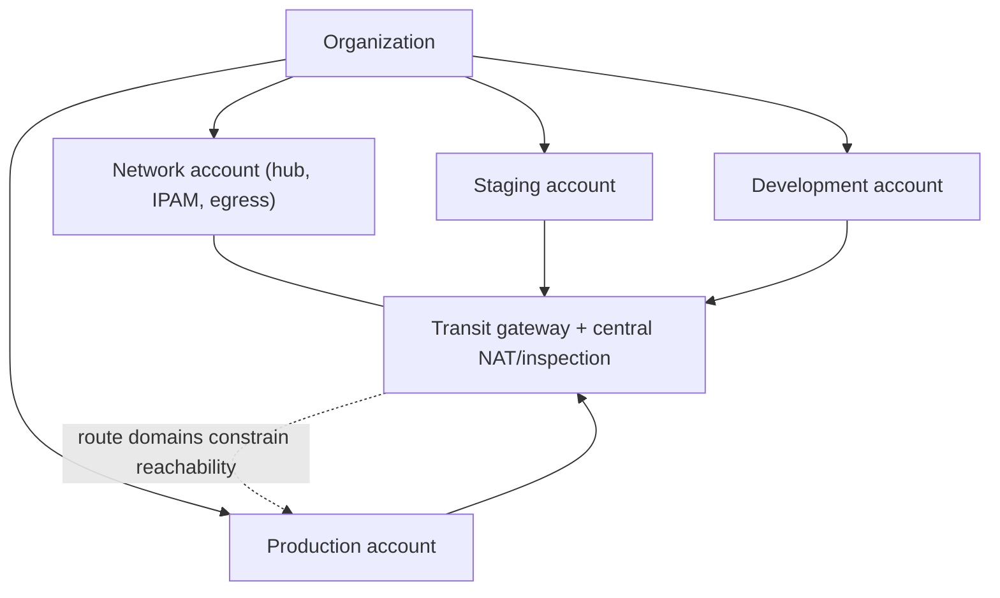

# Multi-Account and Multi-Region Networking

## 1. Why This Chapter Exists

As cloud adoption matures, a single account and a single region become insufficient. Organizations separate workloads into multiple **accounts** (or projects/subscriptions) for security, billing, and blast-radius reasons, and they run across multiple **regions** for latency, data residency, and disaster recovery. This scale turns networking into a governance and topology problem: how do many accounts get consistent connectivity, non-overlapping addresses, and controlled egress, and how do regions connect and fail over?

This chapter explains the account and region as design boundaries, central address management across accounts, centralized ingress/egress and inspection, cross-region connectivity, and the discipline of designing for region failure. It is the capstone of the cloud section because it addresses the organizational scale at which the earlier constructs (virtual networks, subnets, gateways, topologies) must be governed consistently.

---

## 2. The Account (Project) as a Boundary

A cloud **account** (called a project or subscription on some platforms) is a hard administrative boundary: it isolates resources, identities, quotas, and billing. Security best practice uses accounts as **blast-radius containers**: production, staging, and development live in separate accounts, and different teams or workloads are isolated so that a compromise or misconfiguration in one does not automatically grant access to others.

From a networking perspective, accounts complicate connectivity: resources in different accounts are in different virtual networks by default, so connecting them requires peering, transit hubs, or shared networks. This is a deliberate trade-off between isolation and connectivity, and it is why central network architectures (hub accounts, transit gateways, shared networks) exist.

#### In-Line Glossary: Account / Project Boundary

**What it is:** a hard administrative and security boundary that isolates resources, identities, quotas, and billing.

**Why here:** it is the primary blast-radius containment unit, and it defines the network isolation boundaries that connectivity must cross.

**Systemic implication:** because networks are isolated per account, multi-account designs require explicit connectivity architecture; treating accounts as mere folders ignores the isolation that makes them valuable and the cost of connecting them.

---

## 3. Organization Structure and the Central Network Account

Large organizations typically adopt a structure with a central "network" account that owns shared connectivity: the transit hub, the dedicated interconnects, the centralized egress/inspection, and the IPAM. Member accounts attach to the hub rather than building their own connectivity, which centralizes policy, reduces cost (shared NAT and interconnects), and enforces consistency.



The central network account becomes shared infrastructure: its availability and its policy affect every attached account. This centralization is powerful (consistent governance) and risky (a single misconfiguration or failure propagates widely), so it must be designed with redundancy, segmentation (route domains), and rigorous change control.

#### In-Line Glossary: Centralized Egress

**What it is:** routing outbound internet traffic from many accounts through a shared egress path (NAT and inspection) in a central network account.

**Why here:** it centralizes cost, visibility, and security policy for internet-bound traffic.

**Systemic implication:** centralized egress simplifies control but concentrates risk and can become a throughput bottleneck; it must be redundant, monitored, and sized for aggregate traffic.

---

## 4. Central IPAM Across Accounts

Non-overlapping addresses are a prerequisite for connectivity, and at multi-account scale this cannot be left to individual teams. **Central IPAM** allocates ranges to accounts, regions, and environments from a governed plan, preventing the overlaps that block peering and transit. Allocation should leave room for growth and enable summarization, and it should be enforced (not merely documented) so that a team cannot accidentally allocate outside its assignment.

---

## 5. Cross-Region Connectivity

Connecting regions uses the same primitives as connecting accounts—peering, transit gateways, dedicated interconnects—but with additional considerations: inter-region latency (which affects chatty protocols and synchronous replication), data-transfer cost (which can dominate bills for high-volume cross-region traffic), and data residency or sovereignty constraints that may forbid sending certain data across regions regardless of connectivity. Provider backbone peering is typically private and lower-latency than the public internet, but it is not free and not unlimited.

---

## 6. Regions as Failure Domains

A **region** is a large failure domain: an entire region can be affected by large-scale events, and providers design regions to be independent. Designing for region failure means running critical services in multiple regions with independent data and traffic-routing failover (often via global DNS or anycast). Within a region, availability zones provide finer-grained isolation; across regions, the concern is disaster recovery and latency-based routing.

The trade-off is cost and complexity: multi-region active-active is expensive and hard (data consistency across regions is the hard problem), while multi-region active-passive (a warm standby) is cheaper but has a recovery time. The choice depends on the RTO/RPO the business requires.

#### In-Line Glossary: Blast Radius

**What it is:** the scope of impact of a failure or a compromise, expressed in terms of how many accounts, services, or regions are affected.

**Why here:** multi-account and multi-region design is fundamentally about bounding blast radius.

**Systemic implication:** centralizing connectivity and egress reduces operational cost but enlarges blast radius; segmentation and redundancy are the counterweights that keep centralization from becoming a systemic single point of failure.

---

## 7. Automation and Network-as-Code

At multi-account, multi-region scale, manual network configuration is untenable. Networks are provisioned as code (infrastructure as code) so that account networks are consistent, reviewed, and reproducible. Untracked manual changes are a primary source of drift and of the "special account that works differently" failures. Network-as-code also enables policy-as-code (guardrails that prevent overlapping allocations or public exposure before they are deployed).

---

## 8. Invariants, Assumptions, and Boundaries

**Invariant: accounts are isolated by default; connectivity between them is explicit.**

**Invariant: connectivity requires non-overlapping addresses across all connected accounts and regions.**

**Invariant: a region is an independent failure domain; multi-region is required to survive region loss.**

**Assumption: central network components are redundant and segmented.** Otherwise they are systemic single points of failure.

**Boundary: connectivity does not imply permission or data-residency compliance.** Policy and legal constraints still apply.

**Boundary: cross-region traffic has latency and cost implications that affect architecture, not just networking.**

**Boundary: automation is not optional at scale.** Manual configuration drifts and cannot be audited.

---

## 9. Trade-offs and Rejected Alternatives

**Why many accounts rather than one big account?** Accounts contain blast radius, separate billing, and enforce isolation. The cost is connectivity complexity. The rejected single-account model is simpler to connect but offers weak containment and mixes concerns.

**Why a central network account rather than per-team networks?** Centralization enforces consistent IPAM, egress, and policy, and reduces duplicated cost. The cost is a shared dependency and a potential choke point. The rejected per-team model is autonomous but replicates connectivity cost and invites inconsistency and overlap.

**Why multi-region rather than multi-AZ only?** Multi-AZ survives zone failures but not region failures or region-scoped control-plane events. Multi-region is the stronger posture at higher cost. The rejected multi-AZ-only design is a reasonable middle ground for services with lower availability requirements.

**Why policy-as-code rather than review alone?** Guardrails prevent classes of mistakes (overlap, public exposure) before deployment, whereas review catches them only when reviewers are thorough and available. The rejected review-only approach does not scale.

---

## 10. Failure Modes and Operational Consequences

**Overlapping allocations across accounts.** Connectivity fails. Symptom: peering/transit routes ambiguous or refusing. Operational consequence: central IPAM with enforcement.

**Central egress bottleneck or outage.** Shared NAT/inspection fails or saturates, affecting all accounts. Symptom: widespread internet egress failure. Operational consequence: redundant, horizontally scaled, monitored egress.

**Hub misconfiguration propagating widely.** A change in the network account affects every spoke. Symptom: broad connectivity change. Operational consequence: rigorous change control, testing, and segmentation.

**Region-scoped dependency.** A service silently depends on a resource in one region. Symptom: that region's failure takes down the service despite multi-region intent. Operational consequence: map and remove cross-region hard dependencies.

**Cross-region cost shock.** High-volume chatty traffic across regions inflates cost. Symptom: unexpected data-transfer charges and latency. Operational consequence: architect to keep chatty traffic regional; reserve cross-region for replication and failover.

**Configuration drift.** A manually changed account network diverges from the standard. Symptom: an account behaves differently and breaks assumptions. Operational consequence: network-as-code with drift detection.

---

## 11. Hands-On: Auditing Multi-Account and Multi-Region Connectivity

From a resource, confirm which region/zone it is in and its address (platform metadata endpoint names vary):

```bash
ip -br addr
ip route show
# Platform metadata endpoints (names differ per provider); check your platform docs
curl -sS http://169.254.169.254/latest/meta-data/placement/ 2>/dev/null || true
```

Resolve a service in another region/account and measure latency:

```bash
dig +short <cross-region-service-name>
mtr -rwzbc 10 <cross-region-service-name>
```

Measure realistic cross-region throughput and latency to inform design:

```bash
# Requires an iperf3 server in the other region
iperf3 -c <cross-region-host> -t 10
```

Verify egress routing (whether traffic exits via a central path):

```bash
curl -sS https://ifconfig.me/ip; echo   # observe the public egress address
```

Interpretation: if the observed public egress address is the same across many accounts, centralized egress is in use; consistent cross-region latency far above intra-region values confirms traffic crosses a regional boundary and should be minimized for chatty protocols.

---

## 12. Related Documents

- [Cloud Virtual Networks: Fundamentals](./01-virtual-network-fundamentals.md)
- [Connectivity Topologies: Peering, Transit, VPN, and Dedicated Links](./05-connectivity-topologies.md)
- [Cloud DNS, Load Balancing, and Service Discovery](./06-cloud-dns-load-balancing-and-service-discovery.md)
- [Subnetting by Design: VLSM and Route Summarization](../02-ip-addressing-and-subnetting/03-subnetting-by-design-vlsm-and-summarization.md)

## 13. External References

- [RFC 1918: Address Allocation for Private Internets](https://www.rfc-editor.org/rfc/rfc1918)
- [RFC 4632: Classless Inter-Domain Routing (CIDR)](https://www.rfc-editor.org/rfc/rfc4632)
- [NIST SP 800-145: The NIST Definition of Cloud Computing](https://csrc.nist.gov/publications/detail/sp/800-145/final)
- [NIST SP 500-292: NIST Cloud Computing Reference Architecture](https://www.nist.gov/publications/nist-cloud-computing-reference-architecture)
