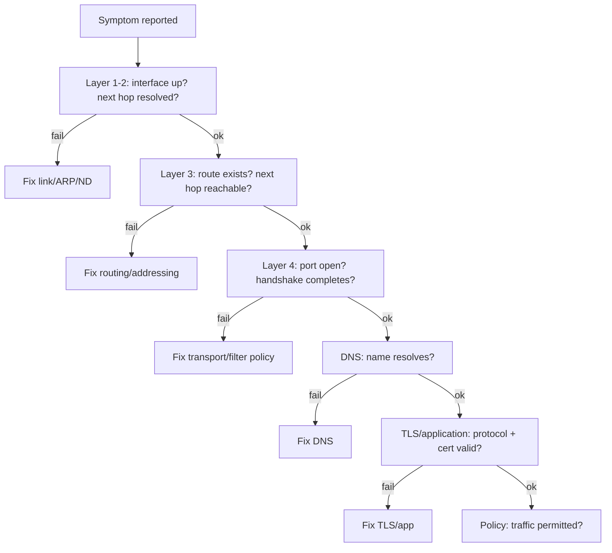

# Network Troubleshooting: Methodology and Tooling

## 1. Why This Chapter Exists

The previous chapters explain how networks work; this chapter is about finding out what is wrong when they do not. Troubleshooting is a discipline, not a bag of commands. Engineers who guess—restarting things, checking whatever comes to mind—often "fix" problems they do not understand and cannot prevent recurrence. Engineers who work methodically, forming hypotheses, choosing the observation that discriminates between them, and using evidence rather than intuition, resolve issues faster and learn from them.

This chapter presents a layered methodology for network diagnosis, the core tooling and what each tool actually proves, the discipline of packet capture, and a catalog of failure signatures that map symptoms to likely causes. It is deliberately tool-agnostic in principle (the commands are examples of a general method) and provider-agnostic in scope, complementing the cloud section's provider-specific tooling.

---

## 2. The Layered Methodology

Because networks are layered (see the fundamentals section), diagnosis should proceed by **isolating the failing layer**. The most efficient order depends on the symptom, but a reliable default is to work from the bottom up until something fails, then investigate that layer:

1. **Link/interface:** is the interface up, does it have an address, does it have carrier?
2. **Layer 2/neighbor:** is the next hop resolvable (ARP/ND)?
3. **Layer 3/addressing and routing:** does a route exist, is the next hop reachable, is the source address correct?
4. **Transport:** do ports open, handshakes complete, does data flow?
5. **Name resolution:** does the name resolve, from which resolver?
6. **Application/TLS:** does the protocol succeed, are certificates valid?
7. **Policy:** is traffic permitted (firewall/security group/NACL)?

The essence is **divide and conquer**: find the boundary between what works and what does not, then move the boundary. "It works by IP but not by name" immediately eliminates everything below DNS. "Small packets work, large ones fail" points at MTU. "One direction works" points at asymmetry or stateful filtering. Each observation should cut the hypothesis space in half.



#### In-Line Glossary: Layered Isolation

**What it is:** the practice of testing each layer independently to locate the first one that fails.

**Why here:** it converts an unbounded problem into a sequence of bounded questions.

**Systemic implication:** because a failure at a lower layer makes everything above it appear broken, diagnosing from the top of the stack produces false leads; isolating bottom-up (or by the symptom) avoids chasing symptoms of a single root cause.

---

## 3. Forming and Testing Hypotheses

Effective troubleshooting is the scientific method under time pressure. State a hypothesis ("the connection fails because the path MTU is too small for the payload"), predict an observation that would confirm or refute it ("a ping with DF at 1500 bytes fails, but a smaller one succeeds"), and make that observation. If the prediction holds, you have strong evidence; if it does not, the hypothesis is wrong and you move on.

This discipline prevents the classic traps: assuming the last change caused the problem (correlation is not causation), conflating similar-sounding symptoms, and fixing one instance of a problem without checking whether others share it. It also produces a natural record of what was ruled out, which is invaluable for post-incident analysis.

#### In-Line Glossary: Baseline

**What it is:** a known-good reference measurement or configuration captured when the system is healthy.

**Why here:** without a baseline, "normal" is a guess, and detecting change is impossible.

**Systemic implication:** baselines turn troubleshooting into comparison; teams that capture latencies, route tables, and configurations in steady state can diff against them during incidents, which is faster and more reliable than reasoning from first principles under pressure.

---

## 4. Core Tooling and What Each Proves

Each tool answers a specific question; using the wrong tool invites false conclusions.

**`ip -br link` / `ip -br addr`** show interface state and addresses: is the interface up, does it have the expected address? This is the first check for "no connectivity".

**`ip route` / `ip route get <dst>`** show forwarding decisions: which next hop and source the kernel selects. `ip route get` is the single most useful routing check because it shows the actual decision.

**`ip neigh`** shows ARP/ND resolution: is the next hop's MAC resolved, or stuck `INCOMPLETE`/`FAILED`? A failure here means layer-2 resolution, not routing.

**`ping`** tests ICMP reachability and, with `-M do -s <size>`, PMTU. It proves the path can carry ICMP of a given size, nothing about TCP ports.

**`traceroute` / `mtr`** reveal the path and per-hop latency/loss using TTL expiry. `mtr` combines this with statistics. Silence (`* * *`) may mean filtering, not unreachability.

**`dig` / `getent hosts`** test name resolution and reveal which resolver answers. `dig +trace` walks the delegation chain.

**`ss`** shows sockets and, with `-ti`, TCP internals (cwnd, rwnd, RTT, retransmits). It answers "is the connection established, and what is the transport doing?"

**`tcpdump`** captures packets and is the ground truth for what is actually on the wire. It proves whether packets are sent, received, retransmitted, or dropped.

**`conntrack`** shows stateful NAT/firewall entries, essential for diagnosing translated and filtered flows.

**`curl -v` / `openssl s_client`** test the application and TLS layer end to end, including certificate validation.

**`iperf3`** measures achievable throughput and is the tool for capacity and performance questions, not connectivity.

#### In-Line Glossary: Packet Capture

**What it is:** recording raw packets on an interface for inspection, the definitive evidence of what traversed (or failed to traverse) a point in the network.

**Why here:** captures resolve disagreements between what configuration says and what is actually happening.

**Systemic implication:** captures are only as good as their vantage point; a capture on a host with hardware offload may not reflect the wire, and a capture on the wrong side of a NAT or firewall shows different addresses—so always state where a capture was taken.

---

## 5. Packet Capture Discipline

Capturing is powerful and easy to do badly. Good practice:

- **Capture at a deliberate point** and record where (host NIC, span port, tunnel endpoint). The same packet looks different at different points because of NAT, tunnels, and offload.
- **Filter narrowly** (`host`, `port`, `tcp[tcpflags]`) to avoid drowning in noise and to avoid filling storage.
- **Correlate two captures** (client and server side) when possible; comparing them reveals where packets are lost or modified.
- **Account for offload:** checksum and segmentation offload can make a host capture differ from the wire; disable offload for precise captures or interpret carefully.
- **Respect privacy and security:** captures may contain credentials and personal data; handle and retain them accordingly.

---

## 6. Failure Signatures

Certain symptom patterns map to a small set of likely causes, and recognizing them shortcuts diagnosis.

**"Works by IP, fails by name"** → DNS resolution. Check the resolver and the record.

**"Small transfers work, large transfers stall"** → MTU/PMTU black hole (often after tunneling or via a path that filters ICMP). Test with `ping -M do` at increasing sizes.

**"The handshake completes, then it hangs"** → MTU, a stateful device dropping return traffic, or an application not reading (zero window).

**"One direction works, the other does not"** → asymmetric routing, a filter on one direction, or a stateful device not seeing both directions.

**"Intermittent, correlates with a specific server"** → one backend behind a load balancer is unhealthy, or a specific path is lossy.

**"Everything slow under load, fine at idle"** → congestion, bufferbloat, or a saturated link; measure with `mtr`/`iperf3`.

**"Connect fails immediately (reset/refused)"** → a closed port (refused) or a firewall sending resets; distinct from a timeout, which suggests a drop or black hole.

**"Timeout, no response at all"** → filtering/drop, wrong route, or a dead host; distinguish from "refused".

#### In-Line Glossary: MTU Black Hole

**What it is:** a failure where packets larger than the path MTU are silently dropped because the ICMP fragmentation-needed message was filtered, so the sender never learns to reduce size.

**Why here:** it produces the confusing "works small, fails large" signature and is a top cause of mysterious stalls.

**Systemic implication:** because the failure is silent and size-dependent, it is often misattributed to the application; recognizing the signature and testing PMTU directly resolves it quickly.

---

## 7. Invariants, Assumptions, and Boundaries

**Invariant: a lower-layer failure makes higher layers appear broken.** Diagnose the lowest failing layer.

**Invariant: the observation must distinguish between hypotheses.** A test that cannot change your mind is not useful.

**Assumption: the tools report what you think they report.** `ping` success does not imply a TCP port is open; `traceroute` silence may be filtering.

**Boundary: diagnosis is limited by the vantage points available.** Without a capture on both sides, some failures cannot be localized precisely.

**Boundary: provider-managed components may be opaque.** In cloud, some devices cannot be logged into; you rely on flow logs, provider metrics, and endpoint captures.

**Boundary: fixing a symptom is not fixing the cause.** A restart may restore service while leaving the root cause to recur.

---

## 8. Trade-offs and Rejected Alternatives

**Why a method rather than trial and error?** Method is slower to start and faster to converge, and it produces reusable knowledge. Trial and error sometimes stumbles onto a fix but cannot explain or prevent it. The rejected alternative trades understanding for the illusion of speed.

**Why layered bottom-up rather than starting at the application?** Starting at the application is tempting because that is where the symptom appears, but it is usually a symptom of a lower failure. Bottom-up (or symptom-directed) avoids chasing false leads. Either is superior to random checks.

**Why capture rather than trust configuration?** Configuration states intent; the wire states reality. When they disagree, the wire is authoritative. The rejected config-only approach fails exactly when it matters most.

**Why narrow capture filters?** Broad captures overwhelm storage and analysis. The rejected "capture everything" approach is occasionally necessary but usually slows diagnosis.

---

## 9. Failure Modes of Troubleshooting Itself

**Correlation mistaken for causation.** "It broke right after the deploy" is a hypothesis, not a conclusion. Operational consequence: verify the causal link or risk rolling back a change that was unrelated, leaving the real cause in place.

**Testing the wrong layer.** Pinging a host proves ICMP, not that the application's port is open. Operational consequence: match the test to the claim.

**Vantage-point blindness.** A capture taken behind NAT or with offload shows different packets than the wire. Operational consequence: always identify the capture point and offload state.

**Symptom patching.** Restarting the service clears the symptom and hides a recurring root cause. Operational consequence: record the recurrence and pursue the cause.

**Confirmed bias.** Seeking evidence for a preferred hypothesis and ignoring contrary observations. Operational consequence: design tests that could refute your hypothesis.

**Data overload.** Capturing or logging everything makes the signal impossible to find. Operational consequence: filter and scope deliberately.

---

## 10. Hands-On: A Worked Diagnosis

Symptom: "the application cannot reach the service at `api.example.internal:443`." Work bottom-up.

Interface and address:

```bash
ip -br addr
ip route get api.example.internal
```

If the route is missing, fix routing. If present, check next-hop resolution:

```bash
ip neigh show
```

Test name resolution and the advertised address:

```bash
dig +short api.example.internal
getent hosts api.example.internal
```

Test transport reachability to the port (distinguish refused, timeout, success):

```bash
nc -vz api.example.internal 443
curl -v --max-time 5 https://api.example.internal
```

If the handshake succeeds but data stalls, test PMTU:

```bash
ping -M do -s 1472 <resolved-ip>
ping -M do -s 1400 <resolved-ip>
```

Capture to see what is actually on the wire (narrow filter):

```bash
sudo tcpdump -nn -i any host <resolved-ip> and port 443
```

Check stateful translation/filtering:

```bash
sudo conntrack -L | grep 443
```

Interpretation: a refused connection (`Connection refused`) means the port is closed or actively rejected; a timeout with no response suggests a filter/black hole; a successful handshake followed by a stall suggests MTU or a stateful return-path problem; a capture that shows SYNs leaving but no SYN-ACK arriving localizes the loss to the path or the remote policy.

---

## 11. Related Documents

- [Models and Encapsulation](../01-network-fundamentals/01-models-and-encapsulation.md)
- [The IP Layer: Packet Delivery, TTL, MTU, and ICMP](../01-network-fundamentals/03-the-ip-layer-delivery-ttl-mtu-and-icmp.md)
- [The Transport Layer: TCP, UDP, Ports, and Sockets](../01-network-fundamentals/04-the-transport-layer-tcp-udp-ports-and-sockets.md)
- [Network Performance and Capacity](./02-network-performance-and-capacity.md)

## 12. External References

- [RFC 1122: Requirements for Internet Hosts — Communication Layers](https://www.rfc-editor.org/rfc/rfc1122)
- [RFC 1191: Path MTU Discovery](https://www.rfc-editor.org/rfc/rfc1191)
- [RFC 6298: Computing TCP's Retransmission Timer](https://www.rfc-editor.org/rfc/rfc6298)
- [RFC 1812: Requirements for IP Version 4 Routers](https://www.rfc-editor.org/rfc/rfc1812)
