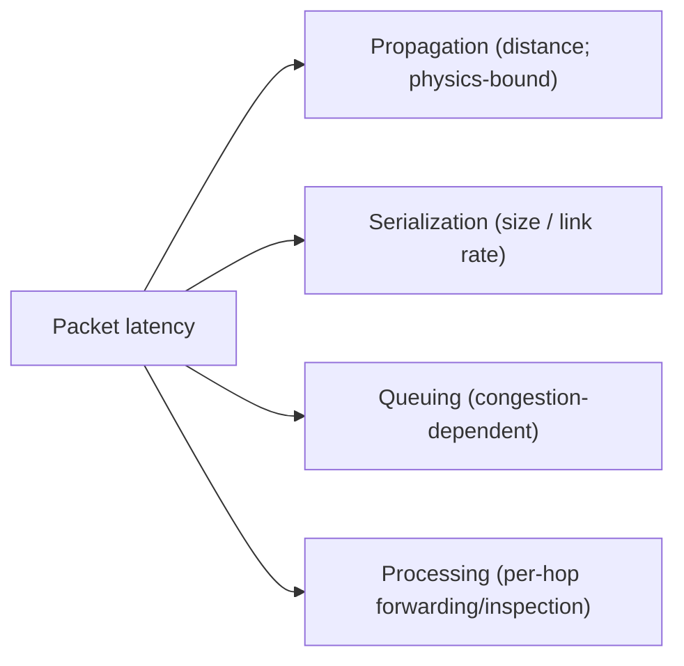

# Network Performance and Capacity

## 1. Why This Chapter Exists

"This is slow" is one of the most common and least specific complaints. Resolving it requires decomposing performance into measurable quantities—bandwidth, latency, jitter, and loss—and understanding how they interact, because the fix for a latency problem is different from the fix for a bandwidth problem, and a throughput ceiling can have nothing to do with raw link capacity. Misdiagnosing the dimension wastes effort: teams upgrade bandwidth when the problem is latency, or tune congestion control when the problem is packet loss on a single hop.

This chapter defines the performance dimensions precisely, explains the physics that relate them (including the bandwidth-delay product that governs throughput on long paths), covers the phenomena that surprise engineers (bufferbloat, goodput, oversubscription), and describes how to measure each dimension correctly. It closes the masterclass by connecting observability and troubleshooting to the quantitative reasoning that capacity and performance work demands.

---

## 2. The Performance Dimensions

Four quantities describe network performance, and they are independent:

**Bandwidth** (capacity) is the maximum bit rate a link can carry—a property of the link, not of the traffic. A 10 Gbps link has 10 Gbps of bandwidth regardless of usage.

**Throughput** is the actual rate achieved by a flow or aggregate. It is bounded by bandwidth but usually lower due to overhead, loss, latency, and protocol behavior.

**Latency** (delay) is the time for data to travel from source to destination. It has several components (below) and is often expressed as **round-trip time (RTT)**.

**Jitter** is the variation in latency over time. High jitter hurts real-time media even when average latency is acceptable, because buffers on the receiver must cover the variation.

**Packet loss** is the fraction of packets not delivered. Loss triggers retransmission (TCP), reducing throughput, and forces real-time protocols to conceal or accept degraded quality.

#### In-Line Glossary: Bandwidth Versus Throughput

**What it is:** bandwidth is the link's maximum capacity; throughput is the rate actually achieved.

**Why here:** conflating them leads to upgrading capacity when the bottleneck is latency, loss, or protocol behavior.

**Systemic implication:** because throughput is bounded by bandwidth but also by the bandwidth-delay product, loss, and window sizes, "we have plenty of bandwidth" does not imply high throughput; the real limit must be measured, not assumed.

---

## 3. Latency Composition

Latency is not a single number; it is the sum of several contributions, and knowing which dominates directs the fix.

- **Propagation delay:** the time for signals to traverse the physical distance at roughly two-thirds the speed of light in fiber. This is the dominant term on long-distance links and cannot be reduced by faster equipment—only by shortening the distance (better topology/placement).
- **Serialization delay:** the time to put the bits of a packet onto the link, proportional to packet size and link rate. Small on fast links, but relevant for small packets on slow links.
- **Queuing delay:** the time a packet waits in buffers when a link is congested. This grows sharply as utilization approaches capacity and is the source of bufferbloat.
- **Processing delay:** per-hop forwarding and inspection time. Usually small, but it accumulates across many hops and grows with deep inspection.



The practical consequence: if latency is dominated by propagation, only topology or placement changes help; if by queuing, reducing congestion or buffer management helps; if by processing, reducing hops or inspection depth helps. Applying the wrong remedy wastes time and money.

---

## 4. The Bandwidth-Delay Product

To achieve high throughput on a path, the sender must have enough data in flight to fill the "pipe." The amount of data that can be in flight is the **bandwidth-delay product (BDP)**: bandwidth × RTT. A 1 Gbps path with 100 ms RTT has a BDP of 100 Mbit (about 12.5 MB); the sender must keep that much unacknowledged data in flight to reach 1 Gbps.

This is why long fat networks (high bandwidth, high latency) need large TCP windows. If the receive window or congestion window is smaller than the BDP, the flow cannot fill the link and throughput caps below bandwidth—even though nothing is "broken." This is the classic explanation for "the link is 1 Gbps but a single transfer only reaches 200 Mbps": either the window is too small, loss is limiting congestion control, or RTT is high.

#### In-Line Glossary: Bandwidth-Delay Product (BDP)

**What it is:** bandwidth × RTT, the amount of data that must be in flight to fully utilize a path.

**Why here:** it explains throughput ceilings on high-latency paths and the need for window scaling.

**Systemic implication:** because BDP grows with latency, WAN and inter-region transfers require large windows and loss-free paths to reach capacity; ignoring BDP leads to misattributing a protocol/window limit to insufficient bandwidth or packet loss.

---

## 5. Goodput and Overhead

**Goodput** is the application-useful data rate, excluding protocol overhead. Every layer adds overhead: Ethernet frames, IP and TCP headers, TLS records, and encapsulation (tunnels, VXLAN). A link that carries 1 Gbps of frames delivers less than 1 Gbps of application data, and the fraction shrinks with small payloads and heavy encapsulation.

For small messages (RPC, telemetry, voice), overhead and per-packet costs matter disproportionately; for large bulk transfers, overhead is a modest percentage. This is why "1 Gbps" never equals 1 Gbps of useful data, and why tunneled and heavily encapsulated paths deliver noticeably less.

#### In-Line Glossary: Goodput

**What it is:** the rate of application-useful data, excluding all protocol and encapsulation overhead.

**Why here:** it is what the application actually experiences, and it is always less than the raw throughput.

**Systemic implication:** because overhead grows with encapsulation and small payloads, evaluating performance against raw link capacity misleads; measure goodput at the application layer for capacity planning.

---

## 6. Bufferbloat

**Bufferbloat** is excessive buffering in the network that inflates latency under load. When a link is congested, packets queue in buffers; if the buffers are large, queuing delay grows to hundreds of milliseconds or seconds before packets are dropped. Large buffers were intended to prevent loss but instead cause high, variable latency that devastates interactive and real-time traffic.

The mitigation is **active queue management** (AQM) and latency-aware scheduling (for example, fair queuing with a controlled delay target) at bottleneck links, which keeps queues short and signals congestion earlier. The phenomenon is a lesson in the trade-off between loss and latency: minimizing loss with huge buffers trades it for latency, and the right balance depends on the traffic mix.

#### In-Line Glossary: Bufferbloat

**What it is:** latency inflation caused by oversized buffers holding packets during congestion instead of dropping or marking them early.

**Why here:** it makes networks that look "not full" (no loss) still feel slow, especially interactively.

**Systemic implication:** because loss-based congestion control reacts to loss, and bufferbloat hides loss, throughput may appear fine while latency degrades; detecting it requires measuring latency under load, not just throughput.

---

## 7. Capacity Planning and Oversubscription

Capacity planning sizes links and paths for expected load with **headroom** for growth and bursts. Two concepts govern it. **Oversubscription** is deliberately selling more aggregate capacity than a shared link can carry simultaneously, betting that not all consumers peak at once; it reduces cost but introduces contention during coincident peaks. **Utilization thresholds** are operational bands (for example, warning above 70% sustained, critical above 85%) that trigger action before saturation, because queuing delay rises non-linearly as utilization approaches 100%.

The trade-off is cost versus headroom versus burst tolerance. Capacity plans should be based on measured demand and peak behavior, not averages, and should reserve headroom for failure scenarios (a link taking over for a failed peer concentrates traffic).

---

## 8. Measuring Performance Correctly

Measurement errors produce wrong conclusions, so the tool must match the question.

**Throughput:** `iperf3` between two hosts measures achievable goodput and reveals whether the limit is the network or the endpoints. Run it in both directions and with multiple streams to expose per-flow versus aggregate limits.

**Latency and loss per hop:** `mtr` reports per-hop RTT and loss over time, distinguishing a lossy hop from lossy endpoints. Be aware that ICMP-based measurements can be rate-limited and may overstate loss to intermediate hops.

**TCP internals:** `ss -ti` shows cwnd, rwnd, RTT, and retransmissions for live connections, revealing whether a flow is window-limited, congestion-limited, or losing packets.

**Application latency:** measure at the application (request duration, percentiles) because network RTT is only one component; include DNS, TLS handshake, and server processing.

**Latency under load:** measure RTT while saturating a link to detect bufferbloat; a link with fine idle latency can have terrible loaded latency.

#### In-Line Glossary: Percentile Latency

**What it is:** latency reported at a percentile (p50, p95, p99) rather than an average, capturing the experience of slower requests.

**Why here:** averages hide tail latency caused by queuing and loss, which is where users notice slowness.

**Systemic implication:** because network problems often appear only in the tail, performance work must target percentiles (especially p99) and measure under realistic load, not just idle averages.

---

## 9. Invariants, Assumptions, and Boundaries

**Invariant: throughput is bounded by both bandwidth and the BDP/window.** A small window caps throughput regardless of capacity.

**Invariant: latency is the sum of propagation, serialization, queuing, and processing.** Improving the wrong term does nothing.

**Invariant: goodput is always less than raw throughput by the overhead.**

**Assumption: the measurement point represents the user experience.** Measuring in the wrong place (for example, a warm cache) misleads.

**Boundary: propagation delay is physics-bound.** No equipment upgrade reduces the speed of light.

**Boundary: loss and latency interact.** Retransmissions add latency; buffers add latency; the two must be reasoned about together.

**Boundary: oversubscription is a bet on non-coincident peaks.** Coincident peaks turn it into contention.

---

## 10. Trade-offs and Rejected Alternatives

**Why measure instead of upgrading bandwidth defensively?** Bandwidth upgrades are expensive and often do not address latency, loss, or window limits. Measuring first targets the real constraint. The rejected "throw bandwidth at it" approach is costly and frequently ineffective.

**Why prefer short queues (AQM) over large buffers?** Large buffers minimize loss but maximize latency; AQM keeps latency low by signaling congestion early. The rejected large-buffer approach is a classic bufferbloat mistake.

**Why oversubscribe at all?** Full non-oversubscribed capacity is prohibitively expensive for bursty, non-coincident demand. Oversubscription trades peak-time contention for cost. The rejected no-oversubscription model wastes capacity most of the time.

**Why target percentiles rather than averages?** Averages hide the tail where users feel pain. The rejected average-only view produces optimistic dashboards and unhappy users.

---

## 11. Failure Modes and Operational Consequences

**Latency misdiagnosed as bandwidth.** A WAN transfer slow due to BDP/window is met with a bandwidth upgrade that does not help. Symptom: throughput below capacity despite ample bandwidth. Operational consequence: check window/BDP and loss before upgrading links.

**Bufferbloat.** Latency spikes under load with no visible packet loss. Symptom: interactive sessions degrade exactly when the link is busy. Operational consequence: deploy AQM and measure latency under load.

**Single-flow limit.** Multi-flow tests are fine but one bulky flow is slow. Symptom: per-flow cap below aggregate capacity. Operational consequence: understand per-flow window/congestion limits and use parallel streams where appropriate.

**Hidden packet loss.** A lossy hop (or a policer) throttles TCP. Symptom: throughput below expectation with `ss -ti` showing retransmits. Operational consequence: use `mtr` to localize loss and investigate the hop or policer.

**Oversubscription contention.** Shared links degrade at coincident peaks. Symptom: periodic slowness at busy times. Operational consequence: size for peak coincidence or add capacity on hot paths.

**Measurement illusions.** Warm caches, localhost tests, or mis-placed probes report unrealistic performance. Symptom: production differs from test results. Operational consequence: measure end to end with realistic conditions.

---

## 12. Hands-On: Measuring the Dimensions

Measure latency and per-hop loss:

```bash
mtr -rwzbc 50 <target>
```

Measure TCP internals for a live connection (cwnd, rwnd, RTT, retransmits):

```bash
ss -ti
```

Measure achievable throughput (requires an `iperf3` server on the far side), single and parallel streams:

```bash
iperf3 -c <server> -t 10
iperf3 -c <server> -t 10 -P 8
iperf3 -c <server> -t 10 -R      # reverse direction
```

Measure latency under load to detect bufferbloat: start a saturating transfer, then ping concurrently:

```bash
iperf3 -c <server> -t 20 & sleep 2; ping -c 20 <server>; wait
```

Estimate the bandwidth-delay product for a path (from measured RTT and bandwidth):

```bash
python3 - <<'PY'
bw_gbps = 1.0
rtt_ms = 100
bdp_bits = bw_gbps * 1e9 * (rtt_ms / 1000)
print(f"BDP ~= {bdp_bits/1e6:.1f} Mbit ({bdp_bits/8/1e6:.1f} MB) in flight to fill the path")
PY
```

Interpretation: if idle latency is low but latency under load is high, bufferbloat is present; if `ss -ti` shows a small cwnd with retransmits, loss is throttling; if throughput is far below the link rate with low loss and high RTT, the window/BDP is the likely limit.

---

## 13. Related Documents

- [Network Troubleshooting: Methodology and Tooling](./01-troubleshooting-methodology-and-tooling.md)
- [The Transport Layer: TCP, UDP, Ports, and Sockets](../01-network-fundamentals/04-the-transport-layer-tcp-udp-ports-and-sockets.md)
- [Overlays and Tunnels: VXLAN, GRE, IPsec, and WireGuard](../03-routing-and-switching/04-overlays-and-tunnels.md)
- [Multi-Account and Multi-Region Networking](../05-cloud-virtual-networks/07-multi-account-and-multi-region-networking.md)

## 14. External References

- [RFC 1122: Requirements for Internet Hosts — Communication Layers](https://www.rfc-editor.org/rfc/rfc1122)
- [RFC 5681: TCP Congestion Control](https://www.rfc-editor.org/rfc/rfc5681)
- [RFC 7323: TCP Extensions for High Performance (Window Scaling)](https://www.rfc-editor.org/rfc/rfc7323)
- [RFC 8290: The Flow Queue CoDel Packet Scheduler and Active Queue Management Algorithm (FQ-CoDel)](https://www.rfc-editor.org/rfc/rfc8290)
- [RFC 8033: Proportional Integral Controller Enhanced (PIE) AQM](https://www.rfc-editor.org/rfc/rfc8033)
